# SIA Digital Communication Standard – Internet Protocol Event Reporting

**SIA DC-09-2021.17**

**Sponsor:** The Security Industry Association

**Published by:** The Security Industry Association  
8405 Colesville Road, Ste 500, Silver Spring, MD 20910  
© SIA 2007, 2013, 2017, 2020 ― All rights reserved

> **Note:** This document was converted from PDF. Some images referenced as `_page_X_Picture_Y.jpeg` may not display correctly.

---

## Table of Contents

- [1. Scope](#1-scope)
- [2. References](#2-references)
  - [2.1. Normative Reference](#21-normative-reference)
  - [2.2. Informational References](#22-informational-references)
- [3. Conventions and Definitions](#3-conventions-and-definitions)
  - [3.1. Typographic Conventions](#31-typographic-conventions)
  - [3.2. UML Notation](#32-uml-notation)
  - [3.3. Binding Language](#33-binding-language)
  - [3.4. Glossary](#34-glossary)
- [4. Compatibility](#4-compatibility)
  - [4.1. User Datagram Protocol (UDP) and Transmission Control Protocol (TCP)](#41-user-datagram-protocol-udp-and-transmission-control-protocol-tcp)
  - [4.2. Marking](#42-marking)
- [5. Requirements](#5-requirements)
  - [5.1. Media](#51-media)
  - [5.2. IP Addresses](#52-ip-addresses)
  - [5.3. Communication Sequence](#53-communication-sequence)
  - [5.4. Encryption](#54-encryption)
  - [5.5. Messages](#55-messages)
  - [5.6. Error Handling](#56-error-handling)
- [Annex A: Cipher Block Chaining](#annex-a-cipher-block-chaining)
- [Annex B: Example Message Frames](#annex-b-example-message-frames)
- [Annex C: Recommended Self-Validation Procedures](#annex-c-recommended-self-validation-procedures)
- [Annex D: Encryption Keys](#annex-d-encryption-keys)
- [Annex E: Windows 1252 Character Encoding](#annex-e-windows-1252-character-encoding)
- [Annex F: Example Transmission Sequences](#annex-f-example-transmission-sequences)
- [Annex G: Checklist of Major Requirements](#annex-g-checklist-of-major-requirements)
- [Annex H: DC-07 Protocol Identifier Tokens](#annex-h-dc-07-protocol-identifier-tokens)
- [Annex I: Optional Remote Commands](#annex-i-optional-remote-commands)

---

## Foreword

This standards document is published by the Security Industry Association (SIA) and was developed and adopted by a consensus of industry volunteers in accordance with SIA's standards development policies and procedures. It is intended to facilitate product compatibility and interchangeability, to reduce misunderstandings between manufacturers and purchasers, and to assist purchasers in obtaining the proper products to fulfill their particular needs.

The existence of this or any SIA standards document shall not prevent any SIA member or non-member from manufacturing, selling, or using products not conforming to this or any SIA standard. SIA standards are voluntary. SIA encourages the use of this document but will not take any action to ensure compliance with this or any other SIA Standard. SIA assumes no responsibility for the use, application or misapplication of this document. Industry members using this document, particularly those having participated in its development and adoption, are considered by SIA to have waived any right they might otherwise have had to assert claims against SIA regarding the development process of this standard.

Although some SIA standards establish minimum performance requirements, they are intended neither to preclude additional product features or functions nor to act as a maximum performance limit. Any product the specifications of which meet the minimum requirements of a SIA standard shall be considered in compliance with that standard. Any product the specifications of which exceed the minimum requirements of a SIA standard shall also be considered in compliance with the standard, provided that such product specifications do not exceed any maximum requirements set by the standard. SIA standards are not intended to supersede any recommended procedures set by a manufacturer for its products.

SIA reserves the right to revise this document at any time. Because SIA policy requires that every standard be reviewed periodically and be revised, reaffirmed, or withdrawn, users of this document are cautioned to obtain and use the most recent edition of this standard. Current information regarding the revision level or status of this or any other SIA standard may be obtained by contacting SIA.

Requests to modify this document are welcome at any time from any party, regardless of membership affiliation with SIA. Such requests, which must be in writing and sent to the address set forth below, must clearly identify the document and text subject to the proposed modification and should include a draft of proposed changes with supporting comments. Such requests will be considered in accordance with SIA's standards development policies and procedures.

Written requests for interpretations of a SIA standard will be considered in accordance with SIA's standards development policies and procedures. While it is the practice of SIA staff to process an interpretation request quickly, immediate responses may not be possible since it is often necessary for the appropriate standards subcommittee to review the request and develop an appropriate interpretation.

**Contact Information:**
> The Security Industry Association  
> 8405 Colesville Road, Ste. 500  
> Silver Spring, MD 20910  
> (703) 683-2075  
> www.securityindustry.org  
> standards@securityindustry.org

This document is owned by the Security Industry Association and may not be reproduced, in whole or part, without the prior written permission from SIA.

---

## Revisions - 2021 Version

| Paragraph | Revision |
|-----------|----------|
| Throughout | Typographic corrections, address updates |
| 5.4.7 | Clarify that ASCII characters representing hex digits may be upper or lower case |
| 5.5.1.5 | Clarify that sequence numbers are associated with account numbers, not reporting paths |
| 5.5.1.6.1 | Note network address as an option for account number |
| 5.5.1.8 | Put list in alphabetical order |
| 5.5.1.8 | Allow extended data to start with A-F as the fixed position of the token (always first character) allows unambiguous parsing, distinct from ASCII-encoded hex data |
| 5.5.1.8 | Add "Supervision Category" data identifier |
| 5.5.1.8 | Add "Encryption Key" data identifier |
| 5.5.1.8 | Add "Network Path" data identifier |
| 5.5.1.8 | Add "Network Address" data identifier |
| 5.5.2.1.3, 4 | Add extended versions of NULL message |
| 5.5.3.4 | Bring RSP message into use, add extended data to RSP message |
| 5.5.3.5 | Add encrypted version of RSP message |
| B.8 | Add example using Network Address identifier |
| C.1.3.9A | Add test case for Network Address data |
| C.2.1 | Add network address as possible data to send |
| C.2.3.10A | Add test case for Network Address data |
| C.2.3.16 | Add test case for RSP message |
| C.2.3.17 | Paragraph renumbered due to addition of RSP message test |
| Figure F5 | Emphasize note on recommended time base implementation |

---

## Revisions - 2017 Version

| Paragraph | Revision |
|-----------|----------|
| Title page | Remove publication order number, remove ANSI references |
| Foreword | Update domain names |
| Acknowledgements | Added 2017 section |
| 5.5.1.8 | Corrected typos |
| 5.5.3.2, 5.6.1.2, 5.6.2.1 | Add note referring to example F5 |
| C.1.3.9, C.1.3.13, C.2.3.10, C.2.3.11, C.2.3.12 | Correct references |
| F5 | Add note regarding independent timebases |

---

## Revisions - 2013 Version

| Paragraph | Revision |
|-----------|----------|
| Contents | Expanded to 4 levels |
| Foreword | Updated SIA address |
| Acknowledgements | Added 2013 section |
| 3.4 | Redefined encryption |
| 4.1.1 | Added section regarding source port number |
| 4.2 | Added requirement to mark equipment with list of supported tokens |
| 5.3 | Close socket is optional |
| 5.4.7 | Revised for clarity |
| 5.5.1.1 | Added "0x0A", sent as binary value |
| 5.5.1.2 | Four ASCII characters |
| 5.5.1.4 | ASCII, must support SIA-DCS or ADM-CID |
| 5.5.1.5 | Revised for clarity, four ASCII characters |
| 5.5.1.7 | Revised for clarity |
| 5.5.1.8 | Added several data identifiers, including "A" for authentication hash |
| 5.5.1.9 | ASCII |
| 5.5.1.10 | Added "0x0D" |
| 5.5.3.1 | Revised for clarity |
| 5.6.2.2 | Shall discard |
| 5.6.2.4 | Added paragraph, no response to decryption errors |
| Annex B | Revised examples |
| Annex B | Corrected title of example B6 |
| Annex E, F, G, H, I | Added annex |

---

## Acknowledgements

### 2021 Working Group
**Technical Editor:** Ted Nesse, North Latitude Technology  
**Working Group Participants:**
- Stéphane Jaquet, DCC Consulting
- Boris Stern, Sitasys AG

### 2017 Working Group
**Technical Editor:** Ted Nesse, North Latitude Technology  
**Working Group Participants:**
- Rodney Bo, ATT
- Larry Dischert, DSC / Johnson Controls
- Joseph Gittens, SIA/SIAC

### 2013 Working Group
**Technical Editor:** Ted Nesse, North Latitude Technology  
**Working Group Participants:**
- Tony Mucci, ADT
- Stéphane Jaquet, Amstein & Walthert / DCC Consulting
- Shane Clary, Bay Alarm
- Stephan Kovaciss, Bosch Security
- Larry Dischert, DSC / LRD Consulting
- Rich Hinkson, Honeywell
- Various contributors from UL, UTC

### 2007 Working Group

This standard was approved as an American National Standard by the Security Industry Standards Council (SISC). The voting members are listed below:

**Voting Members:**
- Jack Sigler, Acquient Security Consulting
- Terry France, Acquient Security Consulting
- Dr. Jimmy Salinas, ACTA
- Larry Dischert, ADT
- American Protective Services
- ASIS
- Bay Alarm Co
- Bosch Security Systems
- Brinks
- Corbin Russwin
- CSAA
- Ralph Sevinor, CSAA
- Pat Devereaux, Emergency24
- Emergency24
- Fargo Electronics
- GE
- HES / Folger Adam
- HID
- Hirsch Electronics
- Honeywell
- IDS Research and Development, Inc.
- Integrated Command Software
- Mastec
- NBFAA
- Rick Simpson, NBFAA
- Pelco
- Salient Systems Corp.
- Sandia National Laboratories
- SecuraKey
- Securitron
- SEIWG
- Security Access Design, LLC
- Sequel Technologies
- Siemens Building Technologies
- Bill Gorski, Siemens Building Technologies
- SIA
- State Farm Insurance
- UL
- U.S. Department of Commerce / NIST
- Vector Security
- Matthew Kenjura, Walker Engineering
- Dale Berti, Walker Engineering
- Reid Wilson, Yale Commercial Locks and Hardware

This standard was developed in SIA Standards, specifically within the IP Working Group of the SIA Security Communications Subcommittee. The following are additional acknowledgements to be made:

**Chairman of the SIA Standards Committee:**  
R. Hunter Knight, Integrated Command Software

**Chairman of the SIA Standards Security Communications Subcommittee:**  
Deister Electronics USA, Inc.

**Chairman of the IP Working Group:**  
Stephan Kovaciss, Bosch Security Systems

**Working Group Technical Editor:**  
Theodore Nesse, Sequel Technologies, LLC

**Participants:**
- ADT
- Warren Burgess, ADT
- Jimmy Salinas, AT&T
- Bosch
- ChannelSmarts
- DSC
- Stephan Frenette, DSC
- Elk Products
- Fire Monitoring of Canada Inc
- Frank Clark, GE
- GE
- HID
- Bill DeVoe, HID
- Honeywell (multiple representatives)
- Integrated Command Software
- Napco
- Salient Systems Corporation
- Security Sales Integration Magazine
- The Command Center
- Tyco

SIA gratefully acknowledges the efforts of the many volunteers from the security industry that helped the Subcommittee to develop this standard.

---

# SIA Digital Communication Standard DC-09-2021.17  
# Internet Protocol Event Reporting

## 1. Scope

This standard details the protocol and related details to report events from premises equipment to a central station using Internet protocol (IP) to carry the event content. It is important to distinguish that, while this reporting method uses the SIA Receiver-to-Computer Interface Protocol as a foundation, it is intended for event transport from protected premises to a central station - possibly using the public Internet.

This standard is intended for use by manufacturers of control panels and central station receivers to ensure equipment compatibility, as well as all affected parties. Compliance with this standard is voluntary.

---

## 2. References

### 2.1. Normative Reference

The following document provides a normative reference for this standard:

- **DC-07:** SIA Digital Communications Standards – Receiver-to-Computer Interface Protocol (Type 2).

### 2.2. Informational References

Additional guidance on areas relating to this standard, as noted and otherwise, can be obtained from the sources below.

#### National Fire Protection Association
- NFPA 72, National Fire Alarm Code

#### Underwriters Laboratories, Inc.
- UL 609, Local Burglar-Alarm Units and Systems
- UL 611, Central-Station Burglar-Alarm Systems
- UL 681, Installation and Classification of Mercantile and Bank Burglar-Alarm Systems
- UL 864, Control Units for Fire-Protective Signaling Systems
- UL 985, Household Fire Warning System Units
- UL 1023, Household Burglar-Alarm System Units
- UL 1076, Proprietary Burglar Alarm Units and Systems
- UL 1610, Central Station Burglar-Alarm Units
- UL 1635, Digital Burglar Alarm Communicator System Units
- UL 1641, Installation and Classification of Residential Burglar Alarm Systems

#### Security Industry Association
- DC-02: Digital Communications - Generic Protocols Overview Technical Report
- DC-03: Digital Communication Standard "SIA Format" Protocol for Alarm System Communications
- DC-04: SIA 2000 Protocol for Alarm System Communications
- DC-05: Digital Communication Standard "Contact ID" Protocol for Alarm System Communications

#### National Institute of Standards and Technology
- Federal Information Processing Standards Publication 197 (AES)
- NIST Special Publication 800-38A: Recommendation for Block Cipher Modes of Operation

---

## 3. Conventions and Definitions

### 3.1. Typographic Conventions

Elements of messages are enclosed in `<braces>`, and may consist of one or more bytes. The notational braces do not appear in the transmitted messages.

Complete messages are enclosed in a frame.

*Italic* font is used for variable elements in a message.

### 3.2. UML Notation

UML sequence diagrams are used to document requirements of the standard that involve a sequence of messages.

### 3.3. Binding Language

This standard uses the term "shall" to convey binding requirements.

The term "may" is used to convey features that are allowed but not required.

Terms such as "is", "are", "will", and others are used to convey statements of fact for advisory purposes only. The annotation "NOTE:" also precedes advisory information.

Where this standard is silent on a feature, the feature is permitted so long as it is not in conflict with the requirements contained herein.

### 3.4. Glossary

**ACK – Acknowledgment**  
A return message indicating correct receipt of a transmitted message.

**Authentication**  
A process to assure that a received message is not a counterfeit sent by an unauthorized sender.

**Central Station Receiver – "CSR"**  
A central station receiver accepts connections from premises equipment, for the purpose of transmitting event information to the central station.

**Encryption**  
The process of obscuring the content of a transmitted data message so it can not be read or replicated by unauthorized persons or equipment.

**Encryption Key**  
A data word used to encrypt and decrypt a message.

**Frame**  
The elements that make up a complete message for this protocol.

**IP Address**  
The unique identifier number assigned to a device on an IP network.

**NAK – Negative Acknowledgement**  
A return message indicating rejection of a transmitted message.

**Premises Equipment – "PE"**  
"Premises equipment" is used to describe a general class of electronic systems that are field-installed for the purpose of reporting event data to a central station. Security systems, fire alarm control panels and access control systems are examples of premises equipment.

---

## 4. Compatibility

### 4.1. User Datagram Protocol (UDP) and Transmission Control Protocol (TCP)

Premises Equipment (PE) and Central Station Receivers (CSRs) shall support either UDP or TCP for event message transmission, and may support both UDP and TCP. When CSRs support both protocols, the CSR shall automatically use the appropriate protocol for incoming messages without requiring a configuration setting. When PE support both protocols, the protocol use may be manually specified, or the manufacturer may implement a method to attempt message delivery with one protocol, and switch to the other as necessary.

When PE or CSRs support only one protocol, UDP is the preferred implementation but TCP may be used.

#### 4.1.1. UDP Source Port Number

When UDP is used, the transmitter may set the source port number in the UDP header to the desired port at which replies from the central station receiver will be accepted. This transmitter behavior is recommended.

### 4.2. Marking

Equipment capable of using UDP/IP for communication shall be marked as compatible with "SIA IP Reporting (UDP-2021.17)". Equipment capable of using TCP/IP for communication shall be marked as compatible with "SIA IP Reporting (TCP-2021.17)". Equipment capable of using UDP/IP or TCP/IP for communication shall be marked as compatible with "SIA IP Reporting (UDP/TCP-2021.17)".

Additionally, equipment shall be marked to show the list of DC-07 tokens (protocols) that are supported.

When PE and CSRs implementing this standard share at least one protocol (UDP or TCP), they are intended to be interoperable.

---

## 5. Requirements

### 5.1. Media

This standard can be implemented on any media that carries Internet protocol (IP), including but not limited to Ethernet, 802.11x, CDMA 1x or GPRS. The ability of the network to perform media conversion and provide limited protection for message integrity is assumed.

### 5.2. IP Addresses

The central station receiver (CSR) shall be hosted on a static IP address. The premises equipment (PE) may be hosted on a dynamic or static IP address and shall be capable of being programmed with the IP address to which events are to be sent.

The PE may have an option to use DNS to obtain the address of the CSR, however the installation is not compliant with this standard when the DNS option is enabled.

### 5.3. Communication Sequence

When UDP is used, a simple transmit/acknowledge sequence is used to transmit messages:

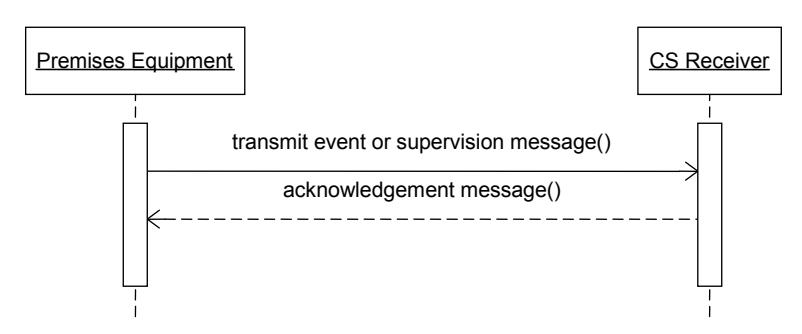

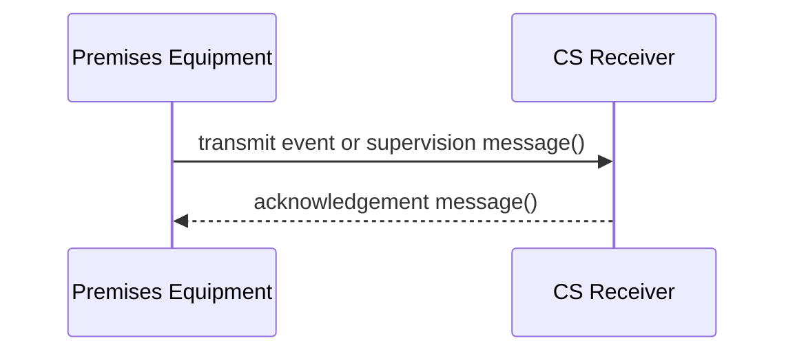

**UDP Communication Sequence:**
1. The Premises Equipment (PE) transmits an event or supervision message to the Central Station Receiver (CSR)
2. The CSR responds with an acknowledgement message (ACK, NAK, or DUH)
3. No socket establishment is required for UDP

When TCP is used, the process is very similar:

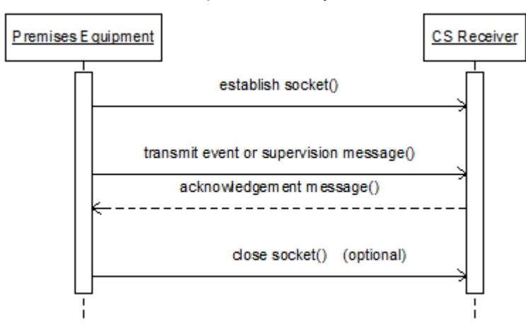

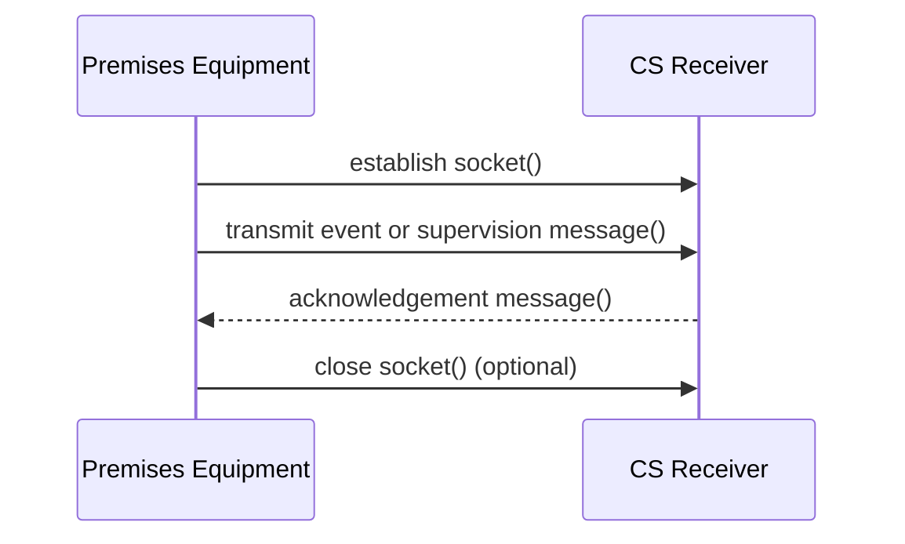

**TCP Communication Sequence:**
1. The Premises Equipment (PE) establishes a socket connection to the Central Station Receiver (CSR)
2. The PE transmits an event or supervision message to the CSR
3. The CSR responds with an acknowledgement message (ACK, NAK, or DUH)
4. The PE may optionally close the socket connection

### 5.4. Encryption

PE may indicate use of AES encryption to transmit events. Encryption support is optional for PE. Encryption support is mandatory for CSRs.

#### 5.4.1. Encryption Standard

For the AES requirements, refer to Federal Information Processing Standards Publication 197 that is available from the National Institute of Standards and Technology.

Additionally, encrypted messages shall use Cipher Block Chaining, as described in section 6.2 of NIST Special Publication 800-38A (2001 Edition).

#### 5.4.2. Identifying Encrypted Messages

Encrypted messages shall be identified with an asterisk as described in section [5.5.1.4.1](#5541-encryption-flag) of this standard.

#### 5.4.3. Encrypted Elements

When encryption is used, only the data, timestamp and padding content of a message are encrypted. Encryption begins on the byte after the opening bracket "[" on the data element, and ends just before the terminating `<CR>`.

The encrypted elements are shown in the frame below (represented with underscores):

```
<LF><crc><0LLL> <"id"><seq><Rrcvr><Lpref><#acct>[<pad>|...data...][x…data…]<timestamp> <CR>
                                                  └──────────────────────────────┘
                                                      encrypted region
```

#### 5.4.4. Padding

Only when encryption is used, messages shall be padded with pseudo-random data (pad) so that the byte count of the encrypted region is an even multiple of 16.

##### 5.4.4.1. Padded Region

The characters counted for padding and encryption begin after the opening bracket "[" on the data element, and include the pad field (pad), data, and timestamp field. The final `<CR>` is not included in the count for padding and is not encrypted.

##### 5.4.4.2. Pad Data

Pad data shall be pseudo-random bytes which vary from one message to the next. This data will consist of binary values 0-255, except that it shall not contain the ASCII values for the character "|" (124, x7C), "[" (91, x5B) or "]" (93, x5D).

##### 5.4.4.3. pad (Pad Data Field)

When a message is encrypted, padding is inserted between the open bracket character "[" and the pad termination character "|". The number of characters in the pad field shall be such that the total number of encrypted characters (from the first pad character up to and including the last timestamp character) is an even multiple of 16.

When a message is already an even multiple of 16 bytes, 16 pad bytes shall be added to the message.

The "|" character immediately following the pad field shall appear in all encrypted messages. This pad termination "|" character shall not appear in unencrypted messages, though the "|" character that typically separates the account number from the rest of the data may appear.

#### 5.4.5. Encryption Key

When encryption is selected, the PE may use a key length of 128, 192 or 256 bits. A matching key value (and therefore matching key length) must be programmed at the PE and the CSR.

##### 5.4.5.1. Central Station Receiver Requirements

A CSR shall support all three key lengths, as well as messages using no encryption. Other key lengths may be incorporated into the standard in the future, but are currently noncompliant.

Each port in the CSR that receives events shall be configurable with at least one encryption key, to be used for all PE reporting to that IP address/port. Optionally, each port may be configurable with multiple encryption keys, to be used with individual accounts or groups of accounts.

##### 5.4.5.2. Premises Equipment Requirements

When the PE supports encryption, it shall be able to store a private key of 128, 192 or 256 bits in length, at the option of the manufacturer.

##### 5.4.5.3. Key Contents

When private or session keys are created, a pseudo-random process shall be used. Each bit shall have an equal probability of being 0 or 1 as the key is created. The use of a binary-encoded ASCII phrase as the key is specifically discouraged.

#### 5.4.6. Cipher Block Chaining

The encrypted blocks of a message implement cipher block chaining as described in section 6.2 of NIST Special Publication 800-38A (2001 Edition). For this protocol, the initialization vector (IV) will be all zeros, as the padding characters provide the variability needed for message confidentiality.

Refer to [Annex A](#annex-a-cipher-block-chaining) for a copy of the cipher block chaining method to be used.

#### 5.4.7. Encoding

In the encrypted region of the message, each byte shall be encoded for transmission as two ASCII characters (0-9, A-F or a-f) representing the hexadecimal value of the encrypted byte. 

**Example:**

Unencrypted message:
```
<LF>B3680040"ADM-CID"0001L0#1234[#1234|1140 00 007]_22:49:34,01-22-2012<CR>
```

When encrypted, the message might (depending on the encryption key used) be transmitted as:
```
<LF>4B89007B"*ADM-CID"0001L0#1234[371baac130fe81508f556e6fd2ccfd8826e9ba186f0fb674bb87c079484e546dff35532aa285936a00c27b6feb053f68]<CR>
```

### 5.5. Messages

PE may send two types of messages: events and link supervision.

CSRs send only one type of message, acknowledgment, which may have three types: ACK, NAK, or DUH.

#### 5.5.1. Event Messages (PE)

The format used for the events is based on SIA protocol (DC-07-2001.04) outlined in SIA Digital Communications Standards – Receiver-to-Computer Interface Protocol (Type 2).

The template for each event:

```
<LF><crc><0LLL> <"id"><seq><Rrcvr><Lpref><#acct>[<pad>|...data...][x…data…]<timestamp> <CR>
```

##### 5.5.1.1. LF

This is the ASCII linefeed character, transmitted as a binary value `0x0A`.

##### 5.5.1.2. crc

The portion of the message starting with the first quote character of the ID and ending with the character before the terminating CR, are included in the CRC calculation. Refer to DC-07-2001.04 for the detailed CRC implementation. When messages are encrypted, the CRC shall be applied after the encryption is applied.

The CRC shall be transmitted as four ASCII characters.

##### 5.5.1.3. 0LLL

This length element consists of the character "0" (ASCII zero) followed by 3 hex digits (in ASCII) giving the length of the message. The characters counted are the same as are included in the CRC calculation, as described in section [5.5.1.2](#5512-crc).

##### 5.5.1.4. "id" (ID Token)

The `<"id">` field contains an ASCII token to indicate the format used in the data field of the message, and whether or not encryption is used. The quote characters are included in the message.

A CSR compliant with this standard shall support at least the SIA-DCS and ADM-CID tokens (protocols) shown in [Annex H](#annex-h-dc-07-protocol-identifier-tokens), based on the token definition in DC-07-2001.04.

PE shall support at least one of the tokens SIA-DCS and ADM-CID, and may support any others shown in [Annex H](#annex-h-dc-07-protocol-identifier-tokens).

###### 5.5.1.4.1. Encryption Flag

When the data and timestamp of a message are encrypted, the ID Token is modified to insert an ASCII "*" after the quotation character and before the first character of the token. For example, an unencrypted SIA DCS packet would use the token `"SIA-DCS"` and an encrypted SIA DCS packet would use the token `"*SIA-DCS"`.

##### 5.5.1.5. seq

The PE applies a sequence number to each message as it is queued. The CSR shall echo the sequence number of the message to which it is replying in its acknowledgement messages.

The PE shall not increment the sequence number when repeating a message due to a communication failure or no response from a CSR.

The PE shall increment the sequence number to be used as each new message is queued. When the sequence number is 9999, the next sequence number is 0001. Refer to section 7.1.5 of DC-07-2001.04 for additional information.

Sequence numbers are associated with PE account numbers, and are shared across different reporting paths or media.

The sequence number shall be transmitted as four ASCII characters.

**Note:** Segment numbers, as described in DC-07, are not used in this protocol.

##### 5.5.1.6. Account Identification (Rrcvr, Lpref, #acct)

Each set of PE may be provided with up to three complementary identifying tokens.

###### 5.5.1.6.1. #acct (Account Number)

The account number is the most specific token, and is always programmed into the premises equipment to identify it. The account token appears both in the header of the message (which is never encrypted) and in the data of the message (which may be encrypted).

This element consists of an ASCII "#", followed by 3-16 ASCII characters representing hexadecimal digits for the account number. There is no corresponding element in the DC-07 protocol.

In certain special applications, the information provided in the `#acct` element may not match the account number contained within the message data (see paragraph [5.5.1.7](#5517-data-or-paddata-message-data)). For example, a manufacturer may choose to transmit a MAC or network address as an identifier.

###### 5.5.1.6.2. Lpref (Account Prefix)

The account prefix can be programmed into the PE to extend the identification provided by the account number.

This element is required, and consists of an ASCII "L", followed by 1-6 HEX ASCII digits for the account prefix. When the PE does not need to transmit an account prefix, "L0" shall be transmitted for this element.

This element corresponds with the receiver line number element in the DC-07 protocol.

###### 5.5.1.6.3. Rrcvr (Receiver Number)

In some cases, PE may be programmed to further extend the identification provided by the account number and account prefix by providing a receiver number.

This element is optional, and consists of an ASCII "R", followed by 1-6 HEX ASCII digits for the receiver number. When the PE does not need to transmit a receiver number, nothing shall be transmitted for this element (i.e. "R" or "R0" are not to be transmitted in this case).

This element corresponds with the receiver number element in the DC-07 protocol.

##### 5.5.1.7. [Data] or [<pad>|Data] (Message Data)

All data is in ASCII characters and the bracket characters "[" and "]" are included in the transmitted message. The data field format is dependent upon the ID token of the message.

Where an account number is associated with a message (most message types), the account number data appears at the start of the data, preceded by the "#" character and followed by the field separator "|". The account number is 3-16 ASCII characters representing hexadecimal digits.

Refer to appendix A in DC-07-2001.04 for a definition of the data packets for the various message types.

**Note:** The data element and timestamp in a message may be encrypted, as described in section [5.4](#54-encryption).

Refer to section [5.4.4.3](#5443-pad-pad-data-field) for a description of the `<pad>` field that appears within the data field of encrypted messages.

##### 5.5.1.8. [x…data…] (Optional Extended Data)

This field allows the PE to attach additional information to the message, by including one or more optional extended data fields.

Use of this field is optional for the PE.

The receiver shall be able to receive and properly process a message containing the optional extended data, however use of the information contained within the extended data field is optional.

The start field is delimited with the ASCII character "[", followed by a single ASCII character (data identifier) that identifies the content of the data field. The data identifier may be any upper case ASCII character in the range "A" to "Z". The field is terminated with the ASCII character "]".

Following the identifier, extended data may contain characters encoded according to the legacy Windows 1252 character set, as shown in [Annex E](#annex-e-windows-1252-character-encoding).

The following data identifiers are defined:

| Name | Identifier | Description | Data Format | Example |
|------|------------|-------------|-------------|---------|
| Authentication Hash | "A" | A hash of the message that allows the message to be authenticated | 12 ASCII characters (0-9, A-F or a-f) | `[A6F2348C99335DF38]` |
| Supervision Category | "C" | An identifier for the number of communication paths and link supervision category | Up to 64 ASCII characters | `[CDP]` - Manufacturer-specific field allows PE to indicate to which standards the communication link complies |
| Time of Occurrence | "H" | Time that event occurred (may be different than message time stamp) | ASCII | `[H13:59:58,12-31-2012]` |
| Alarm Text | "I" | Alarm text which may be a description of the event or a comment regarding the event | Windows 1252 characters | `[I2nd Floor West PIR]` |
| Network Path | "J" | Manufacturer specific identifier for the path that was used for the communication | 1 ASCII character, "0"-"9" | `[J2]` - Allows PE to indicate which network path was used |
| Encryption Key | "K" | Key exchange request from CSR to PE (up to 256 bits) | Up to 64 (even number) ASCII characters (0-9, A-F or a-f) | `[KABCDABCDABCDABCDABCDABCDABCDABCD]` |
| Location | "L" | Location of event on site | Windows 1252 characters | `[L3rd Floor Hallway]` |
| MAC Address | "M" | MAC address of the PE | 12 ASCII characters (0-9, A-F or a-f) | `[M0026B9E4268B]` |
| Network Address | "N" | Hardware network address associated with the communication path used | Up to 128 (even number) ASCII characters (0-9, A-F or a-f) | `[N1133557799bbddff]` - Similar to MAC address field but may contain a different identifier |
| Programming Data | "P" | Contains a message used to support programming or other interactive operations with the receiver | Windows 1252 characters | (future use) |
| Building Name | "O" | Building name | Windows 1252 characters | `[OIDS Center]` |
| Room | "R" | Room of event | Windows 1252 characters | `[R2322]` |
| Site Name | "S" | Site name describing the premises | Windows 1252 characters | `[S123 Main St., 55123]` |
| Alarm Trigger | "T" | Trigger for event | ASCII | `[Tx]` - See trigger identifiers table below |
| Verification | "V" | Information about audio or video information that may be associated with the event report | Windows 1252 characters | `[Vhttp://verify.com/34AC4DE3446]` |
| Longitude | "X" | Location of event, longitude | ASCII | `[X093W23.456]` |
| Latitude | "Y" | Location of event, latitude | ASCII | `[Y45N23.456]` |
| Altitude | "Z" | Altitude of event | ASCII | `[Z123.2M]` |

**Notes:**
1. The content of these fields may be assigned by a local authority having jurisdiction
2. The format of these variable length fields are free form, and are not specified here
3. See trigger identifiers below
4. The length, format and algorithm used for the data of this field is determined by the manufacturer, except that binary-formatted data is disallowed

**Trigger Identifiers:**

| Tag | Assignment | Type |
|-----|------------|------|
| F | Fire / Smoke Detector | Automatic |
| G | Gas Detector | Automatic |
| W | Water / flooding detector | Automatic |
| S | Sensor (temp / humid. / pressure) | Semi-automatic |
| C | Contact (intrusion or other) | Semi-automatic |
| M | Manual Trigger (eg switch) | Manual |

##### 5.5.1.9. Timestamp

The timestamp shall be included in encrypted messages, and may be included on messages that are not encrypted. This field is used to provide protection against message playback. The timestamp indicates when the event was queued for transmission to the central station, and may indicate a time significantly different than the time of event occurrence. The timestamp is always transmitted with a reference of GMT.

The format of the timestamp is: `_HH:MM:SS,MM-DD-YYYY`. The underscore, colon, comma and hyphen characters are included. Integers shall be zero filled, and the year shall be four digits so that the length of the timestamp field is exactly 20 characters. All elements of the timestamp are transmitted as ASCII characters.

The CSR shall validate the timestamp against its own GMT reference. Encrypted messages with a GMT difference from the CSR greater than +20/-40 seconds shall be rejected with a NAK packet that contains the current GMT time known to the CSR in the data field. The allowed time difference may be a configurable parameter for the CSR.

The PE shall re-encrypt the message with an updated timestamp when retrying a message in response to a NAK containing a corrected GMT time.

##### 5.5.1.10. CR

This is the ASCII carriage return character, transmitted as a binary value `0x0D`.

#### 5.5.2. Supervision Message

Optionally, the PE and CSR may be configured to supervise the connection. When supported and enabled, the PE shall periodically send the Null Message to the CSR. The CSR shall respond with an ACK message.

On the CSR, if this function is supported, the supervision interval shall be configurable over a range of 10 seconds to 3600 seconds, and 1 hour to 1080 hours (45 days). If no message of any type is received from a supervised account during this interval, a communication failure shall be declared and reported into the central station.

It shall be possible to disable the supervision on the PE, if it is supported. When enabled, the PE shall transmit the Null Message each time the supervision interval elapses. It is permissible to restart the supervision interval timer when the PE transmits any other message. The supervision interval may be configurable in a range compatible with the CSR.

##### 5.5.2.1. Null Message (Link Test)

The PE may send an encrypted or an unencrypted Null Message to permit supervision of the link between the premises and the central station. The CSR shall acknowledge the message.

**Unencrypted Null Message:**
```
<LF><CRC><0LLL><"NULL"><0000><Rrcvr><Lpref><#acct>[]<timestamp><CR>
```
The timestamp is optional for unencrypted messages.

**Encrypted Null Message:**
```
<LF><CRC><0LLL><"*NULL"><0000><Rrcvr><Lpref><# acct>[<pad>]<timestamp><CR>
```
Note that the ID token is `"*NULL"` for an encrypted null message, and that the timestamp and padding fields are required.

**Unencrypted Extended Null Message:**
```
<LF><CRC><0LLL><"XNM"><0000><Rrcvr><Lpref><#acct>[][x…data…]<timestamp><CR>
```
The Extended Null Message allows optional data to be sent by the PE during the link test. The message is the same as the NULL message, except for the addition of extended data according to section [5.5.1.8](#5518-xdata-optional-extended-data).

**Encrypted Extended Null Message:**
```
<LF><CRC><0LLL><"*XNM"><0000><Rrcvr><Lpref><#acct>[<pad>][x…data…]<timestamp><CR>
```
Note that the ID token is `"*XNM"` for an encrypted extended null message, and that the timestamp and padding fields are required.

#### 5.5.3. Acknowledgement Messages (CSR)

When the CSR receives an event from the PE, it shall respond with an acknowledgement message.

##### 5.5.3.1. ACK - Positive Acknowledgement

Messages received without errors shall cause the CSR to send a positive acknowledgement packet:

```
<LF><CRC><0LLL><"ACK"><seq><Rrcvr><Lpref><#acct>[]<CR>
```

When the CSR is responding to an encrypted message, the ACK response will be encrypted:

```
<LF><CRC><0LLL><"*ACK"><seq><Rrcvr><Lpref><#acct>[<pad>]<timestamp><CR>
```

Note the required timestamp, required padding, and the modified ID token `"*ACK"` in the encrypted ACK message.

##### 5.5.3.2. NAK - Negative Acknowledgement

When an encrypted message fails the timestamp test described in section [5.5.1.9](#5519-timestamp), the CSR shall send a negative acknowledgement packet containing a timestamp:

```
<LF><CRC><0LLL><"NAK"><0000><R0><L0><#0>[]<timestamp><CR>
```

The NAK message is never encrypted. **Refer to example F5 for timestamp security recommendations.**

##### 5.5.3.3. DUH - Unable Acknowledgement

When the CSR is unable to process an otherwise correctly received message, it shall respond with a DUH acknowledgement packet:

```
<LF><CRC><0LLL><"DUH"><seq><Rrcvr><Lpref><#acct>[]<CR>
```

The DUH message is never encrypted.

##### 5.5.3.4. RSP - Message Response (future use)

This message may be implemented in future versions of this standard to define a response to a message containing certain types of extended data that require a response. Neither receivers nor PE are required to support this message at this time.

```
<LF><CRC><0LLL><"RSP"><seq><Rrcvr><Lpref><#acct>[…response data…][x…data…]<CR>
```

##### 5.5.3.5. Encrypted RSP - Message Response

This message defines an encrypted response to an encrypted message containing certain types of extended data that require a response.

```
<LF><CRC><0LLL><"*RSP"><seq><Rrcvr><Lpref><#acct>[<pad>|...data...][x…data…]<timestamp><CR>
```

### 5.6. Error Handling

Various errors may occur during PE-CSR communications. Error handling is defined for these error conditions:

#### 5.6.1. Errors Observed by Premises Equipment

##### 5.6.1.1. No Response

The PE shall time a retry timeout period while it waits for a response to a transmitted message. If the response is not received during the retry timeout period, it shall retransmit the message. The recommended retry timeout period is 20 seconds, and the recommended number of message attempts is 3. The retry timeout period may be configurable in the range of 5-60 seconds. The message attempt count may also be configurable.

##### 5.6.1.2. NAK Response

Upon receiving a NAK response, the PE shall immediately repeat the message a limited number of times, using an updated timestamp. The recommended number of message attempts is 3, and this count may be configurable. **Refer to example F5 for timestamp security recommendations.**

##### 5.6.1.3. DUH Response

Upon receiving a DUH response, the PE may optionally repeat the message a limited number of times, or immediately declare a failure.

#### 5.6.2. Errors Observed by Central Station Receiver

##### 5.6.2.1. Timestamp Mismatch (CSR)

When the CSR determines that a message was encrypted with a timestamp that has aged beyond the acceptable time defined in section [5.5.1.9](#5519-timestamp), it shall send a NAK response to the PE. **Refer to example F5 for timestamp security recommendations.**

##### 5.6.2.2. Checksum Failure

When the CSR receives a message with an incorrect checksum, it shall discard the message without sending a response to the PE.

##### 5.5.2.3. Unsupported Message Elements

When the CSR receives a message containing elements it does not support but otherwise correctly formed, it shall send a DUH response to the PE.

##### 5.6.2.4. Decryption Error

When the CSR receives an encrypted message it cannot decrypt, it shall discard the message without sending a response to the PE.

---

## Annex A: Cipher Block Chaining (Informative Annex)

Cipher block chaining (CBC) is used for message encryption in this standard. The process is defined in NIST Special Publication 800-38A (2001 Edition), section 6.2.

For this protocol:
- The initialization vector (IV) is all zeros
- The padding characters provide the variability needed for message confidentiality
- Each 16-byte block is encrypted using AES
- Each encrypted block is XORed with the next plaintext block before encryption

**CBC Encryption Process:**

```
C₁ = E_K(P₁ ⊕ IV)
C₂ = E_K(P₂ ⊕ C₁)
C₃ = E_K(P₃ ⊕ C₂)
...
C_j = E_K(P_j ⊕ C_(j-1))
```

Where:
- E_K = encryption function using key K
- P_j = plaintext block j
- C_j = ciphertext block j
- IV = initialization vector (all zeros for this protocol)
- ⊕ = XOR operation

**CBC Decryption Process:**

```
P₁ = D_K(C₁) ⊕ IV
P₂ = D_K(C₂) ⊕ C₁
P₃ = D_K(C₃) ⊕ C₂
...
P_j = D_K(C_j) ⊕ C_(j-1)
```

Where:
- D_K = decryption function using key K

---

## Annex B: Example Message Frames (Informative Annex)

This annex provides example message frames to illustrate the protocol format.

### B.1 Fire Alarm, Zone 129, SIA DC-04 Format, Non-Encrypted, No Timestamp

```
<LF>B3680040"SIA-DCS"0001L0#1234[#1234|FA 129]<CR>
```

### B.2 Fire Alarm, Zone 129, Contact ID DC-05 Format, Non-Encrypted, No Timestamp, Group 0

```
<LF>4C2A0046"ADM-CID"0001L0#1234[#1234|1110 00 129]<CR>
```

### B.3 Fire Alarm, Zone 129, SIA DC-04 Format, Non-Encrypted, With Timestamp

```
<LF>E9F8005C"SIA-DCS"0001L0#1234[#1234|FA 129]_22:49:34,01-22-2012<CR>
```

### B.4 Fire Alarm, Zone 129, SIA DC-04 Format, Encrypted

```
<LF>4B89007B"*SIA-DCS"0001L0#1234[371baac130fe81508f556e6fd2ccfd8826e9ba186f0fb674bb87c079484e546dff35532aa285936a00c27b6feb053f68]<CR>
```

Note: The encrypted data is shown as hexadecimal characters representing the encrypted bytes.

### B.5 Fire Alarm, Zone 129, SIA DC-04 Format, Non-Encrypted, No Timestamp, MAC Address

```
<LF>7A3C0055"SIA-DCS"0001L0#1234[#1234|FA 129][M1234567890AB]<CR>
```

### B.6 Intrusion Alarm, Zone 65, Contact ID DC-05 Format, Non-Encrypted, Group 2, MAC Address, Validation Data (future)

```
<LF>8F2D0067"ADM-CID"0001L0#1234[#1234|1130 02 065][M1234567890AB][A6F2348C99335DF38]<CR>
```

### B.7 Open Area 2, User 3, SIA DC-04 Format, Non-Encrypted, No Timestamp

```
<LF>9C4E0042"SIA-DCS"0001L0#1234[#1234|OP 002 003]<CR>
```

### B.8 Fire Alarm, Zone 129, SIA DC-04 Format, Non-Encrypted, No Timestamp, Network Address

```
<LF>AD5F0058"SIA-DCS"0001L0#1234[#1234|FA 129][N1234567890ABCDEF]<CR>
```

---

## Annex C: Recommended Self-Validation Procedures (Informative Annex)

This annex provides guidance on testing and validation procedures for both premises equipment and central station receivers to ensure compliance with this standard.

### C.1 Premises Equipment Testing

Manufacturers of premises equipment should implement comprehensive testing procedures to validate their implementation of this standard.

#### C.1.1 Receiver Simulator

A receiver simulator should be developed or obtained that can:
- Accept UDP and/or TCP connections
- Validate message format and content
- Generate appropriate acknowledgement messages (ACK, NAK, DUH)
- Test encryption and decryption
- Validate timestamps
- Test error handling scenarios

#### C.1.2 Testing Process

Test the PE against the receiver simulator under various conditions:
1. Normal operation scenarios
2. Error conditions
3. Edge cases
4. Encryption scenarios
5. Timeout scenarios
6. Failover scenarios

#### C.1.3 Test Cases

The following test cases should be executed:

##### C.1.3.1 Marking (ref. 4.2)

Verify that the PE is marked correctly according to section 4.2, showing:
- Supported protocol (UDP, TCP, or both)
- Standard version
- Supported DC-07 tokens

##### C.1.3.2 IP Addresses (ref 5.2)

Verify that the PE can be programmed with the IP address of the CSR.

##### C.1.3.3 Encryption

Test that the PE correctly:
- Implements AES encryption (if supported)
- Uses cipher block chaining
- Marks encrypted messages with asterisk in ID token
- Includes required padding
- Includes required timestamp in encrypted messages

##### C.1.3.4 CRC

Verify that the CRC is calculated correctly and transmitted as four ASCII characters.

##### C.1.3.5 Sequence Numbers

Verify that:
- Sequence numbers increment correctly (0001-9999, then back to 0001)
- Sequence numbers are not incremented on retries
- Sequence numbers are associated with account numbers

##### C.1.3.6 Account Identification

Test that all account identification fields (Rrcvr, Lpref, #acct) are formatted correctly.

##### C.1.3.7 Extended Data

If extended data fields are supported, verify correct formatting and encoding.

##### C.1.3.8 Timestamps

Verify that timestamps:
- Are formatted correctly (_HH:MM:SS,MM-DD-YYYY)
- Use GMT reference
- Are exactly 20 characters

##### C.1.3.9 MAC Address Data

If MAC address extended data is supported, verify correct format (12 hex characters).

##### C.1.3.10 Error Handling

Test that the PE correctly handles:
- No response from CSR (retries with timeout)
- NAK response (retransmits with updated timestamp)
- DUH response (handles appropriately)

### C.2 Central Station Receiver Testing

#### C.2.1 Premises Equipment Simulator

A PE simulator should be developed or obtained that can:
- Send properly formatted messages via UDP and/or TCP
- Send malformed messages for error testing
- Send encrypted and unencrypted messages
- Vary timing and sequence
- Simulate various extended data fields

#### C.2.2 Testing Process

Test the CSR against the PE simulator under various conditions to ensure proper handling of:
- Valid messages
- Invalid messages
- Encryption scenarios
- Timestamp validation
- Error conditions

#### C.2.3 Test Cases

The CSR should be tested with the following cases:

##### C.2.3.1 Marking (ref. 4.2)

Verify CSR is marked correctly per section 4.2.

##### C.2.3.2 IP Addresses (ref 5.2)

Verify CSR operates on static IP address.

##### C.2.3.3 Protocol Support

Verify CSR correctly handles both UDP and TCP (if both are supported).

##### C.2.3.4 Encryption

Verify CSR correctly:
- Supports all three key lengths (128, 192, 256 bits)
- Handles both encrypted and unencrypted messages
- Implements cipher block chaining correctly
- Rejects messages with invalid encryption

##### C.2.3.5 CRC

Verify CSR validates CRC and discards messages with incorrect CRC.

##### C.2.3.6 ID Token

Verify CSR supports required ID tokens (at least SIA-DCS and ADM-CID).

##### C.2.3.7 Sequence Number

Verify CSR echoes sequence numbers correctly in acknowledgements.

##### C.2.3.8 Account Identification

Verify CSR correctly processes account identification fields.

##### C.2.3.9 Message Data

Verify CSR correctly parses message data per DC-07 protocol.

##### C.2.3.10 MAC Address Data

Verify CSR can receive and process MAC address extended data.

##### C.2.3.10A Network Address Data

Verify CSR can receive and process network address extended data.

##### C.2.3.11 Extended Data

Verify CSR can receive and properly handle all supported extended data fields.

##### C.2.3.12 Timestamps

Verify CSR:
- Validates timestamps against its GMT reference
- Sends NAK for timestamps outside acceptable range (+20/-40 seconds)
- Includes its current GMT time in NAK messages

##### C.2.3.13 ACK Message

Verify CSR sends properly formatted ACK messages.

##### C.2.3.14 NAK Message

Verify CSR sends NAK for timestamp mismatches with current GMT time.

##### C.2.3.15 DUH Message

Verify CSR sends DUH for messages with unsupported elements.

##### C.2.3.16 RSP Message

If RSP message is supported, verify correct format and usage.

##### C.2.3.17 Error Handling

Verify CSR correctly handles:
- Checksum failures (discard without response)
- Decryption errors (discard without response)
- Unsupported message elements (send DUH)

---

## Annex D: Encryption Keys (Informative Annex)

This annex provides guidance on encryption key management.

### Key Generation

When generating encryption keys:
- Use a cryptographically secure pseudo-random number generator
- Ensure each bit has equal probability of being 0 or 1
- Do NOT use ASCII phrases encoded as binary
- Generate keys of appropriate length (128, 192, or 256 bits)

### Key Storage

Encryption keys should be stored securely:
- Use secure storage mechanisms provided by the operating system
- Protect keys from unauthorized access
- Consider using hardware security modules (HSMs) for high-security applications

### Key Distribution

When distributing keys:
- Use secure out-of-band methods (not over the same communication channel)
- Consider key exchange protocols for automated key distribution
- Document key management procedures

### Key Rotation

Consider implementing key rotation:
- Periodically change encryption keys
- Use the extended data "K" field for automated key exchange (future use)
- Maintain ability to decrypt messages with old keys during transition period

---

## Annex E: Windows 1252 Character Encoding (Informational Annex)

Extended data fields may contain characters encoded according to the Windows 1252 character set, which is an extension of ISO-8859-1 (Latin-1).

Windows 1252 includes:
- Standard ASCII characters (0x00-0x7F)
- Extended Latin characters (0x80-0xFF)
- Additional printable characters in the 0x80-0x9F range not present in ISO-8859-1

**Important characters for this protocol:**
- `[` (0x5B) - Start of extended data field
- `]` (0x5D) - End of extended data field
- `|` (0x7C) - Pad terminator in encrypted messages

These special characters should not appear in pad data and should be handled carefully in extended data fields.

---

## Annex F: Example Transmission Sequences (Informational Annex)

This annex provides example transmission sequences illustrating various scenarios.

### Reference System Diagram

```
[Premises Equipment (PE)] <---> [Network] <---> [Central Station Receiver (CSR)]
```

The PE sends event messages to the CSR and expects acknowledgement responses.

### F.1 Primary Transmission Path Failure
Messages are transmitted first using their primary path, then in case of failure or unavailability
of the latter, a secondary path.
The waiting period for an acknowledgement before retransmitting the message must be set so as to comply with the requirements of approval agencies or other authorities having jurisdiction.

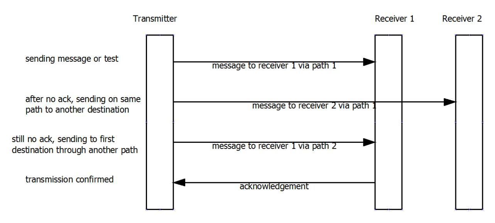

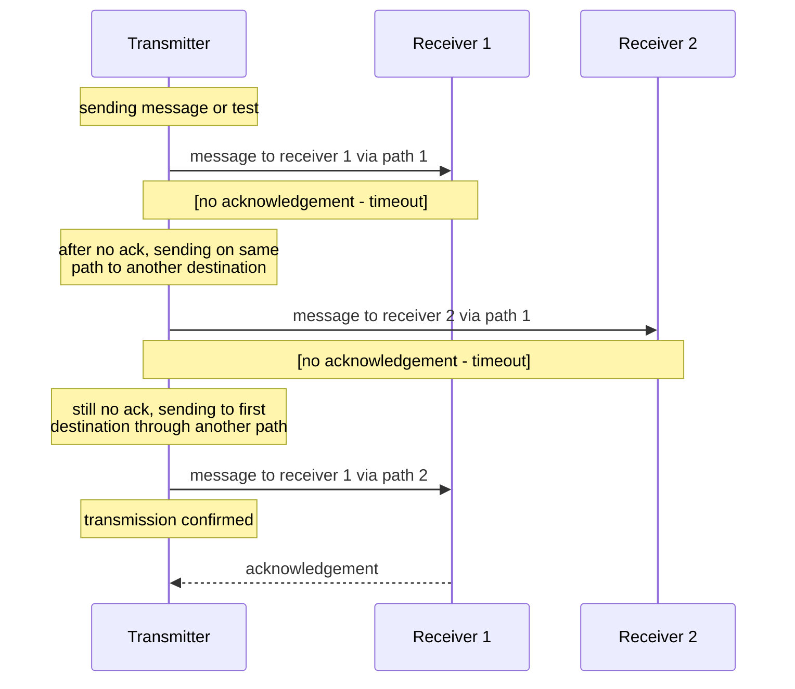

This example shows failover when the primary CSR is unavailable:

1. PE sends event to Primary CSR (no response)
2. PE times out after retry period
3. PE sends event to Backup CSR
4. Backup CSR responds with ACK
5. PE considers transmission successful

**Sequence:**
```
PE → Primary CSR: Event message (seq 0042)
[No response - timeout]
PE → Backup CSR: Event message (seq 0042, same sequence)
Backup CSR → PE: ACK (seq 0042)
```

### F.2 Successful Encrypted Transmission

An event is transmitted successfully

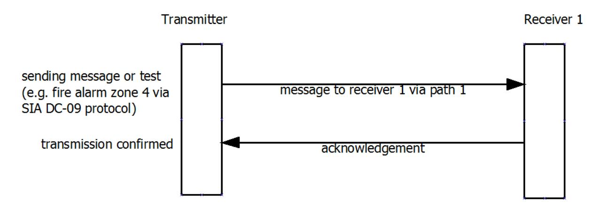

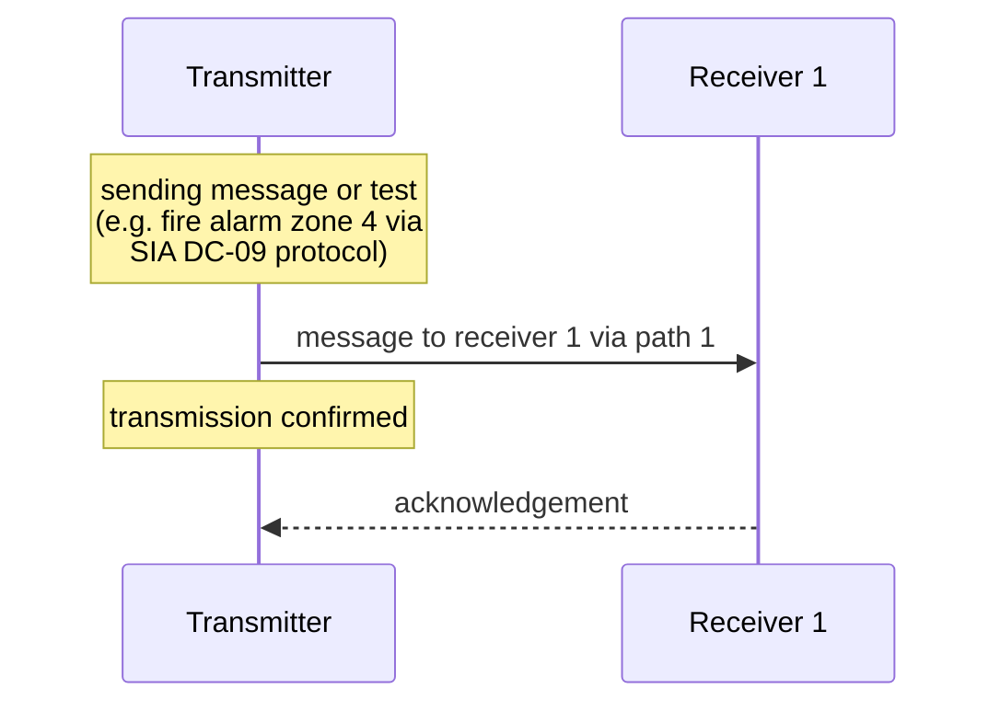

This example shows a successful encrypted message transmission:

1. PE encrypts message with padding and timestamp
2. PE sends encrypted message to CSR
3. CSR decrypt s message successfully
4. CSR validates timestamp (within acceptable range)
5. CSR sends encrypted ACK back to PE

**Sequence:**
```
PE → CSR: Encrypted event message (seq 0043)
           ID token "*SIA-DCS"
           Contains padding and timestamp
CSR → PE: Encrypted ACK (seq 0043)
          ID token "*ACK"
```

### F.3 Primary Receiver Failure

No response to attempt, so transmitter sends to an alternate receiver.

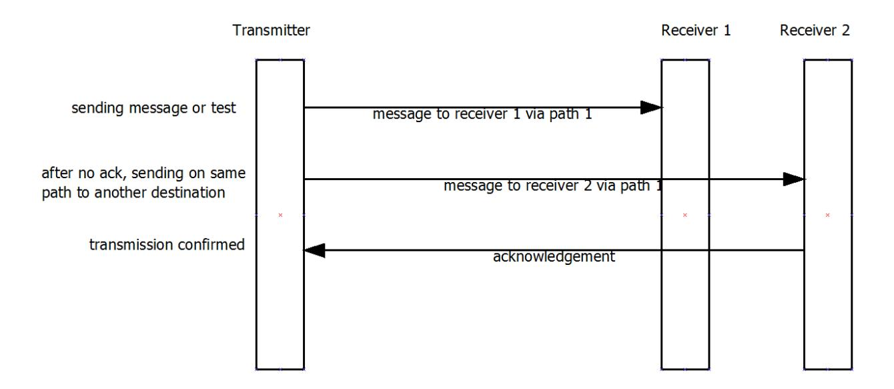

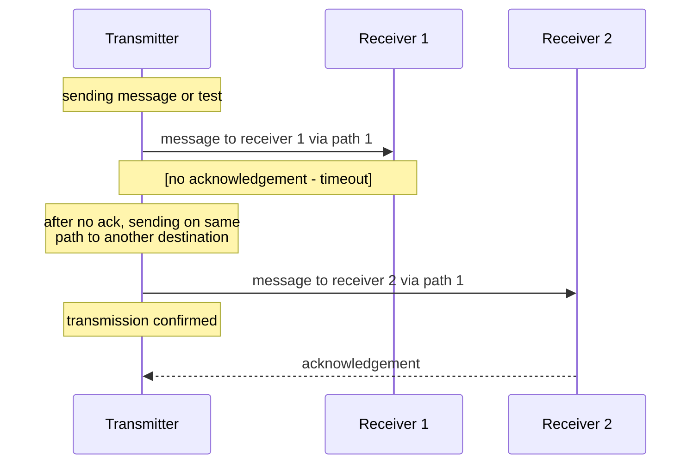

This example shows handling of a DUH response:

1. PE sends event with unsupported extended data
2. CSR receives and validates message structure
3. CSR cannot process unsupported element
4. CSR responds with DUH
5. PE may retry or report failure

**Sequence:**
```
PE → CSR: Event message with unsupported extended data (seq 0044)
CSR → PE: DUH (seq 0044)
PE: Handles DUH per local policy (retry or fail)
```

### F.4 Unsupported Message

Receiver replies to unsupported message with DUH response.

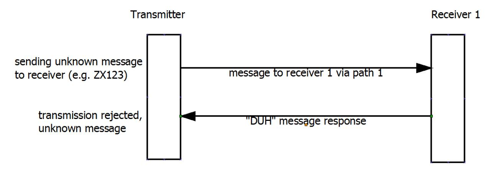

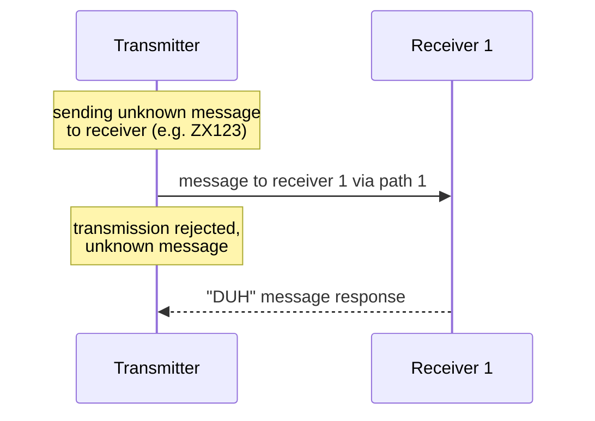

This example illustrates the DUH response for unsupported message elements:

1. PE sends event with extended data field CSR doesn't support
2. CSR successfully receives and validates basic message structure
3. CSR determines it cannot process the extended data
4. CSR sends DUH acknowledgement
5. PE receives DUH and may take alternative action

**Sequence:**
```
PE → CSR: Event message [#1234|BA 001][X123.456][Y45.678] (seq 0045)
CSR → PE: DUH (seq 0045) - Cannot process X/Y coordinates
PE: Reports or handles per configuration
```

### F.5 Expired Time Stamp

This example shows polling message that is rejected with a NAK message (which is never encrypted) with reference time.

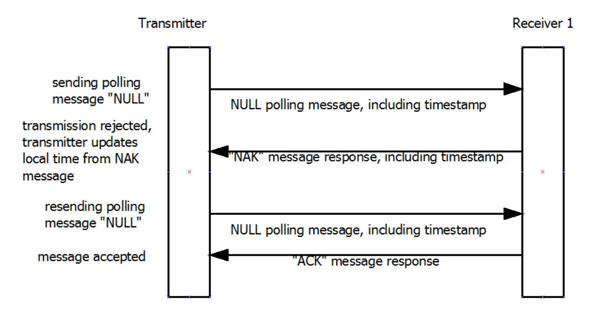

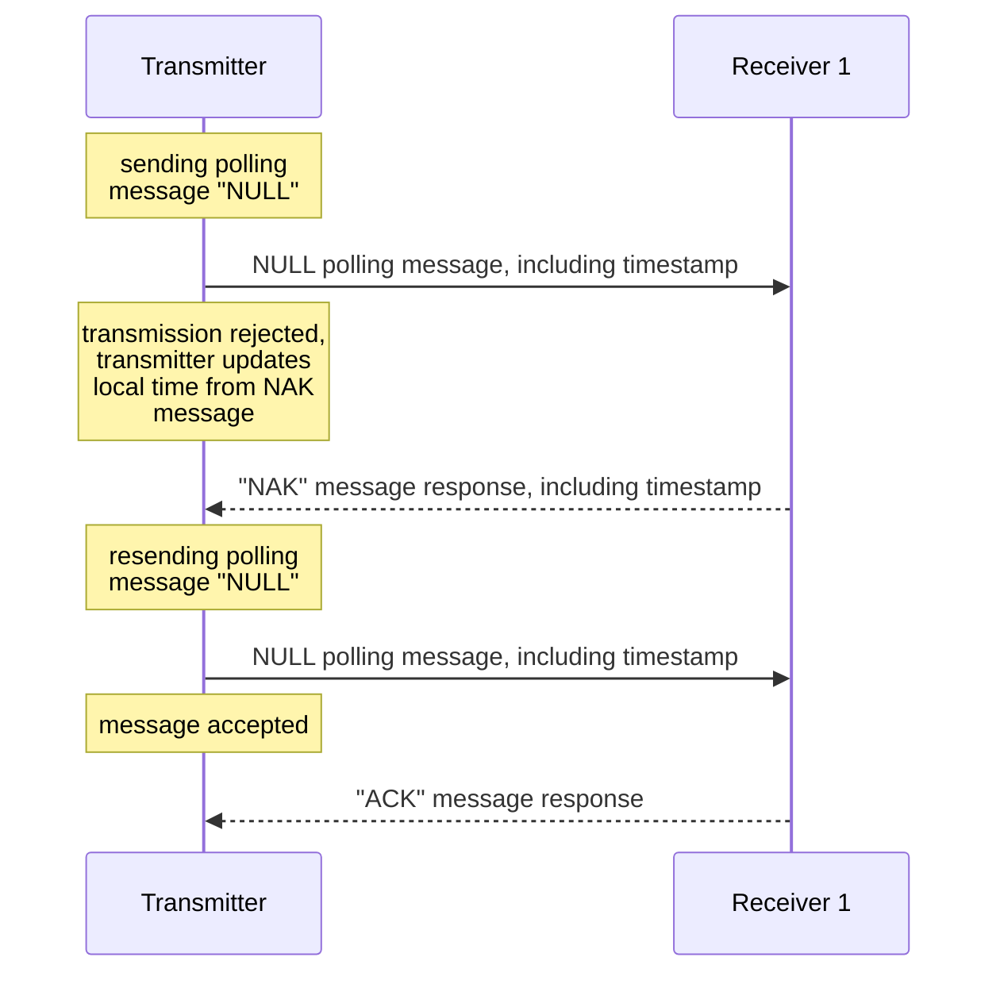

This example demonstrates timestamp validation and NAK handling:

1. PE sends encrypted event with timestamp
2. CSR validates message structure and decrypts
3. CSR compares timestamp against its GMT time
4. CSR determines timestamp is outside acceptable range (> +20/-40 seconds)
5. CSR sends NAK with its current GMT time
6. PE receives NAK, adjusts timestamp
7. PE re-encrypts message with corrected timestamp
8. PE sends updated message
9. CSR validates new timestamp
10. CSR sends ACK

**Sequence:**
```
PE → CSR: Encrypted event (seq 0046)
          Timestamp: _10:00:00,01-22-2026
CSR: Current time: 10:02:00 (difference > 40 seconds)
CSR → PE: NAK with correct time _10:02:00,01-22-2026
PE: Re-encrypts with corrected timestamp
PE → CSR: Encrypted event (seq 0046, same sequence)
          Timestamp: _10:02:05,01-22-2026
CSR → PE: ACK (seq 0046)
```

**Note:** The CSR and PE should maintain independent timebases synchronized to GMT. The timestamp validation provides protection against replay attacks while allowing for reasonable clock drift between systems. The NAK mechanism allows automatic time synchronization without requiring separate time synchronization protocols.

---

## Annex G: Checklist of Major Requirements

This checklist summarizes major requirements for compliance with this standard.

### Premises Equipment (PE)

- [ ] Supports UDP and/or TCP transport
- [ ] Marked with protocol support and version
- [ ] Can be programmed with CSR IP address
- [ ] Generates properly formatted event messages
- [ ] Implements correct CRC calculation
- [ ] Uses proper message length calculation
- [ ] Supports at least one DC-07 token (SIA-DCS or ADM-CID)
- [ ] Implements sequence numbering correctly
- [ ] Formats account identification fields correctly
- [ ] Implements retry logic with timeout
- [ ] Handles ACK, NAK, and DUH responses correctly
- [ ] If encryption supported: uses AES with CBC
- [ ] If encryption supported: includes padding and timestamp
- [ ] If encryption supported: marks messages with asterisk
- [ ] If supervision supported: sends NULL messages at configured interval
- [ ] If extended data supported: formats fields correctly

### Central Station Receiver (CSR)

- [ ] Supports UDP and/or TCP transport
- [ ] Marked with protocol support and version
- [ ] Hosted on static IP address
- [ ] Accepts properly formatted event messages
- [ ] Validates CRC
- [ ] Supports both SIA-DCS and ADM-CID tokens
- [ ] Echoes sequence numbers in acknowledgements
- [ ] Sends ACK for valid messages
- [ ] Sends NAK for timestamp validation failures
- [ ] Sends DUH for unsupported message elements
- [ ] Discards messages with invalid CRC (no response)
- [ ] Discards messages with decryption errors (no response)
- [ ] Supports all three encryption key lengths (128, 192, 256)
- [ ] Handles both encrypted and unencrypted messages
- [ ] Validates timestamps against GMT reference
- [ ] Includes current GMT time in NAK messages
- [ ] If supervision supported: monitors NULL message interval

---

## Annex H: DC-07 Protocol Identifier Tokens (Informative Annex)

The following protocol identifier tokens (ID tokens) are defined for use in the `<"id">` field of messages. These tokens are based on the DC-07 standard.

| Token | Description | Reference |
|-------|-------------|-----------|
| `"SIA-DCS"` | SIA Data Communication Standard format | DC-04 |
| `"ADM-CID"` | Ademco Contact ID format | DC-05 |
| `"NULL"` | Null message / Link test (unencrypted) | This standard |
| `"XNM"` | Extended null message (unencrypted) | This standard |
| `"ACK"` | Positive acknowledgement (unencrypted) | This standard |
| `"NAK"` | Negative acknowledgement (never encrypted) | This standard |
| `"DUH"` | Unable acknowledgement (never encrypted) | This standard |
| `"RSP"` | Response message (unencrypted) | This standard (future use) |

**Encrypted versions** (asterisk added after opening quote):
| Token | Description |
|-------|-------------|
| `"*SIA-DCS"` | Encrypted SIA DCS message |
| `"*ADM-CID"` | Encrypted Ademco Contact ID message |
| `"*NULL"` | Encrypted null message |
| `"*XNM"` | Encrypted extended null message |
| `"*ACK"` | Encrypted acknowledgement |
| `"*RSP"` | Encrypted response message (future use) |

**Requirements:**
- PE shall support at least one of: SIA-DCS or ADM-CID
- CSR shall support both SIA-DCS and ADM-CID
- All implementations shall support ACK, NAK, DUH
- NULL message support is optional
- RSP message support is optional (future use)

---

## Annex I: Optional Remote Commands

This annex describes future capabilities for remote commands from the CSR to the PE.

**Note:** Remote command functionality is not required by this standard and is reserved for future use.

Potential future capabilities may include:
- Remote programming
- Remote key exchange
- Remote diagnostics
- Remote configuration
- Status queries

When implemented in future versions, remote commands would likely use:
- RSP message type for responses
- Extended data fields for command parameters
- Authentication mechanisms for security
- Proper access controls

Manufacturers considering proprietary remote command implementations should:
- Use the "P" programming data extended field
- Implement strong authentication
- Document command formats and security measures
- Consider future standardization

---

**END OF DOCUMENT**
