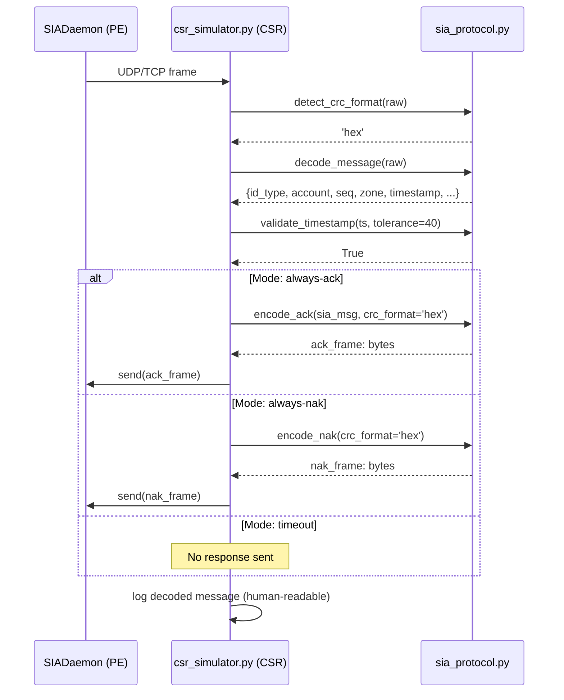
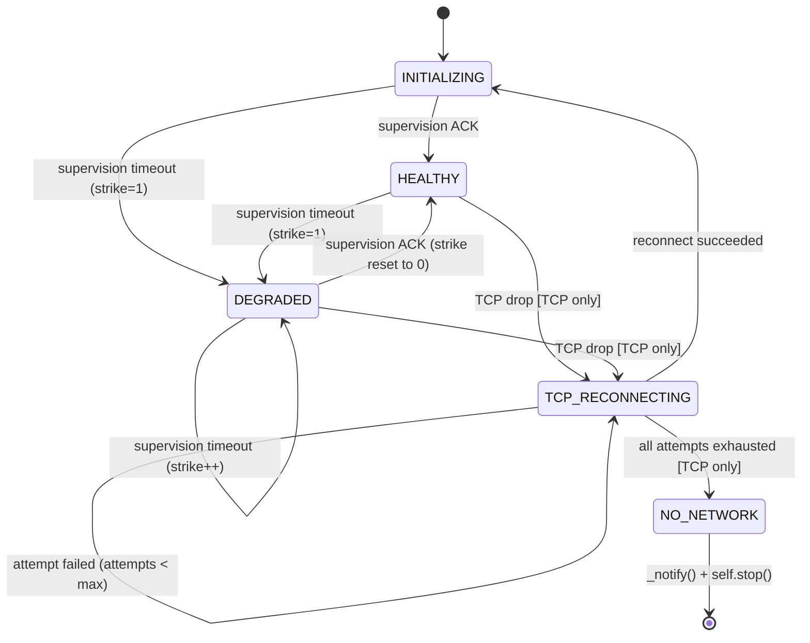
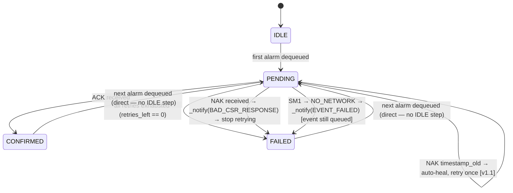
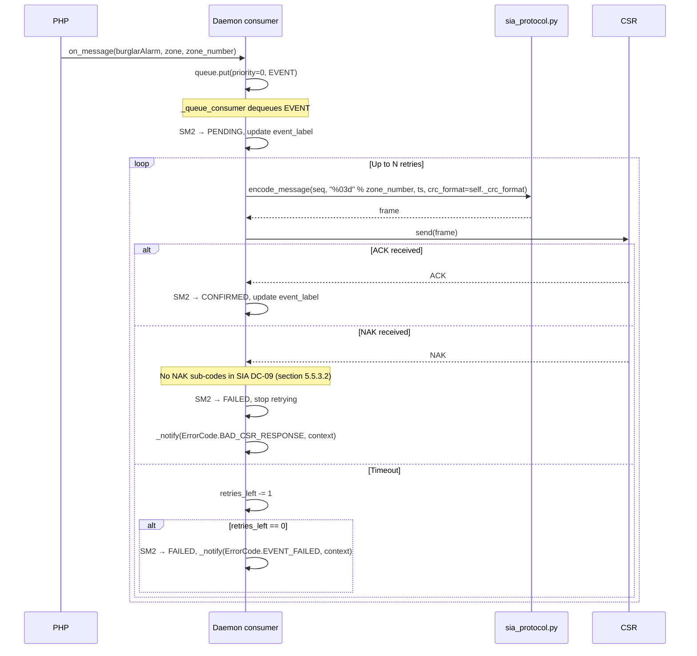
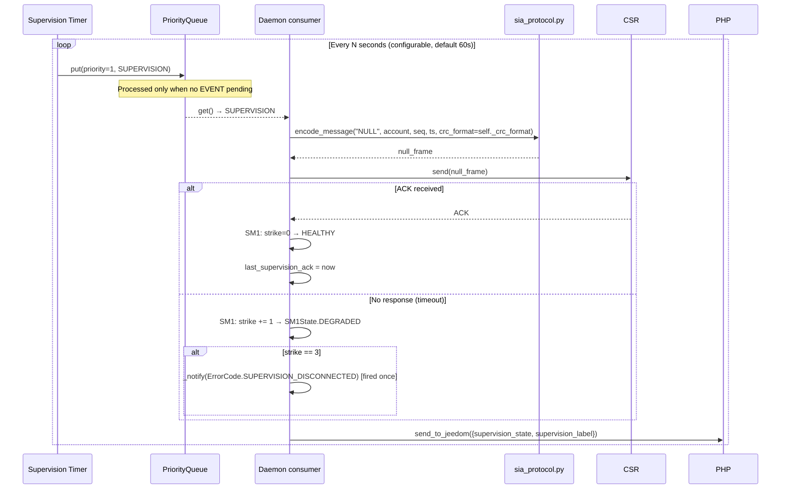

# Daemon Design — Jeedom SIA DC-09 Plugin

**Version:** 0.1 — Architecture & Component Design
**Date:** 2026-03-02
**Status:** Draft — in review

---

## Overview

The daemon is a Python asyncio process that bridges Jeedom alarm events to a Central Station Receiver (CSR) using the SIA DC-09 protocol. It runs continuously, managing two parallel responsibilities:

1. **Event relay** — transmit alarm events from Jeedom to the CSR via SIA-DCS messages
2. **Supervision** — send periodic NULL messages to maintain the connection and detect CSR unreachability

---

## Module Structure

```
resources/siadc09d/
├── siadc09d.py          ← Main daemon (SIADaemon class, extends JeedomDaemon)
├── sia_protocol.py      ← Pure protocol module (encode/decode/CRC) — no Jeedom deps
├── sia_crypto.py        ← AES encryption module (stubbed initially)
├── error_handler.py     ← Error classification and message factory (Component 5a)
tests/
└── simulator/
    └── csr_simulator.py ← CSR simulator for development testing
```

### Dependency rules

- **Requires Python 3.10+** — uses PEP 604 union syntax (`X | Y`) in annotations. On Jeedom, enforced via `info.json` `"os": {"min": 12}` (Debian 12 ships Python 3.11). Runtime type aliases use `typing.Union` for clarity.
- **All `datetime` objects are UTC and timezone-aware** — always use `datetime.now(timezone.utc)`, never `datetime.utcnow()` (deprecated since Python 3.12, returns a timezone-naive object). Mixing naive and aware datetimes raises `TypeError` at runtime.
- `sia_protocol.py` imports only `sia_crypto.py` — zero Jeedom dependencies
- `sia_crypto.py` imports only Python stdlib (`cryptography` or `pycryptodome`)
- `siadc09d.py` imports `sia_protocol`, `sia_crypto`, and `jeedom-daemon-py`
- `csr_simulator.py` imports `sia_protocol` only — standalone tool, not deployed

---

## Enum type ownership

All named constants used in this document belong to one of three Python enums. Values are defined once, in their canonical location — never duplicated here.

| Enum | Python file | Canonical values defined in |
|---|---|---|
| `SM1State` | `siadc09d.py` | [SM1 — Connection / Supervision State](#sm1--connection--supervision-state) — this document |
| `SM2State` | `siadc09d.py` | [SM2 — Alarm Event State](#sm2--alarm-event-state) — this document |
| `ErrorCode` | `error_handler.py` | `error-handler-design.md` §"3-tier error model" |

In prose and code blocks, always use the qualified form: `SM1State.HEALTHY`, `SM2State.FAILED`, `ErrorCode.SUPERVISION_DISCONNECTED`, etc. Mermaid diagrams use short node labels for readability — consult the sections above for the authoritative enum values.

---

## Component 0 — `sia_protocol.py` + `sia_crypto.py` + `csr_simulator.py`

### Exception hierarchy

Two named exception classes are defined in `sia_protocol.py` and replace all generic `ValueError`/`OSError` for protocol and transport failures:

```python
class SIATransportError(OSError):
    """Network/socket failure — TCP timeout, UDP timeout, socket closed."""

class SIAProtocolError(ValueError):
    """SIA DC-09 protocol violation — malformed frame, decode failure."""
```

- `_send_raw_tcp()` / `_send_raw_udp()` raise `SIATransportError` on all transport failures (timeout, connection reset, socket closed, etc.)
- `encode_message()` / `decode_message()` raise `SIAProtocolError` on malformed or invalid data
- Call sites catch by type — never use bare `except Exception:` for protocol/transport errors (that would swallow `CancelledError`)
- Both defined in `sia_protocol.py`; imported from there everywhere

> **`CancelledError` safety rule:** `except Exception:` in asyncio code **must not swallow `asyncio.CancelledError`** (a subclass of `BaseException`, not `Exception`, in Python 3.8+). Use typed `except (SIATransportError, SIAProtocolError):` for expected protocol/transport errors, or `except Exception as e: if isinstance(e, asyncio.CancelledError): raise` if a broad catch is unavoidable. `asyncio.TaskGroup` is forbidden — use `_track_task()` for each coroutine independently.

---

### API surface of `sia_protocol.py`

---

#### `compute_crc(data: bytes) -> int`

**Why:** SIA DC-09 mandates CRC-16/MODBUS integrity checking on every frame (section 5.5.1.2). The CSR discards any frame whose CRC does not match — from the daemon's perspective this is indistinguishable from a timeout.

**What:** Computes CRC-16/MODBUS over the `message_string` bytes using polynomial `0xA001` (bit-reversal of `0x8005`), starting with CRC=0.

**Scope (critical):** CRC is computed over the `message_string` only — not the `0x0A` leader, not the CRC field itself, not the 4-byte length field, not the `0x0D` trailer.

| Parameter | Type | Description |
|---|---|---|
| `data` | `bytes` | Raw `message_string` bytes to checksum |

**Returns:** `int` — 16-bit CRC value (0–65535).

---

#### `make_timestamp() -> str`

**Why:** Every SIA DC-09 frame must carry a UTC timestamp (section 5.5.1.7). The CSR validates it is within +20/−40 seconds of its own clock. A stale or local-time timestamp causes a NAK, which in v1.0 increments the strike counter.

**What:** Returns the current UTC time formatted per the standard. Must be called fresh immediately before encoding each frame.

**Returns:** `str` — `"HH:MM:SS,MM-DD-YYYY"` (e.g. `"14:32:11,03-06-2026"`). Always UTC — local time will cause systematic NAKs when the system timezone differs from UTC.

---

#### `validate_timestamp(ts: str, tolerance_sec: int = 40) -> bool`

**Why:** Used by the CSR simulator to replicate the CSR's timestamp gate (section 5.5.1.6) — decides whether to ACK or NAK an incoming PE frame.

| Parameter | Type | Description |
|---|---|---|
| `ts` | `str` | Timestamp string in `"HH:MM:SS,MM-DD-YYYY"` format |
| `tolerance_sec` | `int` | Acceptance window in seconds (default 40; standard specifies CSR accepts PE messages within +20/−40s of its own clock — default is conservative) |

**Returns:** `bool` — `True` if timestamp is within the tolerance window of current UTC.

---


#### `wrap_frame(message_str: str, crc_format: str = 'hex') -> bytes`

**Why:** Internal helper that encapsulates a `message_string` into the SIA DC-09 frame envelope. Not called directly by the daemon — called internally by `encode_message()`, `encode_ack()`, and `encode_nak()`.

**What:** Computes CRC over `message_str`, encodes it in the requested format, builds the 4-byte ASCII-hex length field, and assembles the complete frame. Uses Windows-1252 encoding for the message string (section 5.5.1.1) — ASCII-only content is unaffected, but media URLs with non-ASCII characters must be pre-validated.

| Parameter | Type | Description |
|---|---|---|
| `message_str` | `str` | The message_string (content between header and trailer) |
| `crc_format` | `str` | `'hex'` (default, 4 bytes ASCII) or `'bin'` (2 bytes binary) |

**Returns:** `bytes` — complete frame: `0x0A + CRC + LENGTH(4 hex ASCII) + message_str.encode('windows-1252') + 0x0D`.

---

#### `encode_message(id_type, account, seq, zone, timestamp, receiver_prefix='', account_prefix='', media_url=None, *, crc_format: str) -> bytes`

**Why:** Primary outbound frame builder. Constructs alarm and supervision frames from semantic parameters, handling the SIA-DCS data block format and optional Verification extended data field.

**`id_type` values (exhaustive):**

| Value | Meaning |
|---|---|
| `'NULL'` | Supervision frame — empty data block, no event. Sent periodically to maintain the CSR link. Unencrypted. |
| `'*NULL'` | Encrypted supervision frame. Used when `encryption_enabled=True`. Timestamp and pad fields are required (section 5.5.2.1). |
| `'SIA-DCS'` | Standard alarm event frame, unencrypted. |
| `'*SIA-DCS'` | Alarm event frame, AES-encrypted. The `*` prefix signals encryption to the CSR per section 5.5.1.4.1. |

**Encrypted frame structure (for `'*SIA-DCS'` and `'*NULL'`):**

Per section 5.4.3–5.4.4, only the content inside the data block `[...]` is encrypted. Padding is **pseudo-random** and is prepended inside the block, terminated by `|`. The closing `]` and everything before `[` are never encrypted.

```
Unencrypted: "SIA-DCS"SSSS...#ACCOUNT[#ACCOUNT|BA 001]_timestamp
Encrypted:   "*SIA-DCS"SSSS...#ACCOUNT[hex(AES(pad|#ACCOUNT|BA 001_timestamp))]
                                        ^^^^^^^^^^^^^^^^^^^^^^^^^^^^^^^^^^^^^^^^
                                        encrypted region: pad + | + data + _ + timestamp
```

The pad is pseudo-random bytes prepended so that the total encrypted region length is a multiple of 16 (section 5.4.4). `encode_message()` is responsible for generating the pad and assembling the plaintext before passing it to `sia_crypto.encrypt()`.

| Parameter | Type | Description |
|---|---|---|
| `id_type` | `str` | Frame identifier token (see table above) |
| `account` | `str` | Account number, 3–16 hex chars |
| `seq` | `int` | Sequence number 0–9999; initialized to 0, wraps `9999 → 0000`. Formatted as 4 zero-padded digits: `f"{seq:04d}"`. |
| `zone` | `str` | Already-formatted zone field for alarm events — the **zone order number, zero-padded to 3 digits** (`"001"`); empty string `''` for `'NULL'` supervision frames **and for an alarm whose zone could not be resolved** (the field is then absent from the data block: `[#001234|BA]`). The caller (`_build_event_frame()`) does the padding; `encode_message()` inserts the value verbatim. Never a zone label. |
| `timestamp` | `str` | UTC timestamp from `make_timestamp()`. `encode_message()` prepends the mandatory `_` separator before embedding it in the frame — do **not** include `_` in the value returned by `make_timestamp()`. |
| `receiver_prefix` | `str` | Optional 0–6 hex char receiver prefix. Default `''` → field omitted; CSR interprets as `R0`. **IMA Protect: unconfirmed — verify at integration time.** |
| `account_prefix` | `str` | Optional 0–6 hex char account prefix. Default `''` → field omitted; CSR interprets as `L0`. **IMA Protect: unconfirmed — verify at integration time.** |
| `media_url` | `str \| None` | Snapshot URL appended as `[V...]` Verification extended data field per section 5.5.1.8. Appended after event data block, before timestamp. Forbidden chars: `[`, `]`, `|`. Encoding: Windows-1252. `None` → field omitted. |
| `crc_format` | `str` | **Required keyword-only argument.** `'hex'` (4-byte ASCII CRC) or `'bin'` (2-byte binary CRC). Loaded from the CSR preset at daemon startup and stored in `self._crc_format`. Always call as `crc_format=self._crc_format`. |

**Returns:** `bytes` — complete frame ready to transmit.

**Example frame (alarm, unencrypted, with media URL):**
```
"SIA-DCS"0007L0#ABC123[#ABC123|BA 001][Vhttp://192.168.1.50/snap.jpg]_14:32:11,03-06-2026
```

**Same alarm, zone unresolved** (the label sent by the alarm plugin matched no row in
`sia_zone_mappings`) — no zone field at all, the alarm is still transmitted:
```
"SIA-DCS"0007L0#ABC123[#ABC123|BA][Vhttp://192.168.1.50/snap.jpg]_14:32:11,03-06-2026
```

---

#### `decode_message(raw: bytes) -> dict`

**Why:** Used by the CSR simulator to parse incoming PE frames for validation and scenario-scripted response selection (ACK / NAK / timeout).

| Parameter | Type | Description |
|---|---|---|
| `raw` | `bytes` | Complete frame bytes including `0x0A` leader and `0x0D` trailer |

**Returns:** `dict` with keys:

| Key | Type | Description |
|---|---|---|
| `id_type` | `str` | e.g. `'SIA-DCS'`, `'*SIA-DCS'`, `'NULL'` |
| `encrypted` | `bool` | True if `id_type` starts with `*` |
| `seq` | `int` | Sequence number |
| `receiver_prefix` | `str \| None` | Receiver prefix, or `None` if absent |
| `account_prefix` | `str` | Account prefix |
| `account` | `str` | Account number |
| `event_data` | `str` | Raw data block content (ciphertext hex if encrypted) |
| `extended_fields` | `list[tuple[str, str]]` | `[(identifier, content), ...]` e.g. `[('V', 'http://...')]` |
| `timestamp` | `str \| None` | Timestamp string, or `None` if absent |
| `crc_format` | `str` | `'hex'` or `'bin'` |

**Raises:** `SIAProtocolError` if frame structure is invalid.

---

#### `encode_ack(sia_msg: dict, crc_format: str) -> bytes`

**Why:** Used by the CSR simulator to send a conformant ACK. Per section 5.5.2.1, the ACK **must echo** the `receiver_prefix`, `account_prefix`, and `account` from the original PE message. A mismatched echo causes the daemon to discard the ACK.

| Parameter | Type | Description |
|---|---|---|
| `sia_msg` | `dict` | Parsed message dict from `decode_message()` |
| `crc_format` | `str` | `'hex'` or `'bin'` — **must match** the incoming frame's CRC format |

**Returns:** `bytes` — complete ACK frame.

**Frame format depends on whether the incoming message was encrypted (section 5.5.2.2):**

| Incoming `id_type` | ACK token | ACK format |
|---|---|---|
| `'SIA-DCS'` / `'NULL'` (unencrypted) | `"ACK"` | `"ACK"SSSS[Rprefix][Lprefix]#account[]` |
| `'*SIA-DCS'` / `'*NULL'` (encrypted) | `"*ACK"` | `"*ACK"SSSS[Rprefix][Lprefix]#account[hex(AES(pad_timestamp))]` |

For encrypted ACK, the `*ACK` response is itself encrypted (timestamp + pad in the data block), using the same key as the incoming message. The `sia_msg['encrypted']` flag from `decode_message()` determines which format to use.

---

#### `encode_nak(crc_format: str) -> bytes`

**Why:** Used by the CSR simulator to send a timestamp NAK. Per section 5.5.3.2, the NAK data field carries the CSR's current GMT time to allow the PE to correct its clock.

| Parameter | Type | Description |
|---|---|---|
| `crc_format` | `str` | `'hex'` or `'bin'` |

**Returns:** `bytes` — complete NAK frame.
**Frame format:** `"NAK"0000R0L0A0[]_HH:MM:SS,MM-DD-YYYY` (timestamp = CSR's current UTC at send time).

---

#### `decode_ack_nak(raw: bytes) -> dict`

**Why:** Used by the daemon to parse every CSR response to its outbound frames. The result drives SM1/SM2 transitions — in v1.0 a NAK always stops retrying and triggers `BAD_CSR_RESPONSE`.

**What:** Parses a raw CSR response and classifies it. Never raises — returns `'unknown'` on any parse failure so the daemon can handle it as a `BAD_CSR_RESPONSE` without crashing.

| Parameter | Type | Description |
|---|---|---|
| `raw` | `bytes` | Complete raw response bytes from CSR |

**Returns:** `dict` with keys:

| Key | Type | Description |
|---|---|---|
| `type` | `str` | `'ACK'`, `'NAK'`, or `'unknown'` (anything unparseable) |
| `seq` | `int \| None` | Echoed sequence number; `None` for `'unknown'` |
| `raw_nak` | `bytes \| None` | Full raw NAK frame bytes; populated only when `type='NAK'`. Passed to `parse_nak_timestamp()` to extract CSR clock for v1.1 auto-heal. |

---

#### `decode(raw: bytes, key: bytes | None = None) -> ParsedMessage` *(Task 0.5 — added by Component 5c)*

**Why:** Inspector-oriented full decoder for the debug UI. Richer than `decode_ack_nak()` — validates CRC and length, decrypts if key is provided, exposes every frame field for human display. **Not used in the daemon runtime** — called only by the `decodeFrame` AJAX endpoint via a short-lived subprocess.

| Parameter | Type | Description |
|---|---|---|
| `raw` | `bytes` | Complete frame bytes |
| `key` | `bytes \| None` | AES key for decryption; `None` if unavailable or frame is unencrypted |

**Returns:** `ParsedMessage` dataclass (full field list in `debug-ui-design.md`):

```python
@dataclass
class ParsedMessage:
    raw_hex:          str
    crc_received:     str
    crc_computed:     str
    crc_valid:        bool
    length_declared:  int
    length_actual:    int
    id_token:         str              # e.g. "SIA-DCS", "*SIA-DCS", "ACK", "NAK"
    encrypted:        bool
    aes_blocks:       int | None       # populated if encrypted
    sequence:         str
    receiver_prefix:  str | None
    account_prefix:   str
    account:          str
    data_raw:         str              # hex string if encrypted + no key; plaintext otherwise
    data_decrypted:   str | None       # populated when encrypted and key provided
    extended_fields:  list[tuple[str, str]]  # [(identifier, content), ...]
    timestamp:        str | None
```

**Behaviour:** `key=None` + encrypted frame → `data_raw` = hex of ciphertext, `data_decrypted=None`. Key provided → decrypt, set `data_decrypted`; `data_raw` still holds original ciphertext hex.

**Subprocess contract:** `decode()` is exposed via a `if __name__ == '__main__'` block in `sia_protocol.py` — no separate wrapper script needed. See `php-core-design.md` Task 2.10 (`decodeFrame` action) for the full invocation contract.

---

#### `parse_nak_timestamp(nak_data: bytes) -> datetime` *(Task 0.5)*

**Why:** Extracts the CSR's current time from a NAK frame data field (section 5.5.3.2). In v1.0 used only to distinguish a standard timestamp-NAK (parseable) from a malformed NAK (anomaly → `BAD_CSR_RESPONSE`). In v1.1, the extracted `datetime` will drive clock auto-heal and a one-shot retry.

| Parameter | Type | Description |
|---|---|---|
| `nak_data` | `bytes` | Full raw NAK frame bytes — the `raw_nak` field from `decode_ack_nak()`. **Must not be `None`** — callers must guard before calling (see call site contract below). |

**Returns:** `datetime` (UTC, timezone-aware) — the CSR's current time extracted from the NAK data field.

**Raises:** `ValueError` if the NAK data field is missing, malformed, or does not contain a parseable SIA DC-09 timestamp. Callers must catch `ValueError` and treat it as a protocol anomaly (`BAD_CSR_RESPONSE`).

**Call site contract:** callers must NOT pass `None`. The canonical pattern is:

```python
try:
    if nak_data is None:
        raise ValueError('no NAK data')
    csr_time = sia_protocol.parse_nak_timestamp(nak_data)
    # success path — standard timestamp NAK
except ValueError:
    # failure path — missing or undecodable NAK data → BAD_CSR_RESPONSE
```

This design is intentional: `parse_nak_timestamp` does one thing (parse), and callers own the
routing decision. Returning `None` would conflate two distinct outcomes (parse failure vs. no data)
and push a conditional into every call site.

---

### API surface of `sia_crypto.py`

---

#### `encrypt(data: bytes, key: bytes) -> bytes`

**Phase 1 (stub):** Returns `data` unchanged. Allows full end-to-end protocol testing before AES is implemented.

**Phase 2:** AES-CBC encryption.
- IV: 16 zero bytes (`b'\x00' * 16`) as specified by section 5.4.6.
- Key length selects variant: 16 bytes → AES-128, 24 bytes → AES-192, 32 bytes → AES-256.
- `data` **must already be a multiple of 16 bytes** — `encrypt()` does NOT add padding. Padding is pseudo-random and is prepended by `encode_message()` as part of the message string structure (section 5.4.4). See `encode_message()` encrypted frame structure above.
- Returns raw ciphertext bytes; caller encodes to hex ASCII for embedding in the frame data block.

| Parameter | Type | Description |
|---|---|---|
| `data` | `bytes` | Plaintext encrypted region, already padded to a multiple of 16 bytes by the caller |
| `key` | `bytes` | AES key — 16, 24, or 32 bytes |

**Returns:** `bytes` — ciphertext, same length as input.

---

#### `decrypt(data: bytes, key: bytes) -> bytes`

**Phase 1 (stub):** Returns `data` unchanged.

**Phase 2:** Reverse of `encrypt`. Returns the full plaintext encrypted region including the pseudo-random pad prefix — the caller is responsible for stripping it (locate the `|` pad terminator and discard everything before it). Used by `decode()` in Task 0.5 (debug inspector only — not in daemon runtime).

| Parameter | Type | Description |
|---|---|---|
| `data` | `bytes` | Ciphertext bytes (decoded from hex ASCII frame field) |
| `key` | `bytes` | AES key — 16, 24, or 32 bytes |

**Returns:** `bytes` — decrypted region including pad prefix; caller strips pad by splitting on first `|`.

---

### Sequence: PHP sends alarm → sia_protocol encodes → CSR responds

```mermaid
sequenceDiagram
    participant PHP as PHP (Jeedom)
    participant D as SIADaemon
    participant Q as PriorityQueue
    participant P as sia_protocol.py
    participant C as sia_crypto.py
    participant CSR as CSR (IMA Protect)

    PHP->>D: on_message("burglarAlarm", {zone: "Salon", zone_number: 1})
    D->>Q: put(priority=0, EVENT{type=BA, zone=Salon, zone_number=1})

    Note over Q: Consumer picks highest priority item

    Q-->>D: get() → EVENT{BA, Salon, 1}
    D->>P: encode_message("SIA-DCS", account, seq, "001", ts, crc_format=self._crc_format)
    P->>C: encrypt(payload, key)
    Note over C: Stub: returns payload unchanged (Phase 1)
    C-->>P: payload
    P->>P: compute_crc() → wrap_frame()
    P-->>D: frame: bytes

    D->>CSR: send(frame) [UDP or TCP]
    CSR-->>D: ACK frame

    D->>P: decode_ack_nak(raw)
    P-->>D: {type: "ACK", seq: 1}

    D->>D: SM2 → CONFIRMED; format event_label via _update_info_commands()
    D->>PHP: send_to_jeedom({event_state: 1, event_label: "...", supervision_state: _supervision_value(), supervision_label: _supervision_label()})
```

---

### Sequence: CSR simulator receives and responds



---

### Frame format reference

```
[0x0A][CRC][LEN][message_string][0x0D]
  1B    2-4B  4B                  1B

CRC format hex : 4 bytes ASCII  → total header: 1+4+4 = 9 bytes before message
CRC format bin : 2 bytes binary → total header: 1+2+4 = 7 bytes before message

Detection: if raw[5]=='0' and raw[9]=='"' → hex; if raw[3]=='0' and raw[7]=='"' → bin

message_string:
  "ID_TOKEN"SSSS[Rreceiver][Laccount_prefix]#ACCOUNT[event_data][Vmedia_url]_HH:MM:SS,MM-DD-YYYY
  └── ID_TOKEN: NULL (supervision, clear) | *NULL (supervision, encrypted)
               | SIA-DCS (alarm, clear) | *SIA-DCS (alarm, encrypted)
  └── SSSS: 0001–9999, wraps
  └── receiver/account prefixes: optional, default R0L0
  └── [event_data]: e.g. [#1234|BA 001] — zone ORDER NUMBER, 3-digit zero-padded (Annex B),
       never the zone label; omitted entirely when the zone is unresolved → [#1234|BA]
  └── [Vmedia_url]: optional — SIA DC-09 Verification extended data field (section 5.5.1.8)
       Appended after [event_data], before timestamp.
       Forbidden chars in URL: '[', ']', '|'. Encoding: Windows 1252.
       Example: [Vhttp://192.168.1.50/snap.jpg]
  └── timestamp: UTC, strict format
```

---

### NAK handling in `csr_simulator.py`

The simulator supports scenario scripts (JSON) to test all NAK branches:

```json
[
  {"action": "ack"},
  {"action": "ack"},
  {"action": "nak"},
  {"action": "timeout"},
  {"action": "timeout"}
]
```

> The simulator supports only the protocol-defined NAK (timestamp validation failure).
> There are no NAK sub-codes in SIA DC-09 (section 5.5.3.2), so `"code"` is not used.
> For testing, a NAK always triggers `BAD_CSR_RESPONSE` in the daemon.

---

## Component 1 — `siadc09d.py` (Daemon Core)

### Design decisions

| Decision | Choice | Rationale |
|---|---|---|
| Event queue | `asyncio.PriorityQueue` | Single consumer, events prioritized over supervision |
| Sequence number persistence | **Not persisted** (reset to 1 on start) | Simpler for v1.0; most CSRs tolerate reset. See limitation note below. |
| Retry on timeout | Yes, up to N times (configurable, default 3) | Transient network errors |
| Retry on NAK | **No** | Per SIA DC-09 section 5.5.3.2, a NAK signals timestamp validation failure only. Any NAK → BAD_CSR_RESPONSE + stop retrying |
| Retry on NAK `timestamp_old` | Yes, **once** with auto-corrected timestamp | Auto-heal |
| Supervision vs event priority | **Event wins** (priority 0 vs 1) | Alarm delivery is safety-critical |
| Critical notification command | User-selected Jeedom ACTION/message command (configured in wizard) | Reuses existing notification channels (SMS, push, etc.) |
| TCP reconnection | Auto-reconnect silently; notify user if reconnection fails | Network blip should not wake user; persistent failure should |
| CRC format | `_crc_format: str` loaded from CSR preset at startup | `'hex'` (standard, IMA Protect) or `'bin'` (Lupusec quirk); defined in preset JSON — not detected at runtime |

> ⚠️ **Known limitation (v1.0):** Sequence number resets to `0000` on daemon restart. Some CSRs may briefly reject messages as potential duplicates until the sequence diverges from the last known value. This will be addressed in v1.1 by persisting the counter in Jeedom plugin config.

**CRC format contract:**

- **Owner:** `SIADaemon._crc_format: str` — loaded from `self._preset.crc_format` in `on_start()`. Fails fast (ADR-09) if the value is not `'hex'` or `'bin'`.
- **No runtime detection:** CRC format is a CSR characteristic defined in the preset JSON, not something discoverable from ACK/NAK responses. The daemon is the *sender* (panel role) — it chooses the format; the CSR does not dictate it.
- **Preset values:** `'hex'` = 4-byte ASCII CRC (SIA DC-09 standard, used by IMA Protect). `'bin'` = 2-byte raw big-endian binary (Lupusec panels only).
- **Usage:** passed as `crc_format=self._preset.crc_format` to every `encode_message()` call (keyword-only, no default — omitting it is a compile-time error). Value is constant for the daemon lifetime.

**`CSRPreset` dataclass:**

`on_start()` constructs a `CSRPreset` from the daemon config:
```python
self._preset = CSRPreset(**preset_dict)
```
`CSRPreset` is a `@dataclass(frozen=True, slots=True)` defined in `presets.py`. Field names:
`csr_provider`, `schema_version`, `host`, `port`, `account_number`, `transport`, `crc_format`,
`connect_timeout_s`, `receive_timeout_s`, `supervision_interval_s`.
`SUPPORTED_SCHEMA_VERSION: int = 1` is a module constant in `presets.py`. `on_start()` raises
`SIAProtocolError` if `preset.schema_version != SUPPORTED_SCHEMA_VERSION`.
All preset field access uses `self._preset.field_name` (attribute access on frozen dataclass —
never dict subscript after construction).

---

**Sequence number contract:**

- **Owner:** `SIADaemon._sia_seq: int` — single instance variable, initialized to `0` in `__init__()`.
- **Scope:** one global counter shared across both supervision NULLs and alarm event frames (SIA DC-09 defines one sequence space per PE/account — section 5.5.1.3).
- **Increment:** only after a successful send (i.e. after `_send_raw()` returns without raising). Wraps `9999 → 0000` via `(self._sia_seq + 1) % 10000`. **Never incremented on send failure** — retry uses the same sequence number (correct per SIA DC-09).
- **Format:** `f"{self._sia_seq:04d}"` — always 4 digits, never 5. First frame uses `"0000"`.
- **Correct ordering:** encode → send → increment:
  ```python
  frame = encode_message(..., seq=self._sia_seq, crc_format=self._preset.crc_format)
  await self._send_raw(frame)           # raises SIATransportError on failure
  self._sia_seq = (self._sia_seq + 1) % 10000  # wraps 9999 → 0000
  ```
- **Restart behaviour:** resets to `0` on every daemon start — not persisted. The CSR treats the first post-restart frame as a fresh sequence. **IMA Protect tolerance for this reset must be verified at integration time.**

---

### Two state machines — independent but coupled at dispatch

The daemon maintains **two state machines** that track different concerns:

**SM1** tracks the CSR link health (driven by supervision results and TCP transport events).
**SM2** tracks the current alarm event lifecycle (driven by send results).

They are **independent** in that an alarm can be PENDING while the connection is DEGRADED, or CONFIRMED while supervision is lost. They are **coupled at dispatch**: SM1 state determines whether `_queue_consumer()` will attempt to send a queued event, hold it (TCP_RECONNECTING), or fail it immediately (NO_NETWORK). See the SM2 dependency matrix below.

They map to separate INFO commands and can be in any combination.

---

### SM1 — Connection / Supervision State



**DEGRADED state — strike counter semantics:**

`SM1State.DEGRADED` and the former DISCONNECTED state are collapsed into a single `SM1State.DEGRADED` state.
The `strike` counter (1–3) drives all side effects — there is no separate DISCONNECTED state.

| Strike | `supervision_state` | `supervision_label` | Action |
|---|---|---|---|
| 1 | `1` | `DÉGRADÉ (1/3)` | WARNING logged |
| 2 | `1` | `DÉGRADÉ (2/3)` | WARNING logged |
| 3 | `0` | `PERDUE` | T3 `_notify()` fired once |

Recovery from any strike level: supervision ACK received → `SM1State.HEALTHY`, strike=0.

For **UDP**, there is no TCP drop event to detect. Network loss is discovered only via
supervision timeouts. `SM1State.TCP_RECONNECTING` and `SM1State.NO_NETWORK` states do not exist for UDP.
In `SM1State.DEGRADED` (including strike=3), the daemon keeps sending supervision packets indefinitely.
Recovery happens when the network restores and the CSR responds with ACK → `SM1State.HEALTHY`.

**SM1 transitions are driven by:**
- Supervision NULL ACK received → `SM1State.HEALTHY`, strike=0
- Supervision timeout → strike++; → `SM1State.DEGRADED` (all strike levels)
- At strike=3: T3 `_notify(ErrorCode.SUPERVISION_DISCONNECTED, {...})` fired once; `supervision_state` → 0
- TCP connection dropped → `SM1State.TCP_RECONNECTING` [TCP only]
- TCP reconnect succeeded → `SM1State.INITIALIZING` (supervision must be re-verified)
- TCP reconnect exhausted → `SM1State.NO_NETWORK` → `_notify(ErrorCode.TRANSPORT_PERMANENT, {...})` + `self.stop()`

**SM1 → INFO commands:**

> **Canonical mapping is in `supervision-design.md`** (SM1 state → PHP INFO commands table).
> Summary reproduced here for readability — supervision-design.md is authoritative.

| SM1 state | `supervision_state` (numeric) |
|---|---|
| INITIALIZING | `1` |
| HEALTHY | `2` |
| DEGRADED (strike 1–2) | `1` |
| DEGRADED (strike 3) | `0` |
| TCP_RECONNECTING | `0` |
| NO_NETWORK | `0` |
| STOPPED | `0` |

> **`supervision_label` strings are NOT defined here.** Call `_supervision_label()` — defined and owned by supervision-design.md (Task B.1). Never hardcode label strings in daemon-design.md.

> **HEALTHY label is static `"OK"` — not `"OK — HH:MM"`.** Embedding a clock in the
> label would cause `checkAndUpdateCmd()` to detect a value change every minute
> (1,440 DB writes/day + 1,440 WebSocket `cmd::update` broadcasts). The "last ACK"
> timestamp is available via `supervision_state`'s `collectDate`, which
> `checkAndUpdateCmd()` always updates regardless of value change. The widget reads
> `collectDate` directly if it needs to display "last seen at HH:MM".

---

### SM1 — Behavior matrix per state and SM2 dependency

Although SM1 and SM2 track independent concerns (CSR link health vs. alarm event
lifecycle), they are **not fully orthogonal**: SM1 state determines whether the
`_queue_consumer()` will attempt to send a queued alarm event, or hold/fail it.

> **Critical states note:** `SM1State.TCP_RECONNECTING` and `SM1State.NO_NETWORK` already generate T3 critical
> alerts (`ErrorCode.SUPERVISION_DISCONNECTED` and `ErrorCode.TRANSPORT_PERMANENT` respectively) — the operator
> already knows the system is broken when SM1 enters these states. SM2 behavior in these
> states must still be explicit: an alarm event must never disappear silently.

#### Phase 1 — Enqueue (on_message → PriorityQueue)

Alarm commands from PHP are **always accepted into the PriorityQueue**, regardless of SM1
state. The enqueue step never blocks or fails — this guarantees PHP's fire-and-forget call
returns immediately. SM2 stays **`SM2State.IDLE` at enqueue time**; it transitions to `SM2State.PENDING` only
when `_queue_consumer()` dequeues the item (Task 1.7). This ensures at most one event is
ever `SM2State.PENDING` simultaneously — a second queued alarm stays `SM2State.IDLE` in the queue until the
first completes.
SM1 state is evaluated at dequeue time (Phase 2).

#### Phase 2 — Dequeue and send (_queue_consumer dispatch)

`_queue_consumer()` checks `self._sm1_state` before dispatching each EVENT item:

| SM1 state | Transport | SM2 behavior on dequeue | SM2 outcome |
|---|---|---|---|
| INITIALIZING | TCP/UDP | `_send_with_retry()` attempted immediately — CSR reachability is **unconfirmed** (no supervision ACK yet). Alarm is too time-critical to hold for confirmation. If CSR unreachable, retries exhaust and SM2 FAILS. | CONFIRMED on ACK; FAILED on timeout×N or NAK |
| HEALTHY | TCP/UDP | `_send_with_retry()` attempted — CSR **confirmed** reachable (at least one supervision ACK received) | CONFIRMED or FAILED |
| DEGRADED (strike 1–2) | TCP/UDP | `_send_with_retry()` attempted — socket open, CSR **possibly** still reachable | CONFIRMED or FAILED |
| DEGRADED (strike 3) | **UDP** | `_send_with_retry()` attempted best-effort. T3 SUPERVISION_DISCONNECTED already fired for supervision loss. If SM2 also FAILS → EVENT_FAILED fires as a second T3 alert. | CONFIRMED or FAILED |
| DEGRADED (strike 3) | **TCP** | Cannot occur in practice: at strike=3 TCP immediately transitions SM1 → `SM1State.TCP_RECONNECTING` and force-closes the socket (supervision-design.md B.1). Event will be re-queued under TCP_RECONNECTING rule below. | — |
| TCP_RECONNECTING | TCP | Event **re-queued** (put back at same priority). Consumer yields briefly (1 s) to allow `_tcp_reconnect_loop()` to progress before re-checking. On reconnect success (SM1 → `SM1State.INITIALIZING`): event processed normally on next dequeue. On reconnect failure (SM1 → `SM1State.NO_NETWORK`): event will be failed on next dequeue via the NO_NETWORK rule below. `ErrorCode.SUPERVISION_DISCONNECTED` was already fired; `ErrorCode.EVENT_FAILED` will fire in addition if the event ultimately fails. | CONFIRMED or FAILED |
| NO_NETWORK | TCP | SM2 → **`SM2State.FAILED` immediately**, no send attempt. `_notify(ErrorCode.EVENT_FAILED)` fired before daemon calls `self.stop()`. `ErrorCode.TRANSPORT_PERMANENT` was already fired for the transport loss; `ErrorCode.EVENT_FAILED` is an additional T3 alert for the lost alarm event. | FAILED |

**Supervision items in critical states:**

| SM1 state | SUPERVISION item dequeued |
|---|---|
| TCP_RECONNECTING | Dropped silently — socket is closed, cannot send |
| NO_NETWORK | Dropped silently — daemon is stopping |

**When a supervision ACK is received:**

| SM1 state | Behavior |
|---|---|
| INITIALIZING | → HEALTHY, strike=0 |
| HEALTHY | Stay HEALTHY, strike=0, update `supervision_state` timestamp |
| DEGRADED (any strike) | → HEALTHY, strike=0 — recovery logged |
| TCP_RECONNECTING | Impossible — TCP is down |
| NO_NETWORK | Not applicable |

**When a supervision NAK is received:**

> **Canonical NAK dispatch is in `supervision-design.md` Task B.2** (`_handle_supervision_nak()`).
> Summary: parseable-timestamp NAK → strike++ only (no `_notify`); undecodable NAK → strike++ + `_notify(ErrorCode.BAD_CSR_RESPONSE)`.
> `classify_nak()` does not exist — per SIA DC-09 section 5.5.3.2 there are no NAK sub-codes.

---

### SM2 — Alarm Event State



> **IDLE is a startup-only state.** After the first alarm, SM2 alternates directly between
> PENDING, CONFIRMED, and FAILED. `_queue_consumer()` writes `SM2=PENDING` unconditionally
> at dequeue time — there is no CONFIRMED→IDLE or FAILED→IDLE transition in the code.
> The IDLE state is never re-entered after the first alarm event.

> **Protocol fact (SIA DC-09 section 5.5.3.2):** The only standard NAK is a timestamp
> validation failure carrying the CSR's current GMT time. There are **no NAK sub-codes**
> (`bad_acct`, `bad_encryption`, `bad_message` do not exist in the protocol).
> Any NAK in v1.0 → `_notify(ErrorCode.BAD_CSR_RESPONSE)` → stop retrying → `SM2State.FAILED`.
> Timestamp auto-heal (parse CSR time from NAK → resync → retry once) is deferred to v1.1.

**SM2 → INFO commands:**

`event_state` (numeric — scenario trigger):

| SM2 state | `event_state` |
|---|---|
| IDLE (never fired) | `0` |
| PENDING | `3` |
| CONFIRMED | `1` |
| FAILED (any cause) | `2` |

| Value | Meaning |
|---|---|
| `0` | No alarm sent since daemon start |
| `1` | Last alarm delivery confirmed (ACK from CSR) |
| `2` | Last alarm delivery failed (timeout, NAK, or NO_NETWORK) |
| `3` | Alarm transmission in progress (`SM2State.PENDING`) |

> **`event_state` is NOT driven by SM2 → IDLE transitions.** When SM2 returns to `SM2State.IDLE`
> after CONFIRMED or FAILED, the daemon does NOT update `event_state` — it retains its last value
> (1 or 2). `event_state` is **NOT reset on daemon startup** — it retains its previous value
> across restarts (see `php-core-design.md` and `supervision-design.md` Task A.1).
> The three points where the daemon writes `event_state` are:
> alarm dequeued for send (3=PENDING), ACK received (1=CONFIRMED), all retries exhausted
> or NO_NETWORK (2=FAILED).
>
> **First-ever install:** `event_state` starts as `null` (no previous run). It will remain
> `null` until the first alarm is sent. The `returnStateValue=0` auto-revert (see below)
> handles this: after 30 minutes with no daemon write, Jeedom resets it to `0`.
>
> **Auto-revert:** the `event_state` command is created with `returnStateTime=30` and
> `returnStateValue=0` (see `php-core-design.md` `_ensureCommands()`). Jeedom automatically
> resets it to `0` after 30 minutes without a daemon update. This cleans up a stuck `3`
> (PENDING) if the daemon crashes mid-alarm — without this, the "in progress" state would
> remain indefinitely. 30 minutes is intentionally generous: a normal alarm exchange completes
> in seconds; any alarm still "in progress" after 30 minutes is unambiguously orphaned.

`event_label` (string — display):

| SM2 state | `event_label` |
|---|---|
| IDLE (never fired) | `Aucun événement depuis le démarrage` |
| IDLE (after event) | _(last result string, unchanged)_ |
| PENDING | `Intrusion — Salon — envoi en cours (tentative N/3)` |
| CONFIRMED | `Intrusion — Salon — HH:MM:SS — Confirmé par la centrale` |
| FAILED (timeout) | `Intrusion — Salon — HH:MM:SS — Échec (3 tentatives)` |
| FAILED (NAK) | `Intrusion — Salon — HH:MM:SS — Réponse inattendue de la centrale` |
| FAILED (NO_NETWORK) | `Intrusion — Salon — HH:MM:SS — Échec — réseau inaccessible` |

SIA code → French label mapping: `BA` → `Intrusion`, `FA` → `Incendie`, `PA` → `Panique`.
Format decided by Component 6 (Widget) to serve the night-time emergency use case.

> **v1.1 (Story 13.1):** codes `BC` and `OP` add no SM2 state and no `event_state` value — see
> "Disarm During an Alarm" at the end of this document. `BR` has no source event and is out of
> scope (story 13-2, parked).

**On `SM2State.FAILED`:** call `_notify(code, ctx)` → dual-channel dispatch via Component 5a.
- Timeout exhausted → `_notify(ErrorCode.EVENT_FAILED, EventFailedCtx(...))`
- NAK received → `_notify(ErrorCode.BAD_CSR_RESPONSE)` — no ctx needed
- SM1 → `SM1State.NO_NETWORK` (event still in queue) → `_notify(ErrorCode.EVENT_FAILED, EventFailedCtx(...))` — fired by `_queue_consumer()` directly, not by `_send_with_retry()`

---

### Combined state examples

| SM1 (connection) | SM2 (alarm) | Meaning | Alerts fired |
|---|---|---|---|
| HEALTHY | IDLE | Normal operation, no alarm | — |
| HEALTHY | PENDING | Alarm being transmitted, link healthy | — |
| HEALTHY | CONFIRMED | Alarm acknowledged by CSR | — |
| DEGRADED (strike 1–2) | PENDING | Alarm attempted despite degraded supervision | T1 SUPERVISION_TIMEOUT |
| DEGRADED (strike 3) | PENDING | Alarm attempted best-effort; supervision declared lost | T3 SUPERVISION_DISCONNECTED |
| DEGRADED (strike 3) | FAILED | Alarm failed AND supervision lost (UDP: double failure) | T3 SUPERVISION_DISCONNECTED + T3 EVENT_FAILED |
| TCP_RECONNECTING | PENDING (queued) | Alarm held in queue; TCP reconnect in progress. T3 already fired. | T3 SUPERVISION_DISCONNECTED (already fired) |
| TCP_RECONNECTING | CONFIRMED | TCP reconnected, alarm sent and ACK'd after reconnect | T3 SUPERVISION_DISCONNECTED (already fired) |
| TCP_RECONNECTING | FAILED | TCP reconnected but alarm failed, OR transition to NO_NETWORK | T3 SUPERVISION_DISCONNECTED + T3 EVENT_FAILED |
| NO_NETWORK | FAILED | Daemon stopping; alarm event in queue failed immediately | T3 TRANSPORT_PERMANENT + T3 EVENT_FAILED |

---

### Priority Queue coordination

```
asyncio.PriorityQueue items — 4-tuple:
  (priority, counter, item_type, data)

  priority:  0 = EVENT, 1 = SUPERVISION
  counter:   monotonic int from itertools.count() — tie-breaker (see below)
  item_type: "EVENT" | "SUPERVISION"
  data:      dict — {type, zone, zone_number, media_url, retries_left} for EVENT; {} for SUPERVISION
             zone        = str|None  human label (logs / notifications / inspector)
             zone_number = int|None  resolved order number — the only field that reaches the frame

Examples:
  (0, 42, "EVENT",       {type, zone, zone_number, media_url, retries_left})  ← from PHP via on_message()
  (1, 43, "SUPERVISION", {})                                                    ← from supervision timer

Single consumer coroutine:
  loop:
    item = await queue.get()
    priority, counter, item_type, data = item
    if item_type == "EVENT"       → send_with_retry(data) → update SM2
    if item_type == "SUPERVISION" → send_raw(null_frame, timeout=10s, no retry) → update SM1
    queue.task_done()
```

**Tie-breaker rationale:** `asyncio.PriorityQueue` uses `heapq`, which compares tuples
element-by-element with `<`. If two items share the same `priority` AND `item_type`
(e.g. two simultaneous EVENT alarms), Python would attempt to compare the `data` dict —
which does not support `<`, raising `TypeError`. A monotonic counter as the second element
guarantees a total ordering that never reaches `data`:

```python
import itertools

# In SIADaemon.__init__() or on_start():
self._queue_counter = itertools.count()

# Enqueue an event:
await self._queue.put((0, next(self._queue_counter), 'EVENT', data))

# Enqueue a supervision tick:
await self._queue.put((1, next(self._queue_counter), 'SUPERVISION', {}))
```

`itertools.count()` is not thread-safe in a multi-threaded context, but asyncio is
single-threaded and cooperative — `next()` is atomic with respect to the event loop.

The supervision timer never sends directly — it only enqueues. This guarantees:
- No concurrent sends on the socket
- An alarm event always jumps ahead of a pending supervision NULL
- The socket is never shared between two coroutines

---

### Sequence: Event delivery with retry



---

### Sequence: Supervision loop



---

### Task breakdown — Component 1

#### Task 1.1 — `SIADaemon` skeleton
Extend `JeedomDaemon`. Implement `__init__()` loading config:
- Reads all CSR parameters (`csr_ip`, `csr_port`, `transport`, `supervision_interval`,
  `retry_count`, `encryption_enabled`) directly from CLI args — always, regardless of
  whether the user chose a preset or manual entry. eqLogic is the single source of truth:
  preset values are resolved into eqLogic by the wizard at step 1 save time.
- Reads `account_number` from CLI args.
- Reads `receiver_prefix` from CLI args (default `''` → field omitted in frames; CSR interprets as `R0`). Stored as `self._receiver_prefix`.
- Reads `account_prefix` from CLI args (default `''` → field omitted in frames; CSR interprets as `L0`). Stored as `self._account_prefix`.
- Reads `encryption_key` from `os.environ.get('SIA_ENCRYPTION_KEY', '')` — injected by
  `deamon_start()` as an env var, never passed as a CLI argument (see security note above).
- Reads `retry_count` from CLI args.
- Does NOT read `sia_notify_cmd_id` — that value is used exclusively by PHP (read from
  `getConfiguration()` inside `message()`). The daemon never needs the cmd ID.
- No `csr_presets.json` dependency at runtime.

Also initialize in `__init__()` (not deferred to `on_start()`) — ensures `on_stop()` never
raises `AttributeError` if called before `on_start()` completes:
```python
self._tasks: set[asyncio.Task] = set()
```

Implement `run()` launching two coroutines: `_queue_consumer()` + `_supervision_loop()`.
Initialize in `on_start()`: `sm1_state = INITIALIZING`, `sm2_state = IDLE`, `strike_counter = 0`.
`on_start()` also re-assigns `self._tasks = set()` to reset tracked tasks on restart (see below).

Initialize the priority queue with its full item type so static analysis catches malformed enqueue calls:

```python
self._queue: asyncio.PriorityQueue[tuple[int, int, str, dict[str, Any]]] = asyncio.PriorityQueue()
#                                   ^       ^       ^    ^
#                                   priority counter kind data
```

Define the `_track_task()` helper — used everywhere in place of bare `asyncio.create_task()`:

```python
def _track_task(self, coro: Coroutine[Any, Any, Any]) -> asyncio.Task:
    """Schedule coro as a tracked asyncio.Task.

    Stores the task ref to prevent GC-before-completion, logs any unhandled
    exception via add_done_callback(), and removes the ref on completion.
    Use in place of bare asyncio.create_task() for all background coroutines.

    coro must be a coroutine object (i.e. the result of calling an async def
    function). Passing a coroutine function reference without calling it is a
    silent error that mypy catches with this annotation.
    Requires: from collections.abc import Coroutine; from typing import Any
    """
    t = asyncio.create_task(coro, name=getattr(coro, '__qualname__', repr(coro)))
    self._tasks.add(t)
    def _on_done(task: asyncio.Task) -> None:
        self._tasks.discard(task)
        if not task.cancelled() and (exc := task.exception()):
            self._logger.error(
                f'Unhandled exception in background task {task.get_name()}: {exc!r}',
                exc_info=exc,
            )
    t.add_done_callback(_on_done)
    return t
```

> **Security note:** `encryption_key` is NOT passed as a CLI argument (it would be visible
> in `ps aux`). It is injected by `deamon_start()` as the `SIA_ENCRYPTION_KEY` environment
> variable and read in `__init__()` via `os.environ.get('SIA_ENCRYPTION_KEY', '')`.
> All other config values arrive as `--arg` CLI parameters.

Define module-level constants:

```python
MAX_ALARM_ATTEMPTS: int = 3
"""Maximum number of send attempts per alarm event (initial + retries).
Used in: _send_with_retry() check `item["attempt"] > MAX_ALARM_ATTEMPTS`.
"""

_EVENT_SIA_CODES: dict[str, str] = {
    'burglarAlarm': 'BA',
    'fireAlarm':    'FA',
    'panicAlarm':   'PA',
}
```

Used in `_log_sm2_event()` (trigger `'received'`) as `_EVENT_SIA_CODES[ctx.event_type]`.
French label mapping (`intrusion`, `incendie`, `panique`) is provided by
`error_handler.event_type_fr()` — separate concern, separate owner.

#### Task 1.2 — Socket management `_connect()` / `_disconnect()`
Open UDP socket (`socket.SOCK_DGRAM`) or TCP (`asyncio.open_connection()`).

For **TCP**: on socket drop → SM1 → `SM1State.TCP_RECONNECTING`. Launch `_tcp_reconnect_loop()` via
`self._track_task()` (does not block `_queue_consumer()`):

```
_tcp_reconnect_loop():
    for attempt in range(1, self._preset.reconnect_max_attempts + 1):   # default 6 attempts
        delay = _reconnect_backoff_delay_s(self._preset.reconnect_delay_s, attempt - 1)
        await asyncio.sleep(delay)                                     # growing backoff, see below
        try:
            await asyncio.wait_for(
                asyncio.open_connection(csr_ip, csr_port),
                timeout=self._preset.connect_timeout_s,
            )
            self._strike_counter = 0          # reset: fresh INITIALIZING, not poisoned by prior DEGRADED
            self._sm1_t3_fired = False         # reset: next DEGRADED(strike=3) must fire T3 again
            SM1 → SM1State.INITIALIZING
            return
        except SIATransportError:
            log WARNING "TCP reconnect probe {attempt}/{max_attempts} failed"
    # exhausted
    SM1 → SM1State.NO_NETWORK
    self._notify(ErrorCode.TRANSPORT_PERMANENT, TransportPermanentCtx(retry_count=max_attempts))
    self._track_task(self.stop(), name="transport_permanent_stop")  # scheduled, not awaited (AC15)
```

Parameters (story 7-2 AC19/AC20 — CLI/wizard-configurable via `--retry-count`/`--reconnect-delay`):
- **Max attempts:** `self._preset.reconnect_max_attempts` (default **6**)
- **Per-attempt connect timeout:** `self._preset.connect_timeout_s` (via `asyncio.wait_for`, default 5 s)
- **Delay between attempts:** growing backoff via `_reconnect_backoff_delay_s(base, attempt_index)` =
  `min(base * FACTOR[attempt_index], 300.0)` for `FACTOR = (1, 2, 4, 10, 10, 10)`; base is
  `self._preset.reconnect_delay_s` (default **30 s**). With the defaults this produces the sequence
  **30 / 60 / 120 / 300 / 300 / 300 s**; attempts beyond the 6-entry table (a `--retry-count` > 6)
  reuse the 300 s cap.
- **Total window before `SM1State.NO_NETWORK`:** ~18.5 min at defaults (30+60+120+300+300+300 = 1110 s)
- On exhaustion, `self.stop()` is **scheduled** as a tracked task (`_track_task`), never awaited inline
  — `BaseDaemon.stop()` cancels all tasks except the caller, so awaiting inline would cancel the loop
  mid-call and drop the `TRANSPORT_PERMANENT` notify (see AC15/AC16, Amendment 2026-09-17).

During `SM1State.TCP_RECONNECTING`: `_queue_consumer()` continues running; EVENT items are re-queued
(held); SUPERVISION items are dropped silently. PriorityQueue retains alarm events until
reconnect succeeds or `SM1State.NO_NETWORK` is declared.

For **UDP**: stateless, no persistent connection. Network loss is not detectable at the
transport layer — only discoverable via supervision timeouts driving SM1 → `SM1State.DEGRADED`.
`SM1State.TCP_RECONNECTING` and `SM1State.NO_NETWORK` states do not apply.

#### Task 1.3 — `_send_raw(frame: bytes) -> dict`

Dispatches to `_send_raw_tcp()` or `_send_raw_udp()` based on `self._preset.transport`. Returns `{status: 'ack'|'nak'|'timeout'|'tcp_drop', raw_nak: bytes|None}`. `raw_nak` holds the full raw NAK frame bytes when status is `'nak'`; `None` otherwise. Passed directly to `_handle_supervision_nak(nak_data: bytes)` for timestamp parsing. Uses `sia_protocol.decode_ack_nak()`.

> **Caller restriction:** Only `_queue_consumer()` may call `_send_raw()`. Any other call site is an architectural violation.

No retry inside `_send_raw()`; retries are the caller's responsibility.

##### `_send_raw_tcp()` rules

- `asyncio.wait_for(open_connection(host, port), timeout=self._preset.connect_timeout_s)` — **never** bare `open_connection()` (would hang indefinitely on filtered ports)
- Response read: `asyncio.wait_for(reader.read(...), timeout=self._preset.receive_timeout_s)`
- `finally:` block closes the writer unconditionally — even on `SIATransportError` or `CancelledError`:
  ```python
  finally:
      writer.close()
      await writer.wait_closed()
  ```
- **Not reentrant** — `asyncio.StreamWriter`/`StreamReader` owned exclusively within the method; no concurrent reader task. Single caller at a time enforced by `_queue_consumer()`.
- Transport failures (connect timeout, read timeout, connection reset, etc.) → raise `SIATransportError`.

**OS exception handling:** if `send()` or `recv()` raises an `OSError`, classify by errno:

```python
import errno as errno_mod

except OSError as e:
    if self._preset.transport == 'TCP' and e.errno in (
        errno_mod.ECONNRESET, errno_mod.EPIPE, errno_mod.ENOTCONN, errno_mod.EBADF
    ):
        # Connection-fatal — kernel already knows the socket is dead.
        # Return tcp_drop so callers transition immediately to TCP_RECONNECTING
        # rather than waiting 3 supervision strikes (~3 min) to detect the loss.
        self._logger.warning(f'TCP connection lost in _send_raw_tcp(): {e!r}')
        return {'status': 'tcp_drop', 'raw_nak': None}
    raise SIATransportError(f'TCP socket error: {e!r}') from e
```

##### `_send_raw_udp()` rules

- Uses a **persistent** `asyncio.DatagramTransport` + `_SIADatagramProtocol(asyncio.DatagramProtocol)` created in `on_start()`, closed in `on_stop()` — **never** creates a per-send socket (avoids ephemeral port exhaustion).
- Reply gate: `_SIADatagramProtocol.datagram_received()` sets an `asyncio.Future`; `_send_raw_udp()` awaits it with `asyncio.wait_for(..., timeout=self._preset.receive_timeout_s)`.
- One `asyncio.Future` per send; replaced after each reply.
- `asyncio.TimeoutError` from `wait_for` → raise `SIATransportError`.

#### Task 1.4 — `_send_with_retry(event_item) -> dict`
Wraps `_send_raw`. Before building the frame, validates and sanitises `media_url`:

**media_url validation (before encode):** Check for forbidden SIA DC-09 chars (`[`, `]`, `|`).
If found: set `media_url = None`, log at WARNING (`"media_url invalide pour zone {zone} — champ V omis"`),
and continue encoding without the URL. An alarm must never be blocked by a media URL issue.
`EVENT_FAILED` is never triggered for a URL validation failure.

Implements NAK dispatch:
- **ACK** → `SM2State.CONFIRMED`
- **NAK** (any) → `SM2State.FAILED`, `_notify(ErrorCode.BAD_CSR_RESPONSE, {...})`, stop retrying.
  Per SIA DC-09 section 5.5.3.2, there are no NAK sub-codes. Any NAK = unexpected CSR behavior.
  _(v1.1: will parse CSR timestamp from NAK data for auto-heal resync before flagging as failure)_
- **Timeout** → decrement `retries_left`; at 0 → `SM2State.FAILED`, `_notify(ErrorCode.EVENT_FAILED, {...})`
- **`tcp_drop`** → SM1 → `TCP_RECONNECTING`, `_track_task(_tcp_reconnect_loop())`, re-queue event
  (same as the TCP_RECONNECTING re-queue path in `_queue_consumer()`). No `SM2State.FAILED` —
  the event is held for delivery after reconnect.
- **Unexpected exception** (unexpected socket state, etc.) → `SM2State.FAILED`,
  `_notify(ErrorCode.EVENT_FAILED, {..., 'error': repr(e)})`, log at ERROR. **Must never propagate.**
  Returns result dict with `status: 'error'` in this case.

Updates SM2 state and `event_label` at each step. Returns final result dict.

**`encode_message()` call site:** always pass `self._receiver_prefix`, `self._account_prefix`, and `crc_format=self._crc_format`. `crc_format` is keyword-only with no default — the compiler enforces it.

#### Task 1.5 — `_next_sequence() -> int`

> **Deprecated helper** — `_next_sequence()` is replaced by the inline increment pattern at each call site:
> ```python
> seq = self._sia_seq
> # ... encode and send ...
> self._sia_seq = (self._sia_seq + 1) % 10000  # only on success
> ```
> `_sia_seq` is initialized to `0` in `__init__()`; first frame uses `"0000"`. In-memory only (v1.0).

#### Task 1.6 — `on_message(cmd, params)`
Receives `{cmd: 'burglarAlarm'|'fireAlarm'|'panicAlarm', zone: zone_name, zone_number: int|None, media_url: str|None}` from PHP. Puts `(0, "EVENT", {..., retries_left: N})` in priority queue. **Does not change SM2 state** — SM2 → PENDING is set by `_queue_consumer()` at dequeue time, ensuring at most one event is PENDING at any moment (serialization).

**`zone` vs `zone_number` — two fields, two purposes:**

| Field | Type | Source | Used for |
|---|---|---|---|
| `zone` | `str \| None` | the alarm plugin's `#zone#` tag (a **label**, e.g. `"Salon"`) | logs, `error_handler` notification context (`zone_name`), the message ring buffer, the protocol inspector |
| `zone_number` | `int \| None` | PHP resolved the label against `sia_zone_mappings` | **the frame, and nothing else** |

`_build_event_frame()` sets `extended_data['zone']` from `zone_number`, zero-padded to 3
digits (`1` → `"001"`, per DC-09 Annex B usage: `[#1234|FA 129]`, Contact ID `[#1234|1130 02 065]`).
When `zone_number` is `None` — the label matched no row in the zone table, or the title was
empty — **no zone field is emitted at all** (`[#001234|BA]`). The label is never transmitted:
a CSR indexes incidents by zone number, and free text is not actionable for an operator.

The label is deliberately kept in the payload so an unresolved zone is still diagnosable:
the log and the notification say which zone name arrived, even though the frame carries none.

`media_url` is passed through to `encode_message()` as the SIA DC-09 Verification extended
data field `[V...]` (section 5.5.1.8). If `None`, the field is omitted.

**Forbidden char policy:** `_send_with_retry()` validates `media_url` for forbidden chars
(`[`, `]`, `|`) before calling `encode_message()`. If found: `media_url` is set to `None`,
a WARNING is logged (`"media_url invalide pour zone {zone} — champ V omis"`), and the alarm
is sent without the URL. An alarm must never be blocked by a media URL issue — the CSR
operator receives a valid alarm frame, just without the camera link.
PHP also performs early detection (at execute time) and logs a warning, but does not nullify
the URL — the daemon is the enforcement point.

#### Task 1.7 — `_queue_consumer()` coroutine

Main send loop. `await queue.get()` → check SM1 state → dispatch. SM1 state is read
**at dequeue time**, not at enqueue time, so that events queued before a TCP drop are
handled correctly after reconnect.

```python
async def _queue_consumer(self):
    while True:
        item = await self._queue.get()
        priority, counter, kind, data = item

        if kind == 'EVENT':
            if self._sm1_state == SM1State.NO_NETWORK:
                # Daemon stopping — fail the event immediately, no send attempt.
                # _update_info_commands() reads self._sm2_state and formats event_label
                # from stored zone/event data — no separate _update_event_label() needed.
                self._sm2_state = SM2State.FAILED
                self._notify(ErrorCode.EVENT_FAILED, EventFailedCtx(
                    event_type  = data.get('cmd', ''),
                    zone        = data.get('zone', ''),
                    retry_count = self._retry_count - data.get('retries_left', 0),
                ))
                await self._update_info_commands()
            elif self._sm1_state == SM1State.TCP_RECONNECTING:
                # Socket down — re-queue to process after reconnect
                await self._queue.put(item)
                self._queue.task_done()
                await asyncio.sleep(1.0)  # Yield: reconnect takes O(seconds)
                continue
            else:
                # INITIALIZING, HEALTHY, DEGRADED — attempt send.
                # SM2 → PENDING is set HERE (not at enqueue time) so that at most
                # one event is in PENDING state. Subsequent queued events stay IDLE
                # until the consumer dequeues them.
                self._sm2_state = SM2State.PENDING
                await self._update_info_commands()
                try:
                    await self._send_with_retry(data)
                except Exception as e:
                    # Safety net: _send_with_retry() should never raise, but if it does,
                    # force SM2 → FAILED so the consumer loop never gets stuck.
                    self._sm2_state = SM2State.FAILED
                    # 'error' detail goes to the ERROR log (traceback), not to the
                    # notification — EventFailedCtx carries only user-facing fields.
                    self._notify(ErrorCode.EVENT_FAILED, EventFailedCtx(
                        event_type  = data.get('cmd', ''),
                        zone        = data.get('zone', ''),
                        retry_count = self._retry_count - data.get('retries_left', 0),
                    ))
                    # log at ERROR with traceback

        elif kind == 'SUPERVISION':
            if self._sm1_state in (SM1State.TCP_RECONNECTING, SM1State.NO_NETWORK):
                pass  # Cannot send on closed/missing socket — drop silently
            else:
                try:
                    await self._send_supervision()
                except Exception as e:
                    # Never crash the consumer loop on a supervision error.
                    # _send_supervision() can raise if PHP is temporarily unreachable
                    # (send_to_jeedom() in _update_info_commands() throws). This is
                    # transient — the next supervision cycle will retry automatically.
                    # Without this guard, an unhandled exception here skips
                    # task_done() and kills the consumer loop silently (zombie daemon).
                    self._logger.error(f'Supervision cycle error (consumer loop kept alive): {e!r}')

        self._queue.task_done()
```

Push INFO command updates to PHP after each dispatch via `_update_info_commands()`
(called inside `_send_with_retry()` and `_send_supervision()`).

#### Task 1.8 — `_supervision_loop()` coroutine

**What:** Periodic timer that enqueues one SUPERVISION item every `self._preset.supervision_interval_s` seconds. Never sends directly — only enqueues. All socket I/O is serialised through `_queue_consumer()`.

```python
async def _supervision_loop(self):
    """Enqueue a SUPERVISION item every supervision_interval_s seconds.

    Starts with a sleep — NOT an immediate put — because on_start() already
    enqueues one SUPERVISION for immediate dispatch. Starting with sleep avoids
    a duplicate put at t=0.

    asyncio.CancelledError propagates naturally on daemon stop — no catch needed.
    """
    while True:
        await asyncio.sleep(self._preset.supervision_interval_s)
        await self._queue.put((1, next(self._queue_counter), 'SUPERVISION', {}))
```

**Key design points:**
- Starts with `asyncio.sleep()` (not a put) — `on_start()` already queues the first one.
- Uses `asyncio.sleep` — cooperative, cancels cleanly on SIGTERM without extra handling.
- No SM1 state check here — the consumer drops SUPERVISION items when SM1 is
  `TCP_RECONNECTING` or `NO_NETWORK` (Task 1.7). The loop keeps enqueuing regardless;
  the queue is bounded only by the reconnect window duration (max ~90 s × 1 item/interval).
- Priority 1 ensures any queued EVENT items always execute first.

#### Task 1.9 — `_update_info_commands()`
Pushes current SM1 + SM2 state to PHP via `send_to_jeedom()`:
`supervision_state`, `supervision_label`, `event_state`, `event_label`.

#### Task 1.10 — `_notify(code, context)` ← replaces `_notify_critical()`
Unified notification dispatcher defined in Component 5a (`error_handler.py`).
Used by:
- SM1: strike=3 → `SUPERVISION_DISCONNECTED`, TCP exhausted → `TRANSPORT_PERMANENT`
- SM2: retries exhausted → `EVENT_FAILED`, any NAK received → `BAD_CSR_RESPONSE`
See `error-handler-design.md` for full dispatch and tier routing.

#### Task 1.11 — `on_stop()` — clean shutdown sequence

**Order (per architecture.md):**

1. Call `_update_info_commands()` directly — terminal state exception to transition rule; final state push to PHP.
2. Queue drain: `while not self._queue.empty(): self._queue.get_nowait()` — discard pending items (no callback invocation).
3. Cancel all tracked tasks: `for task in self._tasks: task.cancel()`.
4. Wait for all tasks with hard timeout: `await asyncio.wait_for(asyncio.gather(*self._tasks, return_exceptions=True), timeout=5.0)`. Catches and logs `asyncio.TimeoutError` if tasks don't complete within 5 seconds; continues.
5. Close UDP `DatagramTransport` if open: `if self._transport: self._transport.close()`.

**Supervision loop clean exit:** Supervision loop checks framework stop flag at top of each iteration and exits cleanly after `self.stop()` is called.

**SM2 drain rationale:** In-flight queue items resolved via `callback(False)` without calling `_notify()`. Daemon is terminating; T3 delivery not guaranteed in shutdown path. PHP infers state from `supervision_state=0` + `event_state=3`.

**Terminal `info_update` delivery:** Best-effort — if framework already torn down, `_send_callback()` catches exception and logs. Accepted risk.

---

### Testing strategy for Component 1

| Test | Simulator mode | What to verify |
|---|---|---|
| Nominal event | `always-ack` | ACK received, INFO commands updated, sequence increments |
| Event retry on timeout | `timeout` ×2 then `ack` | 2 retries, 3rd succeeds, state stays HEALTHY |
| Event critical failure | `timeout` ×3 | SM2 → `SM2State.FAILED`, `_notify(ErrorCode.EVENT_FAILED)` called |
| NAK received | `always-nak` | Zero retries, SM2 → `SM2State.FAILED`, `_notify(ErrorCode.BAD_CSR_RESPONSE)`, status = "Réponse inattendue" |
| Supervision degraded strike 1 | supervision timeout ×1 | `SM1State.DEGRADED` strike=1, `supervision_state=1`, `supervision_label=DÉGRADÉ (1/3)`, no T3 notification |
| Supervision degraded strike 2 | supervision timeout ×2 | `SM1State.DEGRADED` strike=2, `supervision_state=1`, `supervision_label=DÉGRADÉ (2/3)`, no T3 notification |
| Supervision lost strike 3 | supervision timeout ×3 | `SM1State.DEGRADED` strike=3, `supervision_state=0`, `supervision_label=PERDUE`, T3 `_notify(ErrorCode.SUPERVISION_DISCONNECTED)` fired once |
| Supervision recovery from strike 3 | timeout ×3 then ack | → HEALTHY, strike=0, `supervision_state=2`, `supervision_label=CONNEXION ÉTABLIE` |
| T3 notification not repeated | supervision timeout ×5 | `_notify` fired at strike=3 only, not at 4 or 5 |
| Event during supervision wait | send alarm while supervision pending | Alarm delivered before next supervision NULL |
| TCP drop → reconnect success | drop socket, reconnect | SM1 → TCP_RECONNECTING → INITIALIZING → HEALTHY |
| TCP drop → queued alarm sent | queue alarm during TCP_RECONNECTING | Alarm sent after reconnect, not dropped |
| TCP permanent failure | exhaust reconnect attempts | SM1 → `SM1State.NO_NETWORK`, `_notify(ErrorCode.TRANSPORT_PERMANENT)`, `self.stop()` called |
| Alarm during `SM1State.TCP_RECONNECTING` — reconnect succeeds | Queue alarm, drop TCP, reconnect → ACK | SM2: `SM2State.PENDING` (queued) → `SM2State.CONFIRMED` after reconnect; `ErrorCode.EVENT_FAILED` NOT fired |
| Alarm during `SM1State.TCP_RECONNECTING` — reconnect fails | Queue alarm, drop TCP, exhaust reconnect | SM2: `SM2State.PENDING` (queued) → `SM2State.FAILED`; both `ErrorCode.TRANSPORT_PERMANENT` + `ErrorCode.EVENT_FAILED` fired |
| Alarm arrives in `SM1State.NO_NETWORK` | on_message called while SM1=`SM1State.NO_NETWORK` | SM2 → `SM2State.FAILED` immediately; `ErrorCode.EVENT_FAILED` fired; no send attempted |
| `SM1State.DEGRADED` strike 3 UDP — alarm sent and ACK'd | 3 supervision timeouts (UDP), then alarm | `SM2State.CONFIRMED` despite DEGRADED(3); only `ErrorCode.SUPERVISION_DISCONNECTED` fired, not `ErrorCode.EVENT_FAILED` |
| `SM1State.DEGRADED` strike 3 UDP — alarm fails | 3 supervision timeouts (UDP), alarm times out | `SM2State.FAILED`; `ErrorCode.SUPERVISION_DISCONNECTED` + `ErrorCode.EVENT_FAILED` both fired |
| Supervision dropped during `SM1State.TCP_RECONNECTING` | supervision timer fires while reconnecting | Supervision item dequeued and silently dropped; no send on closed socket |

---

## Disarm During an Alarm — Story 13.1 design decisions

**Status:** rewritten 2026-09-25 (Sprint Change Proposal, `sprint-change-proposal-2026-09-25.md`).
**Supersedes** the section this replaces (per-zone `BC` fan-out on a single `raz`-wired
command), reversed because DC-03 addresses `BC` — and, in this rescope, `OP` — by **user
number**, never by zone. See `php-core-design.md`, "Disarm During an Alarm", and ADR-18
(`architecture.md`). BR (Burglary Restoral) still has **no source event** in the alarm plugin
and stays out of scope; it is tracked as story **13-2** (parked, `backlog`).

### The address field: `user_number`, not `zone_number`

DC-03 (p. 4) defines `BC`'s address as "User number" — "alarm has been cancelled by authorized
user" — not a zone. This rescope extends the same rule to `OP` (Opening Report, disarm),
confirmed by Herve against the full table. The alarm plugin never forwards the Jeedom user to
its actions (`alarm.class.php:639-670`), so a single configured `sia_user_number` (wizard step
3, default 1) stands in for it.

**Consequence for `_build_event_frame()`:** the address-field rule becomes code-dependent, not
uniformly `zone_number`:

| Codes | Address source | Formatting |
|---|---|---|
| `BA`, `FA`, `PA` (unchanged) | `zone_number` | `:03d`, omitted if `None` |
| `BC`, `OP` (new) | `user_number` | `:03d`, same padding — never omitted: the field is always the configured user |

### Two commands on the PHP side, dispatched exactly like any other event

The Jeedom alarm plugin has two independent hooks that end a sounding alarm
(`alarm.class.php:697-717`, `:812-832`): `release` (normal disarm) and `raz` alone (a
mode-change reset while staying armed). PHP wires `disarm` on the former and `alarmReset` on
the latter; each decides BC/OP vs. nothing using the `sia_open_alarms` cache — see
`php-core-design.md` for the full decision, including why no `BC` is ever sent twice.

**SM2 itself is unchanged.** `BC`/`OP` travel the identical path as `BA`/`FA`/`PA`: `EVENT`
priority 0 in the queue, `_queue_consumer()` → `_send_with_retry()`, `SM2State.PENDING` at
dequeue, one sequence increment per event, `CONFIRMED` on ACK, `FAILED` on NAK or exhausted
retries. No new SM2 state, no new transition, no change to the SM2 diagram above, and **no
daemon-side open-alarms table** — that decision (PHP owns the "is a BA open?" memory, not the
daemon) is unchanged from the superseded design; see `php-core-design.md`'s rationale
(survives a daemon restart, no merge conflict with the current `daemon.py` hot-spot, no SM2
surgery).

### Consequences for the rest of Component 1 (Story 13.1 Tasks 5-6)

- `SiaEventCode` becomes `Literal['BA', 'FA', 'PA', 'BC', 'OP']` — **no `BR`**: it has no source
  and is deferred to story 13-2. **No `CL`**: that is story 13-4.
- **Deviation from the original plan, recorded here (Task 1 reconciliation, 2026-09-25).**
  `_EVENT_SIA_CODES` does **not** gain `disarm`/`alarmReset` entries: a fixed `dict[str,
  SiaEventCode]` cannot express "the same command name sends `BC` on one call and `OP` on the
  next" — PHP's `execute()` makes one `sendToDaemon()` call per frame, each carrying its own
  `sia_code` key (see `php-core-design.md`'s `disarm`/`alarmReset` snippets). Instead:
  `_EVENT_SIA_CODES` keeps only `burglarAlarm`/`fireAlarm`/`panicAlarm` (`burglaryCancel` is
  removed — never shipped); a new `_VARIABLE_SIA_CODE_COMMANDS = frozenset({"disarm",
  "alarmReset"})` set marks the two commands whose `sia_code` `on_message()` reads directly
  from `params["sia_code"]` instead of a static lookup, validated against
  `_USER_ADDRESSED_SIA_CODES = frozenset({"BC", "OP"})`.
- The IPC payload gains an optional `user_number` key, read into `EventItem` and used by
  `_build_event_frame()` for the address field on `BC`/`OP` per the table above.
- `error_handler.py`: `EventFailedCtx` widens `sia_code` to the same `Literal` and gains an
  optional `user_number` field (default `None`, so existing `BA`/`FA`/`PA` call sites are
  unaffected). `event_type_fr()` gains `"OP"` → `désarmement` (`"BC"` → `annulation` already
  existed). The EVENT_FAILED wording in `build_notification()` now branches on `sia_code`: for
  `BC`/`OP` it names the subject `"L'annulation"`/`"Le désarmement"` (never `"L'alarme
  annulation"`) and addresses it `"(utilisateur: N)"` (never `"(zone: ...)"`), with correct
  masculine/feminine agreement on "transmis(e)" — the EVENT_FAILED wording names a failed
  cancel/disarm, not an "alarm" (finding #4).
- `event_state` / `event_label` semantics for `BC`/`OP`: see `widget-design.md`.
- BR: no daemon change at all in this story. Story 13-2 (parked) inherits the identical
  extension pattern (one more `Literal` member, one more `_EVENT_SIA_CODES` entry, one more
  `event_type_fr()` case) whenever it is unparked.
- CL/the `OP`-on-normal-disarm branch: story 13-4, filling the `else` branch of `disarm` and
  adding one more command (`arm`) and `Literal` member.
