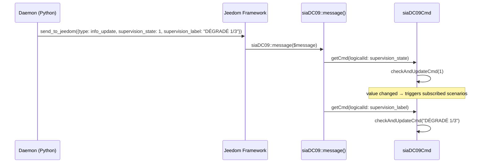
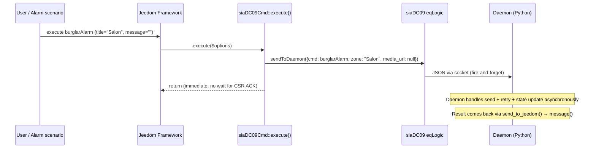
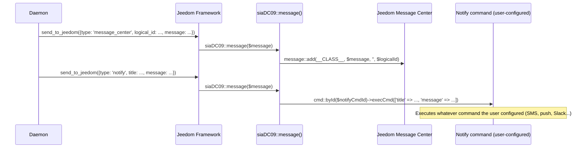

# PHP Plugin Core Design — Jeedom siaDC09 Plugin

**Version:** 0.3
**Date:** 2026-03-16
**Status:** Draft — all Component 2 decisions confirmed

---

## Plugin Identity

| Field | Value |
|---|---|
| Plugin ID | `siaDC09` |
| PHP class (eqLogic) | `siaDC09` |
| PHP class (cmd) | `siaDC09Cmd` |
| Daemon script | `resources/siadc09d/siadc09d.py` |
| Auto-equipment name | `Télésurveillance` (created on plugin activation) |
| Auto-equipment object | `null` (user places it manually in Jeedom object tree) |

---

## File Structure

```
plugin_info/
├── info.json                        ← Plugin metadata
├── install.php                      ← Mandatory install/update/remove hooks (F4)
├── packages.json                    ← Python dependencies (pip3)
└── configuration.php                ← Plugin-level settings page (socketport) (Task 2.13)

core/
├── class/
│   ├── siaDC09.class.php            ← eqLogic class
│   └── siaDC09Cmd.class.php         ← cmd class
├── ajax/
│   └── siaDC09.ajax.php             ← AJAX handlers
├── php/
│   └── jeesiaDC09.php               ← Daemon → PHP callback endpoint (F5)
└── i18n/
    ├── en_US.json                   ← English translations (Market requirement)
    └── de_DE.json                   ← German translations (optional, community)

desktop/
└── php/
    └── siaDC09.php                  ← Equipment config page (wizard, Component 3)

resources/
└── siadc09d/
    ├── siadc09d.py                  ← Daemon entry point (Component 1)
    ├── sia_protocol.py              ← Protocol module (Component 0)
    ├── sia_crypto.py                ← Crypto module (Component 0)
    ├── install_dep.sh               ← pip3 install script; writes .install_ok on success (Task 2.8)
    └── .install_ok                  ← Sentinel: created by install_dep.sh, deleted on reinstall (Task 2.8)
```

> **Note:** Jeedom plugin convention places daemon scripts in `resources/<daemon-name>/`. The `jeedomdaemon` framework is installed via `pip3` (declared in `packages.json`) — not bundled directly.

> **i18n note (F13):** French is the source language — all `__('string', __FILE__)` calls embed French strings directly in PHP. No `fr_FR.json` is needed or expected. `core/i18n/en_US.json` is required for Market submission; it uses the full plugin file path as the top-level key and string→translation pairs as values (matching the reference plugin structure). Values are empty until translated. Format: `{"plugins\/siaDC09\/core\/class\/siaDC09.class.php": {"Impossible de lancer le démon": "Unable to start daemon", ...}, ...}`.

---

## Configuration Storage

**All configuration is stored in `eqLogic->getConfiguration()`** on the single auto-created equipment.

Rationale: Only one equipment exists (plugin-centric). The wizard IS the equipment configuration page. Fragmenting between `config::byKey` (plugin-level) and `getConfiguration` (equipment-level) would complicate access patterns for no benefit.

### Configuration keys

| Key | Type | Description |
|---|---|---|
| `csr_provider` | string | `ima_protect` or `manual` |
| `csr_ip` | string | CSR IP address |
| `csr_port` | int | CSR UDP/TCP port |
| `transport` | string | `udp` or `tcp` |
| `account_number` | string | 3–16 hex chars |
| `encryption_enabled` | bool | AES encryption on/off |
| `encryption_key` | string | 32 hex chars (AES-128) |
| `receiver_prefix` | string | 0–6 hex chars receiver prefix (`R` field). Default `''` → omitted; CSR interprets as `R0`. **IMA Protect: unconfirmed — verify at integration time.** |
| `account_prefix` | string | 0–6 hex chars account prefix (`L` field). Default `''` → omitted; CSR interprets as `L0`. **IMA Protect: unconfirmed — verify at integration time.** |
| `supervision_interval` | int | seconds between NULL messages (default 60) |
| `retry_count` | int | max retries on timeout (default 3) |
| `notify_cmd_id` | int | Jeedom cmd ID of ACTION/message command for critical alerts |
| `wizard_step` | int | last completed wizard step (1–4), for resuming |
| `zoneMapping` | array | `[{zone_name, camera_action, media_url_cmd_id}]` |

### IMA Protect preset values

All CSR preset values (`csr_ip`, `csr_port`, `transport`, `encryption_enabled`, `supervision_interval`) are defined in `resources/siadc09d/csr_presets.json` — not hardcoded in PHP. The wizard reads this file at render time and pre-fills the step 1 fields. `deamon_start()` reads eqLogic config (already populated by the wizard save) — it has no knowledge of `csr_presets.json`.

See `wizard-design.md` §"CSR Presets Configuration File" for the full preset format and IMA Protect values.

---

## Confirmed Design Decisions

| Decision | Choice | Rationale |
|---|---|---|
| Plugin ID | `siaDC09` | Matches protocol name |
| Plugin name (Market) | `Télésurveillance` | Non-technical, user-friendly |
| Jeedom min version | `4.5` | User's reference installation |
| Market category | `security` | Correct category for alarm-related plugin |
| INFO command type for scenario triggers | **Numeric** | Standard Jeedom practice |
| INFO update mechanism | **`checkAndUpdateCmd()`** | Standard Jeedom — always updates `collectDate`, updates `valueDate` only on change, fires scenario events automatically |
| Config storage | **All in `getConfiguration`** on auto-equipment | Single equipment, wizard = equipment config page, no fragmentation needed |
| Zone mapping storage | `getConfiguration('zoneMapping', [])` | JSON array, consistent with all other config keys |
| `jeedom-daemon-py` distribution | **pip3 via `packages.json`** | Confirmed by examining the reference plugin in this repo — `jeedomdaemon` is in pip3 deps, not bundled |
| `pycryptodome` in packages.json | **Declared from phase 1** | Avoids migration issues when AES is enabled later |
| Daemon logging | Python `logging` module via jeedom-daemon-py | Writes directly to Jeedom log files — no 'log' message type needed in PHP `message()` |
| `testConnection` mechanism | **Option A: standalone subprocess** — daemon must be stopped; PHP `exec()` returns result synchronously | No polling, no cache; daemon lifecycle stays explicit |
| Daemon restart on save | **None** — `postSave()` only manages commands. Config changes take effect on next daemon start (watchdog or manual). | Matches z2m/zwavejs pattern. Jeedom watchdog handles crashed→restart; config changes require manual restart or wizard re-run. |
| Daemon start guard | `launchable: false` if config incomplete | Standard Jeedom pattern — shown as NOK in plugin manager |
| `preRemove` config cleanup | **Not needed** — eqLogic config deleted automatically by Jeedom | |
| Multiple equipments | Log error + return null | Should never happen in plugin-centric design |
| Auto-recreate if deleted | **Yes** + log warning | Plugin-centric: equipment must always exist |
| Zone not in mapping | **Send alarm anyway** + log warning | Never block an alarm for a config issue |
| media_url null at alarm time | **Send alarm with empty media_url** + log warning | Same principle |

---

## INFO and ACTION Commands

### Design rationale: numeric + label pairs

Jeedom scenarios can only trigger on **numeric** INFO commands (binary or value comparison). String INFO commands cannot be used as scenario triggers. However, human-readable labels are needed for widgets and logs.

Pattern: each state has a **numeric** command (scenario trigger) + a **string label** command (display only, not visible on dashboard by default).

### Full command list

| Name | Type | Sub-type | Dashboard | Scenario trigger | Updated by |
|---|---|---|---|---|---|
| `burglarAlarm` | action | message | no (toHtml panel) | — | User/alarm plugin |
| `fireAlarm` | action | message | no (toHtml panel) | — | User/alarm plugin |
| `panicAlarm` | action | message | no (toHtml panel) | — | User/alarm plugin |
| `supervision_state` | info | numeric | no (toHtml panel) | ✅ 0/1/2 | Daemon SM1 |
| `supervision_label` | info | string | no | — | Daemon SM1 |
| `event_state` | info | numeric | no | ✅ 0/1/2/3 | Daemon SM2 |
| `event_label` | info | string | no (toHtml panel) | — | Daemon SM2 |

### Numeric values

**`supervision_state`** (SM1):

Values are designed for scenario triggers (0 = problem, 1 = impaired, 2 = ok).
`supervision_label` carries the precise per-state text for display.

> **Canonical SM1 → supervision_state mapping is in `supervision-design.md`** (SM1 state → PHP INFO command mapping table). Do not duplicate here.

Summary for scenario use:
- `0` = supervision not working (DEGRADED(strike=3), TCP_RECONNECTING, NO_NETWORK, STOPPED)
- `1` = impaired but alive (DEGRADED strike 1–2, **INITIALIZING**)
- `2` = HEALTHY

**`event_state`** (SM2):

| Value | Meaning |
|---|---|
| `0` | No alarm sent since daemon start |
| `1` | Last alarm delivery confirmed (ACK from CSR) |
| `2` | Last alarm delivery failed (timeout, NAK, or NO_NETWORK) |
| `3` | Alarm transmission in progress (PENDING) |

> `event_state` and `event_label` are **not reset on daemon start or stop** — they
> retain the value from the previous daemon run. The combination with `supervision_state`
> conveys the full picture: e.g. `supervision_state=0` + `event_state=3` clearly indicates
> the daemon was stopped while an alarm was in flight.
> Value `3` (in progress) is transient during normal operation and typically lasts only a
> few seconds. Scenario triggers should watch for `1` (confirmed) or `2` (failed), not `3`.

### Scenario use examples

```
IF supervision_state == 0 THEN send_sms("CSR unreachable")
IF event_state == 2 THEN send_push("Alarm delivery FAILED")
```

---

## Sequence: Daemon → PHP INFO command update



`checkAndUpdateCmd()` is the standard Jeedom mechanism: it compares old vs new value, persists only on change, and fires events that launch subscribed scenarios automatically.

---

## Sequence: ACTION command → Daemon



**Fire-and-forget** is the correct behavior: PHP cannot block waiting for a SIA protocol exchange. The result (ACK/FAIL) arrives seconds later via the reverse channel (`message()`), updating `event_state` and `event_label`, which then triggers any subscribed scenarios.

---

## Sequence: Critical notification (daemon → PHP → user command)

See `error-handler-design.md` for the full `_notify()` dispatch and `message_center` / `notify` / `error_update` callback implementations. Below is the simplified flow:



---

## Task breakdown — Component 2

### Task 2.1 — `plugin_info/info.json`

**What:** Plugin metadata consumed by Jeedom to register the plugin in the marketplace and UI.

**Key fields:**
```json
{
  "id": "siaDC09",
  "name": "Télésurveillance SIA DC-09",
  "description": {"fr_FR": "Transmission d'alarmes vers centrale de télésurveillance via protocole SIA DC-09"},
  "licence": "AGPL",
  "author": "...",
  "require": "4.5",
  "category": "security",
  "hasDependency": true,
  "hasOwnDeamon": true,
  "maxDependancyInstallTime": 10
}
```

**Challenge Q:** `category: "security"` — est-ce le bon choix pour le Market Jeedom ? Il y a aussi `"automation"`, `"communication"`. Cela affecte le référencement sur le Market.

---

### Task 2.2 — `plugin_info/packages.json`

**What:** Declares Python package dependencies. Jeedom installs these via pip when the user clicks "Install dependencies".

**Content:**
```json
{
  "apt": {},
  "pip3": {
    "jeedomdaemon": {},
    "pycryptodome": {}
  }
}
```

**Notes:**
- All pip3 entries use `{}` (object) — consistent type, matches the reference plugin pattern.
- No version constraints in `install_dep.sh` — pycryptodome's AES-CBC has been stable since v2.x; no minimum version is required. `packages.json` does not currently support version pinning reliably.
- `jeedomdaemon` installed via pip3 — confirmed by examining the reference plugin in this repo. Not bundled or git-submoduled.
- `pycryptodome` needed for AES phase 2 (crypto stub in phase 1 has no deps). Declared from day 1 to avoid a migration install step later.
- ✅ **Decision confirmed**: pip3 for both dependencies, all-object format.

---

### Task 2.3 — `siaDC09Cmd.class.php`

**What:** The cmd class handles individual command execution. For ACTION commands, `execute()` is the entry point called by Jeedom when a user or scenario triggers the command.

**Key method: `execute($options)`**

```php
public function execute($options = []) {
    $eqLogic = $this->getEqLogic();
    $cmd = $this->getLogicalId();  // burglarAlarm | fireAlarm | panicAlarm

    // Extract zone name from title (set by alarm plugin in $options['title'])
    $zone = $options['title'] ?? '';

    // Resolve zone mapping entry for this zone
    $zoneMapping = $eqLogic->getConfiguration('zoneMapping', []);
    $zoneEntry   = $this->_findZoneEntry($zone, $zoneMapping);

    // Execute camera action if configured (e.g. snapshot or recording start).
    // Executed unconditionally — the Jeedom Camera plugin has no "already recording"
    // status; we always fire the action and let the camera handle duplicate starts.
    // v1.5 note: Frigate integration (MQTT frigate/events + has_clip) will allow
    // skipping this step when a Frigate clip recording is already in progress.
    if (!empty($zoneEntry['camera_action_cmd_id'])) {
        $camCmd = cmd::byId((int) $zoneEntry['camera_action_cmd_id']);
        if ($camCmd) {
            try {
                $camCmd->execCmd();
            } catch (Exception $e) {
                log::add(__CLASS__, 'warning',
                    'Camera action failed for zone ' . $zone . ': ' . $e->getMessage()
                );
                // Camera failure must never block alarm transmission
            }
        }
    }

    // Resolve media URL (reads INFO command value from camera plugin)
    $mediaUrl = $this->_resolveMediaUrl($zone, $zoneEntry);

    // Early validation: SIA DC-09 [V...] field forbids '[', ']', '|' in the URL.
    // PHP cannot fix the URL — log a warning so the operator knows before the daemon strips it.
    if ($mediaUrl !== null && preg_match('/[\[\]\|]/', $mediaUrl)) {
        log::add(__CLASS__, 'warning',
            'media_url for zone ' . $zone . ' contains forbidden SIA DC-09 characters — daemon will strip it'
        );
        // Do NOT nullify the URL here: the daemon strips forbidden chars and logs a WARNING
        // (never EVENT_FAILED — an alarm must never be blocked by a media URL issue).
        // The PHP warning above is the only early-detection signal available at execute time.
    }

    // Fire-and-forget to daemon
    $eqLogic->sendToDaemon([
        'cmd'       => $cmd,
        'zone'      => $zone,
        'media_url' => $mediaUrl,
    ]);
}
```

**Why fire-and-forget:** PHP cannot block on a network exchange. The daemon handles the async protocol dialog and reports back via `message()`.

**Camera action execution order:** `camera_action_cmd_id` (start snapshot/recording) is executed **before** `_resolveMediaUrl()` so the camera has time to begin recording before we read the URL. The camera plugin does not expose a "recording in progress" status — the action is always fired unconditionally. A camera exception is logged as a warning but never blocks alarm transmission.

**Frigate integration (v1.5):** Frigate NVR exposes recording status via MQTT (`frigate/<camera>/recording` ON/OFF) and REST (`GET /api/events?camera=<name>&in_progress=1`). When Frigate integration is added in v1.5, `execute()` will be able to skip the `camera_action_cmd_id` step when a Frigate event recording is already in progress for the triggered zone's camera, avoiding duplicate recording start commands.

### How the alarm plugin passes zone name

The Jeedom alarm plugin provides these tags in action command execution:
- `#zone#` — name of the triggered zone
- `#alarm_trigger#` — trigger description
- `#mode#` — current alarm mode

**User configuration required:** In the alarm plugin's zone action settings, the user must manually configure the ACTION command with `title` = `#zone#` (or any text containing `#zone#`). This is NOT automatic — the user must set this up once during configuration.

The PHP `execute()` extracts `$options['title']` which receives the resolved tag value (e.g. `"Salon"` when `#zone#` was configured).

**Zone name matching — case-insensitive, trimmed:** `_findZoneEntry()` normalises both
sides with `mb_strtolower(trim(...))` before comparing. This handles capitalisation
differences and accidental whitespace between the alarm plugin runtime value and the
wizard-stored mapping key:

```php
private function _findZoneEntry(string $zone, array $zoneMapping): ?array {
    $needle = mb_strtolower(trim($zone));
    foreach ($zoneMapping as $entry) {
        if (mb_strtolower(trim($entry['zone_name'] ?? '')) === $needle) {
            return $entry;
        }
    }
    return null;
}
```

**No zone in mapping → send alarm anyway:** If `$zone` is not found in `zoneMapping`,
`_findZoneEntry()` returns `null`. Both `camera_action_cmd_id` and `media_url_cmd_id`
checks are skipped (empty entry), and the alarm is sent with an empty `media_url`.
An alarm must never be blocked by a configuration issue.

### Future feature (v1.x): Auto-configure alarm zone actions

When the user configures the zone mapping table (zone name → camera action), the plugin could offer a button **"Configurer automatiquement le plugin alarme"** that:
1. Reads the configured zone names from `zoneMapping`
2. Finds matching zones in the Jeedom alarm plugin config
3. Sets up the action commands on each zone with `title = #zone#` pre-filled

This removes the manual setup step for the user. **Deferred to a future release.**

---

### Task 2.3a — `siaDC09Cmd::_resolveMediaUrl()`

**What:** Reads the last known camera snapshot URL from the Jeedom command identified by `media_url_cmd_id` in the zone mapping entry.

**API choice:** `cmd::getValue()` — returns the last value stored by the camera plugin via `checkAndUpdateCmd()`. No network call, no side effects. `execCmd()` must **not** be used here: on INFO commands it may trigger a live device refresh (latency, potential failure, unwanted side effect inside `execute()`).

```php
private function _resolveMediaUrl(string $zone, ?array $zoneEntry): ?string {
    if (empty($zoneEntry['media_url_cmd_id'])) {
        return null;
    }
    $urlCmd = cmd::byId((int) $zoneEntry['media_url_cmd_id']);
    if (!$urlCmd) {
        log::add(__CLASS__, 'warning',
            'media_url_cmd_id configured for zone ' . $zone . ' but command not found — ignored'
        );
        return null;
    }
    // getValue() returns the last value stored by the camera plugin via checkAndUpdateCmd().
    // No network call, no side effects — safe to call inside execute().
    $url = $urlCmd->getValue();
    return (!empty($url)) ? (string) $url : null;
}
```

**Failure policy:** returns `null` on any failure (cmd not found, empty value). `null` causes `encode_message()` to omit the `[V...]` field entirely. Alarm transmission is never blocked by a URL read failure.

---

### Task 2.4 — `siaDC09::postSave()`

**What:** Called by Jeedom after any save on the equipment. Responsible for:
1. Auto-creating missing commands (idempotent — safe to call multiple times)

**Why idempotent command creation:** The user might save the equipment multiple times. Each save should check and create only missing commands, not duplicate existing ones.

**No daemon restart logic.** Config changes take effect on the next daemon start. If the daemon is running when config changes, the user restarts it manually from the Jeedom plugin manager (or via the wizard). This matches the z2m and zwavejs pattern — Jeedom's watchdog handles crash recovery; config-change restart is a user action.

**Commands auto-created (if not present):**

```php
private function _ensureCommands() {
    $commandsSpec = [
        // ACTION commands — isVisible=0: rendered via toHtml() panel only, not as raw tile buttons
        ['logicalId' => 'burglarAlarm', 'type' => 'action', 'subType' => 'message',
         'name' => 'Alarme intrusion', 'isVisible' => 0, 'order' => 1],
        ['logicalId' => 'fireAlarm',    'type' => 'action', 'subType' => 'message',
         'name' => 'Alarme incendie',  'isVisible' => 0, 'order' => 2],
        ['logicalId' => 'panicAlarm',   'type' => 'action', 'subType' => 'message',
         'name' => 'Alarme panique',   'isVisible' => 0, 'order' => 3],
        // INFO numeric (scenario triggers) — isVisible=0: toHtml() renders state display
        ['logicalId' => 'supervision_state',    'type' => 'info', 'subType' => 'numeric',
         'name' => 'État supervision', 'isVisible' => 0, 'order' => 4],
        // returnStateTime=30, returnStateValue=0: Jeedom auto-reverts to 0 after 30 min of no update.
        // Handles stuck event_state=3 (PENDING) if daemon crashes mid-alarm — without this,
        // the "in progress" state would remain visible indefinitely. 0 = no alarm since startup.
        ['logicalId' => 'event_state', 'type' => 'info', 'subType' => 'numeric',
         'name' => 'Transmission alarme', 'isVisible' => 0, 'order' => 5,
         'returnStateTime' => 30, 'returnStateValue' => 0],
        // INFO string (display) — isVisible=0
        ['logicalId' => 'supervision_label',    'type' => 'info', 'subType' => 'string',
         'name' => 'Supervision détail', 'isVisible' => 0, 'order' => 6],
        ['logicalId' => 'event_label',    'type' => 'info', 'subType' => 'string',
         'name' => 'Dernier événement', 'isVisible' => 0, 'order' => 7],
    ];
    foreach ($commandsSpec as $spec) {
        if (!$this->getCmd(null, $spec['logicalId'])) {
            // create cmd with spec
        }
    }
}
```

```php
public function postSave() {
    $this->_ensureCommands();
}
```

✅ **Decision:** No restart-on-save. `postSave()` only manages commands. Config changes take effect on the next daemon start (manual restart via plugin manager, or wizard re-run). This is consistent with z2m and zwavejs and avoids any risk of interrupting an in-progress SM2 alarm event.

---

### Task 2.5 — `siaDC09::preRemove()`

**What:** Called before the equipment is deleted. Must stop the daemon cleanly to avoid orphan processes.

**Why:** If the daemon is not stopped before removal, it continues running, holds the socket open, and cannot be restarted cleanly after reinstall.

```php
public function preRemove() {
    // deamon_running() does not exist in Jeedom — use deamon_info()['state']
    if (siaDC09::deamon_info()['state'] == 'ok') {
        siaDC09::deamon_stop();  // includes its own graceful shutdown polling
    }
}
```

✅ **Decision:** Do NOT clear `getConfiguration` on `preRemove`. Jeedom deletes the eqLogic row (and its config) automatically. No explicit cleanup needed — and preserving config would anyway ease reinstalls.

---

### Task 2.6 — `siaDC09::message($message)`

**What:** Static callback called by the Jeedom framework when the daemon sends data via `send_to_jeedom()`. Routes incoming messages to the appropriate handler.

**Message types from daemon:**

```php
public static function message($message) {
    // Use _getAutoEquipmentSafe() — NOT _getAutoEquipment() — to avoid triggering
    // equipment + command creation (DB writes, postSave()) inside a framework callback.
    // message() is a read-dispatch operation; side effects here are unexpected and
    // can cause re-entrancy issues. If the equipment is missing (user deleted it),
    // log a warning and discard the message — auto-creation belongs in deamon_start().
    $eqLogic = self::_getAutoEquipmentSafe();
    if (!$eqLogic) {
        log::add(__CLASS__, 'warning',
            __('Message daemon reçu mais équipement absent — ignoré jusqu\'à réactivation du plugin.', __FILE__)
        );
        return;
    }

    switch ($message['type']) {
        case 'info_update':
            self::_handleInfoUpdate($eqLogic, $message);
            break;
        // --- Component 5a callback types ---
        // Implement per error-handler-design.md §"PHP callback — new payload types"
        case 'message_center':
            // T1/T2/T3 → message::add(__CLASS__, $message['message'], '', $message['logical_id'])
            // Full implementation: error-handler-design.md §`message_center`
            break;
        case 'notify':
            // T2/T3 → execCmd on notify_cmd_id with ['title'=>..., 'message'=>...]
            // Full implementation: error-handler-design.md §`notify`
            break;
        case 'error_update':
            // Structured error → prepend to last_errors (max 10, newest first)
            // Full implementation: error-handler-design.md §`error_update`
            break;
        // --- Component 5b callback type ---
        // Implement per logging-design.md §"PHP callback: message_trace"
        case 'message_trace':
            // Protocol dialog → prepend to last_messages (max 50, newest first)
            // Full implementation: logging-design.md §`message_trace`
            break;
        // Note: 'test_result' type removed — testConnection uses Option A
        // (standalone subprocess) and never sends a message() callback.
        default:
            log::add(__CLASS__, 'warning',
                'Message daemon de type inconnu ignoré : ' . ($message['type'] ?? '<null>')
            );
            break;
    }
}
```

**`_handleInfoUpdate()`** — updates INFO commands via `checkAndUpdateCmd()`:

```php
private static function _handleInfoUpdate($eqLogic, $data) {
    $map = [
        'supervision_state'    => 'supervision_state',
        'supervision_label'    => 'supervision_label',
        'event_state' => 'event_state',
        'event_label'    => 'event_label',
    ];
    foreach ($map as $key => $logicalId) {
        if (isset($data[$key])) {
            $cmd = $eqLogic->getCmd(null, $logicalId);  // null type = type-agnostic (Jeedom best practice)
            if ($cmd) {
                $cmd->checkAndUpdateCmd($data[$key]);
                // checkAndUpdateCmd: persists if changed, fires scenario events
            }
        }
    }
}
```

**Why `checkAndUpdateCmd()` and not a direct setValue:** `checkAndUpdateCmd()` is the correct Jeedom API. It:
1. Checks if value actually changed (avoids unnecessary DB writes)
2. Fires the event bus so subscribed scenarios are triggered
3. Updates `collectDate` timestamp
4. Handles history recording if enabled

✅ **Decision:** Always call `checkAndUpdateCmd()`. The method internally updates `collectDate` on every call (regardless of value change) and only updates `valueDate` + fires scenarios when the value changes. This is the correct behavior: the widget shows "last seen at HH:MM" via `collectDate`, and scenarios trigger only on real state changes.

---

### Task 2.7 — `siaDC09::deamon_info()` / `deamon_start()` / `deamon_stop()`

**What:** Standard Jeedom daemon management interface. These static methods are called by the Jeedom core to manage the daemon lifecycle from the plugin management page.

> ⚠️ **`deamon_info()` is superseded by supervision-design.md Task C.2.** The enhanced
> version in Component 4 adds per-key config validation with precise launchable messages
> (returns `'launchable' => 'ok'|'nok'` string, not a boolean). Do not implement the
> minimal version below — implement Task C.2 directly. It is kept here for context only.

**`deamon_info()` — minimal skeleton (reference only, see Task C.2 for the real impl):**
```php
// DO NOT IMPLEMENT — use supervision-design.md Task C.2 instead
public static function deamon_info() {
    return [
        'launchable'  => 'ok',  // C.2 validates each config key with precise messages
        'state'       => self::_isDaemonRunning() ? 'ok' : 'nok',
        'log'         => log::getPathToLog('siaDC09_daemon'),
        'auto'        => config::byKey('autoStartDeamon', 'siaDC09', 1),
    ];
}
```

**`deamon_start()`** builds the config payload and launches the daemon via `system::php()`.
All CSR parameters are always read from eqLogic config — no branching on `csr_provider`.
eqLogic is the single source of truth: preset values are saved there by the wizard at
step 1 (via `data-l2key` + `readonly` fields), so `deamon_start()` has no knowledge of
whether the user chose a preset or manual entry.

```php
public static function deamon_start() {
    self::deamon_stop(); // Kill any stale/zombie instance before launching a new one

    $eqLogic = self::_getAutoEquipment();

    // encryption_key is intentionally excluded from $config — it is passed via
    // environment variable (SIA_ENCRYPTION_KEY) to prevent exposure in ps aux /
    // process listings and in the Jeedom log file where $cmd is logged.
    $config = [
        'socketport'         => config::byKey('socketport', 'siaDC09', 55001),
        'loglevel'           => log::convertLogLevel(log::getLogLevel('siaDC09')),
        'csr_ip'             => $eqLogic->getConfiguration('csr_ip'),
        'csr_port'           => $eqLogic->getConfiguration('csr_port'),
        'transport'          => $eqLogic->getConfiguration('transport'),
        'supervision_interval'=> $eqLogic->getConfiguration('supervision_interval', 60),
        'retry_count'        => $eqLogic->getConfiguration('retry_count', 3),
        'account_number'     => $eqLogic->getConfiguration('account_number'),
        'encryption_enabled' => $eqLogic->getConfiguration('encryption_enabled') ? '1' : '0',
        'receiver_prefix'    => $eqLogic->getConfiguration('receiver_prefix', ''),
        'account_prefix'     => $eqLogic->getConfiguration('account_prefix', ''),
        // notify_cmd_id intentionally omitted — used by PHP only (message() reads it from
        // getConfiguration()), never by the daemon. No need to pass it via CLI.
    ];

    // system::getCmdPython3() returns the venv-aware python binary on Debian 12.
    // Falls back to 'python3 ' if the method doesn't exist (older Jeedom versions).
    $python3 = method_exists('system', 'getCmdPython3')
        ? system::getCmdPython3(__CLASS__)
        : 'python3 ';

    $path = realpath(dirname(__FILE__) . '/../../resources/siadc09d');
    $cmd  = $python3 . $path . '/siadc09d.py';

    foreach ($config as $k => $v) {
        $cmd .= ' --' . $k . ' ' . escapeshellarg($v);
    }

    $cmd .= ' --callback ' . network::getNetworkAccess('internal', 'http:127.0.0.1:port:comp')
          . '/plugins/siaDC09/core/php/jeesiaDC09.php';
    $cmd .= ' --apikey ' . jeedom::getApiKey(__CLASS__);
    $cmd .= ' --pid ' . jeedom::getTmpFolder(__CLASS__) . '/deamon.pid';

    log::add(__CLASS__, 'info', __('Lancement démon', __FILE__));
    // NOTE: $cmd is safe to log — it contains only CLI args, not the encryption key.
    // Do NOT log $envPrefix or the full ($envPrefix . $cmd) string — that would expose
    // the AES key in plaintext in the Jeedom log file.

    // Reset PHP execution timer before the blocking section.
    // deamon_start() is called from the web UI (plugin manager "Démarrer" button →
    // AJAX → PHP). In that context PHP's max_execution_time applies (typically 30s).
    // The exec() call itself returns immediately (daemon runs in background via &),
    // but the polling loop below sleeps up to 10 × 1s = 10s. Resetting the timer
    // here guarantees we stay well within the 30s window regardless of how much
    // PHP time was already consumed before this method was called.
    // Same rationale as the set_time_limit(30) guard in testConnection (Task 2.10).

    // Build env prefix as late as possible — immediately before exec(), never stored longer.
    // The daemon reads it via os.environ.get('SIA_ENCRYPTION_KEY', '').
    // SECURITY: never pass ($envPrefix . $cmd) to log::add() or any logging function.
    $encKey    = $eqLogic->getConfiguration('encryption_key', '');
    $envPrefix = 'SIA_ENCRYPTION_KEY=' . escapeshellarg($encKey) . ' ';
    set_time_limit(30);
    $result = exec($envPrefix . $cmd . ' >> ' . log::getPathToLog(__CLASS__ . '_daemon') . ' 2>&1 &');
    unset($encKey, $envPrefix); // Scrub from scope immediately after use

    // Poll up to 10s for daemon to confirm startup
    $i = 0;
    while ($i < 10) {
        $deamon_info = self::deamon_info();
        if ($deamon_info['state'] == 'ok') { break; }
        sleep(1);
        $i++;
    }
    if ($i >= 10) {
        log::add(__CLASS__, 'error', __('Impossible de lancer le démon', __FILE__), 'unableStartDeamon');
        return false;
    }
    message::removeAll(__CLASS__, 'unableStartDeamon');
    return true;
}
```

**`deamon_stop()`** — targeted PID kill → poll → force kill:
```php
public static function deamon_stop() {
    log::add(__CLASS__, 'info', __('Arrêt du démon', __FILE__));
    // Targeted kill via PID file (safer than pkill -f on multi-instance systems).
    // Falls back to script-name kill if PID file is absent or stale.
    $pidFile = jeedom::getTmpFolder(__CLASS__) . '/deamon.pid';
    if (file_exists($pidFile) && ($pid = (int)trim(file_get_contents($pidFile))) > 0) {
        system::kill($pid);          // targeted SIGTERM — only this instance
    } else {
        system::kill('siadc09d.py'); // fallback: PID file missing or unreadable
    }
    // Poll up to 5s for graceful shutdown (BaseDaemon on_stop() runs and exits cleanly)
    $i = 0;
    while ($i < 5) {
        if (self::deamon_info()['state'] == 'nok') { break; }
        sleep(1);
        $i++;
    }
    // Force kill if still running after 5s
    if ($i >= 5) {
        if (file_exists($pidFile) && ($pid = (int)trim(file_get_contents($pidFile))) > 0) {
            system::kill($pid, true);
        } else {
            system::kill('siadc09d.py', true);
        }
    }
    sleep(1);
}
```

✅ **Decision:** Fixed default port (55001), configurable in plugin advanced settings (not in the wizard — too technical for end users). Standard Jeedom pattern: advanced/technical config stays out of the user-facing wizard.
✅ **Decision (`deamon_stop()`):** Targeted PID-file kill (safer than script-name `pkill -f` on multi-instance systems), with script-name fallback when PID file is absent. Polling pattern from z2m/zwavejs — graceful SIGTERM, poll 5s, force kill if needed. The `sleep(1)` at the end ensures the PID file is removed before `deamon_start()` checks for it (BaseDaemon removes the PID file in its shutdown handler).

---

### Task 2.8 — `siaDC09::dependancy_info()` / `dependancy_install()`

**What:** Lets Jeedom check and install Python dependencies. Shown in plugin management page with a progress bar during install.

#### Why not `exec('python3 -c "import ..."')`

The Jeedom watchdog calls `deamon_info()` every minute, which calls `dependancy_info()`. Spawning a Python subprocess on every tick would mean **1440+ subprocess forks per day** — measurable overhead on a Raspberry Pi or NAS. More importantly, this is not how established Jeedom plugins work.

Research on plugin-zwavejs (the reference for daemon-based Python plugins) shows the correct pattern: **two cheap O(1) checks** — no subprocess, no cache needed.

#### Design: sentinel file (zwavejs pattern)

Two conditions must both be true for state `'ok'`:
1. `lastDependancyInstallTime` is non-empty — set by the Jeedom core's `dependancy_install()` wrapper when it first runs the install script. Empty means install was never attempted.
2. The sentinel file `resources/siadc09d/.install_ok` exists — written by the install shell script on successful completion. Deleted by `dependancy_install()` before each reinstall.

No subprocess. No cache. The sentinel file is the ground truth: it exists if and only if `pip3 install` completed successfully on this machine.

```
resources/
└── siadc09d/
    ├── siadc09d.py
    ├── install_dep.sh       ← installs pip3 packages, writes .install_ok on success
    └── .install_ok          ← sentinel: created by install_dep.sh, deleted on reinstall
```

**`dependancy_info()`:**
```php
public static function dependancy_info() {
    $return = [
        'state'         => 'nok',
        'progress_file' => jeedom::getTmpFolder(__CLASS__) . '/dependance',
    ];
    if (config::byKey('lastDependancyInstallTime', __CLASS__) != ''
        && file_exists(__DIR__ . '/../../resources/siadc09d/.install_ok')) {
        $return['state'] = 'ok';
    }
    return $return;
}
```

**`dependancy_install()`:**
```php
public static function dependancy_install() {
    // Remove sentinel — forces state 'nok' until install completes
    @unlink(__DIR__ . '/../../resources/siadc09d/.install_ok');

    $progressFile = jeedom::getTmpFolder(__CLASS__) . '/dependance';
    $logFile      = log::getPathToLog(__CLASS__ . '_update');
    $script       = realpath(__DIR__ . '/../../resources/siadc09d/install_dep.sh');

    $cmd = 'sudo bash ' . escapeshellarg($script)
         . ' ' . escapeshellarg($progressFile)
         . ' >> ' . escapeshellarg($logFile) . ' 2>&1 &';

    exec($cmd);
}
```

**`install_dep.sh`** (shell script — skeleton):
```bash
#!/bin/bash
PROGRESS_FILE="$1"
echo 10 > "$PROGRESS_FILE"
pip3 install pycryptodome jeedomdaemon
echo 90 > "$PROGRESS_FILE"
# Write sentinel only on success
if pip3 show pycryptodome > /dev/null 2>&1 && pip3 show jeedomdaemon > /dev/null 2>&1; then
    touch "$(dirname "$0")/.install_ok"
fi
echo 100 > "$PROGRESS_FILE"
```

> **Note (F3 — deferred):** On Debian 12 with Jeedom's venv, `pip3` in the script must use
> the venv-aware path (`system::getCmdPython3()` equivalent in shell). For v1.0 on the
> user's installation, bare `pip3` is acceptable — venv path to be confirmed at implementation.

#### How the Jeedom core wraps this

The Jeedom core's `plugin.dependancy_info()` wrapper (plugin.class.php):
- Calls `siaDC09::dependancy_info()` (our override)
- Watches `progress_file` to set `state = 'in_progress'` while the script runs
- Sets `lastDependancyInstallTime` when it first sees `in_progress`
- **Caches `state = 'ok'`** via `cache::set('dependancy' . pluginId)` — so our method is
  only called on cache miss (first call, or after `$_refresh = true` from `dependancy_install()`)

The core's caching + our sentinel file = zero subprocess cost at steady state.

✅ **Decision:** Sentinel file approach (zwavejs pattern). No subprocess, no custom cache. `dependancy_install()` deletes the sentinel before running, ensuring `'nok'` is shown during reinstall. `install_dep.sh` writes the sentinel only on verified success. The Jeedom core's `cache::set()` handles repeat `dependancy_info()` calls efficiently.

✅ **Decision:** Declare `pycryptodome` as required from phase 1. The plugin will not start without it. This avoids a silent production gap where phase 2 AES is enabled but the dependency was never installed. The install cost is negligible.

---

### Task 2.9 — `siaDC09::_getAutoEquipment()`

**What:** Private helper that returns the single auto-created equipment. Used throughout the class to avoid repeating the lookup.

```php
private static function _getAutoEquipment() {
    $eqLogics = self::byType('siaDC09');
    if (empty($eqLogics)) {
        // Auto-create on first access
        $eq = new siaDC09();
        $eq->setName('Télésurveillance');
        $eq->setIsEnable(1);
        $eq->setIsVisible(1);
        $eq->setObject_id(null);
        $eq->save(); // triggers postSave() which creates commands
        return $eq;
    }
    return $eqLogics[0];
}
```

**Why auto-create here and not only in postSave:** The first call to `message()` or `deamon_start()` may happen before the user has explicitly saved the equipment. Auto-creation on first access ensures the equipment always exists when the daemon tries to report back.

✅ **Decision:** Auto-recreate on access + log a warning. Plugin-centric design requires the equipment to always exist. If a user deletes it, it means they may be trying to reset — recreating silently (with warning in log) is the least surprising behavior.

---

### Task 2.10 — `siaDC09.ajax.php` (skeleton)

**What:** AJAX endpoint for the wizard and debug UI. All calls from the browser pass through here.

**Mandatory authentication preamble — must appear at the top of the file:**

```php
<?php
try {
    require_once dirname(__FILE__) . '/../../../../core/php/core.inc.php';
    include_file('core', 'authentification', 'php');
    if (!isConnect('admin')) {
        throw new Exception('{{401 - Accès non autorisé}}');
    }
    ajax::init(); // validates CSRF token + session

    // --- action dispatch ---
    if (init('action') == 'testConnection') { ... }
    if (init('action') == 'getZones') { ... }
    if (init('action') == 'getCameraCommands') { ... }
    // ... other actions ...

    throw new Exception('{{Action not found : }}' . init('action'));
} catch (Exception $e) {
    ajax::error(displayException($e), $e->getCode());
}
```

`ajax::init()` is a **file-level guard**, not per-action. It verifies the user session and
CSRF token in one call. Without it, all endpoints in the file are reachable without
authentication — including `testConnection` (which spawns a subprocess and opens a socket
to the CSR) and the debug panel "Vider" handlers (which wipe `last_errors`/`last_messages`).
The reference plugin (`core/ajax/jeeaiodemo.ajax.php`) uses this exact structure.

**Endpoints needed (detail in Component 3 and 5c):**

| Action | Called by | Request params | Response |
|---|---|---|---|
| `testConnection` | Wizard step 2 | — | `{status: 'ack'|'nak'|'timeout'|'error', message: str}` |
| `getZones` | Wizard step 3 | — | `[{name: str}, ...]` |
| `getCameraCommands` | Wizard step 3 | — | `[{id: int, name: str, type: 'CAMERA_TAKE'|'CAMERA_URL'}, ...]` |
| `getDiagnosticData` | Diagnostic tab "Actualiser" | — | `{errors: [...], messages: [...], supervision_state: int, supervision_label: str, event_state: int, event_label: str}` — one call refreshes all three panels |
| `clearDiagnosticData` | Diagnostic tab "Vider" | `target=errors\|messages` | `{success: true}` — clears the corresponding plugin-level config key via `config::save('last_errors'\|'last_messages', '[]', __CLASS__)` |
| `decodeFrame` | Protocol inspector (5c) expand row | `raw_hex=<hex>`, `key_hex=<hex>\|''` | JSON-encoded `ParsedMessage` dict on success; `{error: str}` on failure — see subprocess contract below |

✅ **Decision: Option A — standalone subprocess, no running daemon required.**

The production daemon must be stopped before the test runs (enforced by the wizard).
PHP spawns `python3 siadc09d.py --test-only --timeout 15 --config '<json>'` synchronously
via `exec()`. The subprocess sends one NULL frame, writes a JSON result to stdout, and exits.
PHP reads stdout and returns the result directly in a single AJAX response. No cache, no polling.

> **PHP execution time guard (F12):** `exec()` blocks the PHP process for up to 15 seconds.
> PHP's default `max_execution_time` (30s on most Jeedom installs) can kill the request
> before the subprocess exits, leaving an orphaned Python process. Call `set_time_limit(30)`
> immediately before the `exec()` call in the `testConnection` handler to reset the timer
> for this request. The subprocess has `--timeout 15` so it always exits within ~16s —
> well within the 30s limit.

Full implementation detail: see `wizard-design.md` Tasks 3.6 and 3.10.

**`decodeFrame` subprocess contract:**

`sia_protocol.py` exposes `decode()` via a `if __name__ == '__main__'` CLI block — no separate wrapper script.

```
python3 resources/siadc09d/sia_protocol.py --decode <raw_hex> [--key <key_hex>]
```

| Argument | Description |
|---|---|
| `--decode <raw_hex>` | Complete frame as hex ASCII string (e.g. `0a30303132...0d`) |
| `--key <key_hex>` | Optional AES key as hex string. Omitted if encryption disabled or key unavailable. |

**Stdout on success:** JSON-encoded `ParsedMessage` dict (fields match the `ParsedMessage` dataclass in `daemon-design.md` Task 0.5).
**Stdout on failure:** `{"error": "<message>"}`.
**Timeout:** 5 seconds — enforced by the PHP AJAX handler via `set_time_limit(10)` before `exec()`.
**Key source:** the PHP handler reads `encryption_key` from eqLogic config and passes it only if `encryption_enabled=true`.

---

### Task 2.11 — `plugin_info/install.php`

**What:** Mandatory Jeedom file declaring install/update/remove hooks. Without it the plugin cannot be installed or removed from the plugin manager.

```php
require_once dirname(__FILE__) . '/../../../core/php/core.inc.php';

function siaDC09_install() {
    // Auto-equipment is created lazily via _getAutoEquipment() on first use.
    // Nothing to do here.
}

function siaDC09_update() {
    // Future: migrate config keys if needed between versions.
}

function siaDC09_remove() {
    // Jeedom removes eqLogic rows automatically on plugin removal.
    // preRemove() on the eqLogic stops the daemon before row deletion.
}
```

Based on the reference plugin template (`plugin_info/install.php`) — all three functions are present but empty for v1.0.

---

### Task 2.12 — `core/php/jeesiaDC09.php` (daemon → PHP callback)

**What:** HTTP endpoint called by the daemon via `send_to_jeedom()`. Verifies the API key, handles the test ping, then dispatches the JSON payload to `siaDC09::message()`.

Based directly on the reference plugin (`core/php/jeeaiodemo.php` in this repo — siaDC09 will have `core/php/jeesiaDC09.php`):

```php
<?php
try {
    require_once dirname(__FILE__) . "/../../../../core/php/core.inc.php";

    if (!jeedom::apiAccess(init('apikey'), 'siaDC09')) {
        echo __('Vous n\'êtes pas autorisé à effectuer cette action', __FILE__);
        die();
    }

    if (init('test') != '') {
        echo 'OK';
        log::add('siaDC09', 'debug', 'test from daemon');
        die();
    }

    $result = json_decode(file_get_contents("php://input"), true);
    if (!is_array($result)) {
        die();
    }

    siaDC09::message($result);

    echo 'OK';
} catch (Exception $e) {
    log::add('siaDC09', 'error', displayException($e));
}
```

The `--callback` argument in `deamon_start()` points to this file:
```php
$cmd .= ' --callback ' . network::getNetworkAccess('internal', 'http:127.0.0.1:port:comp')
      . '/plugins/siaDC09/core/php/jeesiaDC09.php';
```

---

### Task 2.13 — `plugin_info/configuration.php` (plugin settings page)

**What:** Plugin-level configuration page, auto-discovered by Jeedom from `plugin_info/configuration.php`. Jeedom adds a "Configuration" button to the plugin manager row when this file exists. Renders inside the plugin manager modal — not the equipment config page.

**Scope for v1.0:** One field only — `socketport`. This is a plugin-level key (`config::byKey('socketport', 'siaDC09', 55001)`) used by `deamon_start()`. It must be accessible for users who have port 55001 already in use on their machine. All other config (CSR params, zone mapping) belongs in the equipment wizard.

**Pattern** (based directly on zwavejs `plugin_info/configuration.php`):
- `class="configKey form-control" data-l1key="..."` — auto-bound; Jeedom's plugin config page saves all `configKey` inputs to `config::byKey(l1key, pluginId)` on "Sauvegarder"
- No custom save handler needed
- Auth guard required

```php
<?php
require_once dirname(__FILE__) . '/../../../core/php/core.inc.php';
include_file('core', 'authentification', 'php');
if (!isConnect('admin')) {
    throw new Exception('{{401 - Accès non autorisé}}');
}
?>
<form class="form-horizontal">
    <fieldset>
        <div class="col-lg-6">
            <div class="form-group">
                <label class="col-md-4 control-label">
                    {{Port socket démon}}
                    <sup><i class="fas fa-question-circle tooltips"
                            title="{{Port local utilisé par le démon pour recevoir les commandes de Jeedom. Modifier uniquement en cas de conflit avec un autre service. Redémarrer le démon après modification.}}">
                    </i></sup>
                </label>
                <div class="col-md-2">
                    <input type="number" class="configKey form-control"
                           data-l1key="socketport" placeholder="55001" />
                </div>
            </div>
        </div>
    </fieldset>
</form>
```

**After changing the port:** the user must manually restart the daemon from the plugin manager. `postSave()` is not called from the plugin configuration page — it applies only to eqLogic saves. The user clicks "Sauvegarder" then restarts the daemon via the plugin manager daemon controls.

✅ **Decision:** `plugin_info/configuration.php` with `socketport` input only. Standard Jeedom pattern, confirmed from zwavejs and z2m. No JS save handler needed — `configKey` binding handles persistence.

---

## Testing strategy for Component 2

| Test | How |
|---|---|
| Auto-equipment creation | Activer le plugin → vérifier équipement + 8 commandes créées |
| postSave idempotent | Sauvegarder 3 fois → toujours 8 commandes, pas de doublons |
| execute() burglarAlarm | Déclencher la commande manuellement → vérifier payload reçu par le simulateur |
| message() info_update | Envoyer JSON depuis simulateur → vérifier mise à jour commandes INFO en DB |
| checkAndUpdateCmd → scenario | Créer scénario sur `supervision_state == 0` → vérifier déclenchement |
| preRemove() | Supprimer équipement → vérifier daemon stoppé proprement |
| dependancy_info() | Sans pycryptodome installé → état `nok` affiché dans UI |
