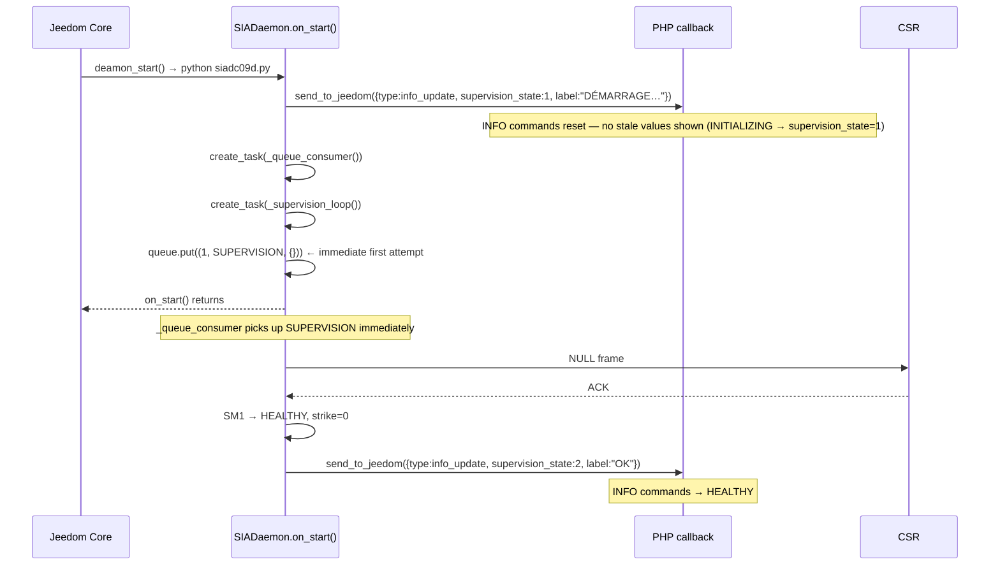
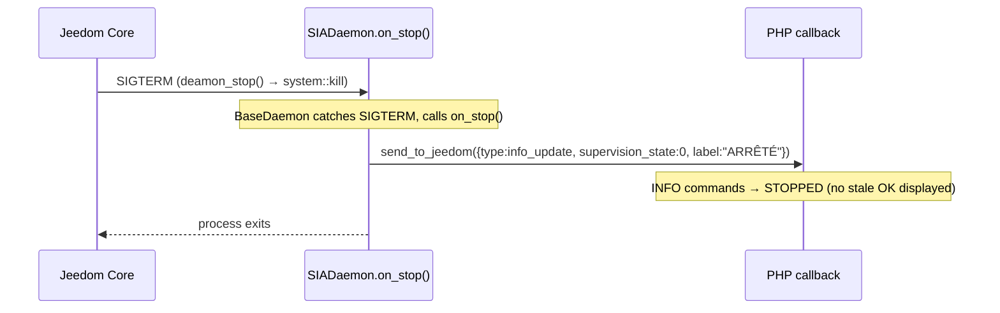

# Supervision & Health Monitoring Design — Jeedom siaDC09 Plugin

**Version:** 0.2
**Date:** 2026-03-05
**Status:** Draft — all Component 4 decisions confirmed (revised after Jeedom watchdog clarification)

---

## Overview

Component 4 fills three gaps left by Components 1 and 2:

1. **State consistency across lifecycle events** — PHP INFO commands show stale values
   after a daemon restart or stop. Nothing in Components 1–2 resets them.
2. **Supervision NAK handling** — Component 1's `_send_supervision()` handled ACK and
   timeout but left NAK responses from the CSR completely unhandled.
3. **PHP health watchdog** — if the daemon process hangs internally (PID alive but
   asyncio loop frozen), nothing detects or alerts about it.

---

## Jeedom's built-in daemon watchdog — what it already does

Jeedom core has a **runtime daemon watchdog** (not just startup). It runs every minute
as part of Jeedom's internal cron cycle. For every active plugin with `hasOwnDeamon: true`,
it calls `deamon_info()` and:

- If `state='nok'` AND `auto=1` AND `launchable='ok'` → calls `deamon_start()`
- Tracks consecutive failed restart attempts
- After 3 consecutive failures → writes to the Jeedom **message center**:
  *"Problème avec le démon du plugin XXX, je ne peux pas le lancer."* and stops retrying
- Resets the failure counter on the next successful start

**Consequence for Component 4:** Plugin-level `cron5()` does NOT need to restart
crashed daemons — Jeedom already does it, more frequently (every minute vs every 5
minutes), and with proper message center notification. Duplicating restart logic in
`cron5()` would interfere with Jeedom's own failure counting.

The `auto` field in `deamon_info()` controls whether Jeedom manages the daemon:
```php
$return['auto'] = config::byKey('autoStartDeamon', __CLASS__, 1);
```
This corresponds to the "Auto" toggle visible in the Jeedom plugin manager UI.

---

## SM1 state → PHP INFO command mapping (canonical)

| SM1 state | `supervision_state` | `supervision_label` | Set by |
|---|---|---|---|
| INITIALIZING | `1` | `DÉMARRAGE…` | Group A — `on_start()` push |
| HEALTHY | `2` | `OK` | Group B — `_send_supervision()` on ACK |
| DEGRADED (strike 1–2) | `1` | `DÉGRADÉ (N/3)` | Group B — `_send_supervision()` on timeout |
| DEGRADED (strike 3) | `0` | `PERDUE` | Group B — `_send_supervision()` on 3rd strike |
| TCP_RECONNECTING | `0` | `Reconnexion {transport}…` | Task 1.2 — `_connect()` on TCP drop |
| NO_NETWORK | `0` | `HORS RÉSEAU — arrêt` | Task 1.2 — `_connect()` on exhausted reconnect |
| STOPPED | `0` | `ARRÊTÉ` | Group A — `on_stop()` push |

> **HEALTHY label is static `"OK"`** — not `"OK — HH:MM"`. A time-embedded label would
> change every minute, causing a value-changed DB write + WebSocket `cmd::update` broadcast
> on every supervision ACK (1,440×/day). The last-ACK timestamp is available via
> `supervision_state.collectDate` — the widget reads it from there if needed.

INITIALIZING maps to `supervision_state = 1` (impaired — daemon is starting, not yet confirmed).
DEGRADED(strike=3), TCP_RECONNECTING, NO_NETWORK all map to `supervision_state = 0` — supervision is broken.
The `supervision_label` string distinguishes them for display.
There is no separate DISCONNECTED state — it was collapsed into DEGRADED (see daemon-design.md).

```python
SM1_STATE_TO_VALUE = {
    SM1State.INITIALIZING:     1,  # impaired — daemon starting, supervision not yet confirmed
    SM1State.DEGRADED:         1,  # strike 1-2; strike=3 overrides to 0 (see _supervision_value())
    SM1State.HEALTHY:          2,
    SM1State.TCP_RECONNECTING: 0,
    SM1State.NO_NETWORK:       0,
}

def _supervision_value(self) -> int:
    """Numeric value for supervision_state INFO command."""
    if self._sm1_state == SM1State.DEGRADED and self._strike_counter >= 3:
        return 0
    return SM1_STATE_TO_VALUE.get(self._sm1_state, 0)
```

---

## Task organization — three groups

```
Group A — Lifecycle state sync (daemon → PHP)
  A.1  on_start()     Push INITIALIZING + enqueue immediate supervision
  A.2  on_stop()      Push STOPPED before process exits

Group B — Supervision protocol hardening (daemon internal)
  B.1  _update_sm1_from_strike()    Centralized strike→state helper
  B.2  _send_supervision()          Full NAK dispatch, uses B.1

Group C — PHP health watchdog (PHP monitors daemon)
  C.1  _getAutoEquipmentSafe()      Non-creating equipment getter (foundation)
  C.2  deamon_info()                Per-key launchable guard — read by Jeedom watchdog
  C.3  cron5()                      Freshness check only (restart handled by Jeedom)
  C.4  _checkSupervisionFreshness() Zombie detection + emergency notification
```

**Build order:**
- B.1 before B.2 (B.2 calls B.1)
- C.1 before C.2, C.3, C.4 (all use it)
- C.2 before C.3 (C.3 calls deamon_info() indirectly via state check)
- C.3 calls C.4

---

## Group A — Lifecycle state sync

### Startup sequence



### Shutdown sequence



---

## Group B — Supervision protocol hardening

### NAK dispatch table for supervision NULLs

Component 1's `_send_supervision()` specified ACK → HEALTHY and timeout → strike++
but left NAK completely unhandled.

**Protocol fact (SIA DC-09 section 5.5.3.2):** The standard defines one kind of NAK —
a timestamp validation failure. The NAK data field carries the CSR's current GMT time
for clock correction. There are no standard NAK sub-codes for bad account, bad
encryption key, or bad message format.

| CSR response | Action | Notification |
|---|---|---|
| ACK | strike=0 → SM1 HEALTHY | — |
| NAK with parseable CSR timestamp | strike++ + `_notify(SUPERVISION_NAK, {…})` if strike < 3 | T1 via `error_handler`; T3 at strike=3 via `_update_sm1_from_strike()` |
| NAK without parseable timestamp, or undecodable response | strike++ + `_notify(BAD_CSR_RESPONSE, {…})` | T2 via `error_handler` |
| Timeout (no response) | strike++ + `_notify(SUPERVISION_TIMEOUT, {…})` if strike < 3 | T1 via `error_handler`; T3 at strike=3 via `_update_sm1_from_strike()` |

**In v1.0**, all NAK variants result in strike++ with no special recovery path.
The `timestamp_old` auto-heal (parse CSR time from NAK → resync clock → retry) is
deferred to v1.1. The T3 `SUPERVISION_DISCONNECTED` notification fires automatically
after 3 strikes via `_update_sm1_from_strike()`.

---

### TCP half-open stall at DEGRADED(strike=3)

**Problem:** When TCP transport is used and the CSR becomes unreachable without sending
a RST/FIN, the OS TCP stack may keep the socket in a half-open state indefinitely.
From the application's perspective, `send()` succeeds (data goes into the kernel
buffer) but no ACK arrives — the socket looks "alive" while the remote end is gone.
After 3 strikes, SM1 stays DEGRADED(strike=3) indefinitely without ever entering
TCP_RECONNECTING. Recovery is impossible without closing and reopening the socket.

**Fix:** When `_update_sm1_from_strike()` fires and strike reaches 3 on TCP transport,
force-close the TCP socket and transition to TCP_RECONNECTING. This is consistent with
the intention of TCP_RECONNECTING: it exists precisely for when the TCP link is down.

**For UDP:** no TCP_RECONNECTING state — network loss is detected only via supervision
timeouts. DEGRADED(strike=3) for UDP means: keep sending supervision indefinitely;
recovery is via ACK → HEALTHY. This is correct behavior (UDP is stateless).

**TCP reconnect policy — no exponential backoff:**

The `_tcp_reconnect_loop()` uses a **fixed** `self._preset.reconnect_delay_s` sleep between
attempts (default: 5 s). Exponential backoff is deliberately **not used** — it is an
anti-pattern for this protocol:
- A CSR restart completes in seconds; exponential backoff delays alarm delivery unnecessarily.
- The supervision contract already provides an upper bound via strike=3 (T3 notification).
- All timing parameters are part of the `CSRPreset` dataclass.

`reconnect_delay_s: float` — preset field (default 5 s). Part of `CSRPreset` loaded at startup via `self._preset.reconnect_delay_s`.

> The full `_update_sm1_from_strike()` implementation is in Task B.1 below — that is
> the canonical code. This section describes the rationale for the TCP_RECONNECTING
> transition at strike=3.

---

## Group C — PHP health watchdog

### What the plugin's `cron5()` adds beyond Jeedom's built-in watchdog

| Concern | Jeedom built-in (every minute) | Plugin `cron5()` |
|---|---|---|
| Restart crashed daemon | ✅ Handled | ❌ Redundant — do not duplicate |
| Respect `launchable='nok'` | ✅ Reads our `deamon_info()` guards | — |
| Message center on restart failure | ✅ After 3 attempts automatically | — |
| Detect zombie daemon (PID alive but hung) | ❌ Only checks PID | ✅ Unique value |
| Emergency notification on zombie | ❌ Not applicable | ✅ Unique value |

**`cron5()`'s only job:** call `_checkSupervisionFreshness()` when the daemon appears
running. No restart logic. No duplication of Jeedom's mechanism.

### Zombie detection rationale

A zombie daemon has a valid PID (so `deamon_info()['state'] = 'ok'` and Jeedom's
watchdog sees no problem) but its asyncio loop has frozen — it stopped calling
`send_to_jeedom()`. As a result:
- Supervision NULLs are no longer sent to the CSR → supervision contract broken
- PHP INFO commands show stale state (last known good values)
- Jeedom's watchdog is blind to this — PID check passes
- The alarm system is silently vulnerable

Detection mechanism: `supervision_state` INFO command's `collectDate` (updated on
every `checkAndUpdateCmd()` call) becomes stale. If it is older than
`3 × supervision_interval` seconds, the daemon has missed at least 3 supervision
cycles — a clear sign of a frozen loop.

**Action on detection: emergency notification.** A zombie daemon means the CSR
supervision contract is broken. The real monitoring center may no longer consider
this PE reachable. This is a high-vulnerability state requiring immediate user attention.
Two notification channels are used:
1. `notify_cmd_id` — the configured emergency command (SMS, push, etc.)
2. Jeedom message center (`message::add()`) — always visible regardless of notification config

**Rate limiting:** To avoid notification spam (cron5() runs every 5 minutes), alerts
are rate-limited to one per 30 minutes using a `_freshness_alert_ts` plugin-level config
key (`config::byKey/__CLASS__`). Stored at plugin level — NOT on eqLogic — to avoid
triggering `postSave()` on set and clear.
This key is NOT user-visible and resets automatically when freshness recovers.

---

## Task breakdown — Component 4

### Task A.1 — Daemon: `on_start()`

**What:** Override `on_start()` in `SIADaemon`. Pushes INITIALIZING state to PHP
before starting any tasks (guarantees no race condition), then starts background
coroutines and enqueues one immediate supervision attempt.

```python
async def on_start(self):
    self._logger.info('Démarrage démon siaDC09')
    self._sm1_state = SM1State.INITIALIZING
    self._sm2_state = SM2State.IDLE
    self._strike_counter = 0
    self._tasks: set[asyncio.Task] = set()   # reset on restart (also initialized in __init__ — see daemon-design.md Task 1.1)

    # Push INITIALIZING to PHP before any task starts.
    # Guarantees stale state is cleared even if queue_consumer runs first.
    # NOTE: event_state and event_label are intentionally NOT reset here.
    # They retain their value across daemon restarts — the combination of
    # supervision_state + event_state conveys the full picture without ambiguity
    # (e.g. supervision_state=0 + event_state=3 = daemon stopped during alarm-in-flight).
    #
    # Error policy: intentionally NOT wrapped in try/except.
    # If PHP is unreachable at startup the daemon cannot function — fail fast and let
    # Jeedom's watchdog handle the restart. Contrast with on_stop() which is best-effort
    # (PHP may itself be shutting down). The exception propagates after the ERROR log below.
    try:
        await self.send_to_jeedom({
            'type':              'info_update',
            'supervision_state': SM1_STATE_TO_VALUE[SM1State.INITIALIZING],  # → 1 (impaired)
            'supervision_label': 'DÉMARRAGE…',
        })
    except Exception as e:
        self._logger.error(f'Impossible de joindre PHP au démarrage — arrêt du démon : {e}')
        raise

    # Start background coroutines — tracked to log exceptions and allow cancellation
    self._track_task(self._queue_consumer())
    self._track_task(self._supervision_loop())

    # Enqueue immediate first supervision — SM1 exits INITIALIZING within seconds
    await self._queue.put((1, next(self._queue_counter), 'SUPERVISION', {}))
    self._logger.info('Démon prêt — supervision initiale planifiée')
```

**Why enqueue and not call directly:** Preserves the single-consumer invariant —
no two coroutines send on the socket simultaneously.

---

### Task A.2 — Daemon: `on_stop()`

**What:** Override `on_stop()` in `SIADaemon`. Pushes STOPPED state to PHP before
the process exits. Best-effort: failure is swallowed so shutdown is never blocked.

```python
async def on_stop(self):
    self._logger.info('Arrêt propre du démon siaDC09')
    try:
        await self.send_to_jeedom({
            'type':              'info_update',
            'supervision_state': 0,
            'supervision_label': 'ARRÊTÉ',
            # event_state and event_label intentionally omitted — retained across
            # stop/start so the user can read what happened to the last alarm event.
        })
    except Exception as e:
        # Best-effort — never block shutdown on a failed HTTP call
        # (Jeedom may itself be stopping during a system reboot)
        self._logger.warning(f'Impossible de notifier PHP à l\'arrêt : {e}')

    # Drain the queue before cancelling tasks — prevents _queue_consumer from
    # processing items after the transport is closed.
    while not self._queue.empty():
        self._queue.get_nowait()

    # Cancel all tracked background tasks (queue_consumer, supervision_loop,
    # any in-flight reconnect or notify tasks).
    for task in list(self._tasks):
        task.cancel()
    # Hard 5-second ceiling — prevents shutdown from hanging if a task ignores
    # cancellation or is blocked in a tight loop.
    # return_exceptions=True: exceptions from cancelled tasks are not re-raised.
    # asyncio.gather(..., return_exceptions=True) is mandatory here — never omit it.
    await asyncio.wait_for(
        asyncio.gather(*self._tasks, return_exceptions=True),
        timeout=5.0,
    )
```

---

### Task B.1 — Daemon: `_update_sm1_from_strike()` + `_supervision_label()`

**What:** Centralized SM1 state transition from strike counter. Extracted to avoid
duplicating the 3-strike logic. Called by B.2 after incrementing the counter.

```python
async def _update_sm1_from_strike(self) -> bool:
    """Update SM1 from current strike counter. Call AFTER incrementing.

    Returns True if the T3 notification was fired by this call, False otherwise.
    Callers use the return value to set t3_just_fired in their SM1LogCtx.

    async def — awaits T3 notification directly (must not be dropped at shutdown);
    schedules TCP reconnect as a tracked task (non-blocking long-running loop).
    Must be called with `await` from within a coroutine.

    SM1 stays DEGRADED at all strike levels — there is no DISCONNECTED state.
    At strike=3 on TCP: force socket close and enter TCP_RECONNECTING to escape
    potential half-open stall (see TCP half-open stall section above).
    T3 notification fires exactly once when strike first reaches 3.
    _sm1_t3_fired is reset to False when strike resets to 0 (ACK received).
    """
    self._sm1_state = SM1State.DEGRADED
    if self._strike_counter >= 3:
        if self._transport == 'TCP':
            # Force TCP_RECONNECTING to escape half-open socket stall.
            # SM1 state is set synchronously here; _tcp_reconnect_loop() is scheduled
            # as a tracked task — it runs a long retry loop and must not block here.
            # This is safe: _queue_consumer() checks SM1=TCP_RECONNECTING and
            # re-queues (never calls _send_raw()), so the socket close inside
            # _tcp_reconnect_loop() completes before any send is attempted.
            self._sm1_state = SM1State.TCP_RECONNECTING
            self._track_task(self._tcp_reconnect_loop())
        if not self._sm1_t3_fired:
            self._sm1_t3_fired = True
            self._notify(ErrorCode.SUPERVISION_DISCONNECTED)
            return True
    return False


def _supervision_label(self) -> str:
    """Build the human-readable supervision label from current SM1 state.

    HEALTHY returns the static string 'OK'. Do NOT embed HH:MM here — a
    time-varying label causes checkAndUpdateCmd() to detect a value change every
    minute (1,440 DB writes/day + WebSocket broadcasts). The last-ACK timestamp
    is available via supervision_state.collectDate on the PHP side.
    """
    state = self._sm1_state
    if state == SM1State.HEALTHY:
        return 'OK'
    if state == SM1State.DEGRADED:
        return 'PERDUE' if self._strike_counter >= 3 else f'DÉGRADÉ ({self._strike_counter}/3)'
    if state == SM1State.TCP_RECONNECTING:
        return f'Reconnexion {self._transport}…'
    if state == SM1State.NO_NETWORK:
        return 'HORS RÉSEAU — arrêt'
    return 'DÉMARRAGE…'  # INITIALIZING
```

**Note:** `_update_sm1_from_strike()` is `async def`. `_notify()` is a synchronous wrapper
that internally calls `_track_task(self._dispatch_notify(...), name)` — GC-safe and
exception-logged via done-callback, without blocking the caller (see ADR-04, ADR-05).
`_tcp_reconnect_loop()` is also scheduled via `_track_task()` because it runs a long retry
loop and must not block the caller. See daemon-design.md Task 1.1.
`_sm1_t3_fired` is initialised to `False` in `on_start()`
and reset to `False` in two places:
1. **ACK received** → `_strike_counter` reset to 0 → `_sm1_t3_fired = False`
2. **TCP reconnect succeeded** → `_tcp_reconnect_loop()` on success resets both
   `_strike_counter = 0` and `_sm1_t3_fired = False` before transitioning to INITIALIZING.
   This ensures a new DEGRADED(strike=3) after reconnect will fire T3 again.

---

### Task B.2 — Daemon: `_send_supervision()`

**What:** The supervision send function called by `_queue_consumer()` for each
SUPERVISION queue item. Completes the NAK handling left unspecified by Component 1.

> **Instance variable origins (see daemon-design.md Task 1.1):**
> `self._encryption_enabled` is loaded from the `--encryption_enabled` CLI arg in `__init__()`.
> `self._encryption_key` is loaded from `os.environ.get('SIA_ENCRYPTION_KEY', '')` — **never**
> from a CLI arg (would be visible in `ps aux`). Any implementer adding encryption handling
> here must read the key from `self._encryption_key`, not from argv.

> **Concurrency note:** `_strike_counter` is incremented in three places, all within
> `_send_supervision()` or `_handle_supervision_nak()` (called from `_send_supervision()`).
> Because `_queue_consumer()` serialises all sends through the PriorityQueue, only one
> supervision send is ever in flight at a time — there is no concurrent increment path.
> Python asyncio is cooperative: no context switch occurs between the read and write of
> `self._strike_counter = min(self._strike_counter + 1, 3)` because there is no `await`
> between them. **Do not introduce an `await` call between reading and writing
> `_strike_counter`** — that would create a race condition.

> **TCP_RECONNECTING guard:** `_send_supervision()` is never called while
> `SM1 == TCP_RECONNECTING` or `SM1 == NO_NETWORK`. This is enforced by
> `_queue_consumer()` (daemon-design.md Task 1.7): when SM1 is in either of these
> states, SUPERVISION items are **dropped silently** before `_send_supervision()` is
> called — no strike increment, no send attempt on the closed socket. This is the only
> place the guard lives; `_send_supervision()` itself has no SM1 state check.
>
> **EVENT items during TCP_RECONNECTING / NO_NETWORK** are handled differently — see
> daemon-design.md Task 1.7 SM2 dependency matrix: TCP_RECONNECTING → re-queued with
> 1 s backoff; NO_NETWORK → instant EVENT_FAILED.

```python
async def _send_supervision(self):
    """Send one supervision NULL frame and update SM1."""
    seq = self._sia_seq   # capture before send; increment only on success
    id_type = '*NULL' if self._encryption_enabled else 'NULL'
    frame = sia_protocol.encode_message(
        id_type=id_type,
        account=self._account,
        seq=seq,
        zone='',
        timestamp=sia_protocol.make_timestamp(),
        receiver_prefix=self._receiver_prefix,
        account_prefix=self._account_prefix,
        crc_format=self._preset.crc_format,
    )
    t_start = time.monotonic()
    result = await self._send_raw(frame)
    elapsed = time.monotonic() - t_start

    if result['status'] == 'ack':
        # Increment sequence counter only on successful send+ACK.
        # Never incremented on timeout/NAK/drop — retry reuses the same seq number.
        self._sia_seq = (self._sia_seq + 1) % 10000  # wraps 9999 → 0000
        prev_strike = self._strike_counter
        self._strike_counter = 0
        self._sm1_t3_fired = False          # reset so next DEGRADED(3) fires T3 again
        self._sm1_state = SM1State.HEALTHY
        self._last_supervision_ack = datetime.now(timezone.utc)
        self._log_sm1_supervision('ack', SM1AckCtx(
            seq=seq,
            elapsed_ms=int(elapsed * 1000),
            crc_format=self._crc_format,
            raw_hex=result.get('raw_hex', ''),
            prev_strike=prev_strike,
        ))

    elif result['status'] == 'nak':
        await self._handle_supervision_nak(seq, elapsed, result.get('raw_nak'))

    elif result['status'] == 'tcp_drop':
        # TCP connection lost at OS level — transition immediately without waiting
        # for 3 supervision strikes (~3 min). _update_sm1_from_strike() is NOT called
        # here; TCP_RECONNECTING is set directly.
        self._sm1_state = SM1State.TCP_RECONNECTING
        self._track_task(self._tcp_reconnect_loop())

    else:  # timeout
        prev_state = self._sm1_state
        self._strike_counter = min(self._strike_counter + 1, 3)
        t3_just_fired = await self._update_sm1_from_strike()
        if self._strike_counter < 3:
            self._notify(ErrorCode.SUPERVISION_TIMEOUT)
        self._log_sm1_supervision('timeout', SM1TimeoutCtx(
            seq=seq,
            elapsed_ms=int(elapsed * 1000),
            strike=self._strike_counter,
            prev_state=prev_state,
            t3_just_fired=t3_just_fired,
        ))

    await self._update_info_commands()


async def _handle_supervision_nak(self, seq: int, elapsed: float, nak_data: bytes | None):
    """
    Handle a NAK from the CSR during supervision.

    Per SIA DC-09 section 5.5.3.2, the only standard NAK is a timestamp validation
    failure. The NAK data field contains the CSR's current GMT time (for clock sync).
    There are no NAK sub-codes. In v1.0 all NAKs are treated as timeouts (strike++).
    The timestamp auto-heal will parse nak_data in v1.1.

    seq and elapsed are passed from _send_supervision() for the logging context —
    they are not needed for protocol logic.
    """
    raw_hex = nak_data.hex() if nak_data else ''

    self._strike_counter = min(self._strike_counter + 1, 3)
    t3_just_fired = await self._update_sm1_from_strike()

    try:
        if nak_data is None:
            raise ValueError('no NAK data')
        csr_time = sia_protocol.parse_nak_timestamp(nak_data)
        # Standard timestamp NAK — treat as timeout in v1.0
        # (v1.1 will use csr_time to resync clock and retry)
        if self._strike_counter < 3:
            self._notify(ErrorCode.SUPERVISION_NAK)
        self._log_sm1_supervision('nak_timestamp', SM1NakCtx(
            seq=seq,
            elapsed_ms=int(elapsed * 1000),
            strike=self._strike_counter,
            raw_hex=raw_hex,
            csr_time=csr_time.isoformat(),
            t3_just_fired=t3_just_fired,
        ))
    except ValueError:
        # Missing or undecodable NAK data — protocol anomaly
        self._notify(ErrorCode.BAD_CSR_RESPONSE)
        self._log_sm1_supervision('nak_bad', SM1NakCtx(
            seq=seq,
            elapsed_ms=int(elapsed * 1000),
            strike=self._strike_counter,
            raw_hex=raw_hex,
            csr_time=None,
            t3_just_fired=t3_just_fired,
        ))

# _nak_to_user_message() removed — replaced by error_handler.build_notification()
# from Component 5a.
```

---

### Task C.1 — PHP: `_getAutoEquipmentSafe()`

**What:** Returns the auto-equipment without creating it if missing. Used by all
Group C tasks. Distinct from `_getAutoEquipment()` (Task 2.9) which auto-creates.

```php
private static function _getAutoEquipmentSafe() {
    $eqLogics = self::byType('siaDC09');
    return empty($eqLogics) ? null : $eqLogics[0];
}
```

**Contract:** Read-only. Never creates. Returns `null` if equipment missing.
Calling this from `deamon_info()` or `cron5()` is safe — no side effects.

---

### Task C.2 — PHP: `deamon_info()` — enhanced launchable guard

**What:** Replaces the minimal `deamon_info()` from Task 2.7. Adds per-key config
validation with precise French messages referencing wizard step numbers.

This method is called **by Jeedom's own runtime watchdog** (every minute) to decide
whether to attempt a daemon restart. Accurate `launchable_message` prevents Jeedom
from repeatedly trying to start a daemon with broken config.

```php
public static function deamon_info() {
    $return = [
        'log'        => __CLASS__ . '_daemon',  // points to siaDC09_daemon (Python output), not siaDC09 (PHP log)
        'state'      => 'nok',
        'launchable' => 'ok',
        'auto'       => config::byKey('autoStartDeamon', __CLASS__, 1),
    ];

    // PID check
    $pidFile = jeedom::getTmpFolder(__CLASS__) . '/deamon.pid';
    if (file_exists($pidFile)) {
        if (@posix_getsid(trim(file_get_contents($pidFile)))) {
            $return['state'] = 'ok';
        } else {
            shell_exec(system::getCmdSudo() . 'rm -rf ' . $pidFile . ' 2>&1 > /dev/null');
        }
    }

    // NOTE: no dependency guard here. Jeedom's plugin::deamon_info() core wrapper
    // automatically calls dependancy_info() and injects its result before returning
    // to the watchdog. Adding it here would be a redundant double-check.

    // Guard 1 — equipment exists
    $eqLogic = self::_getAutoEquipmentSafe();
    if (!$eqLogic) {
        $return['launchable'] = 'nok';
        $return['launchable_message'] = __("L'équipement n'existe pas — activez le plugin.", __FILE__);
        return $return;
    }

    // Guard 2 — wizard complete (F1 fix)
    // Without this guard, Jeedom's watchdog (auto=1) auto-restarts the daemon within
    // ~1 minute of "Relancer l'assistant", even while the user is mid-wizard, because
    // all other guards pass when previously saved config is still present.
    if ((int) $eqLogic->getConfiguration('wizard_step', 0) < 4) {
        $return['launchable'] = 'nok';
        $return['launchable_message'] = __(
            "L'assistant de configuration n'est pas terminé — complétez les 4 étapes.", __FILE__
        );
        return $return;
    }

    // Guard 3 — CSR IP
    // eqLogic is the single source of truth: preset values are resolved into eqLogic
    // by the wizard at step 1 save time. Guard 3 applies to both preset and manual mode.
    if (empty($eqLogic->getConfiguration('csr_ip'))) {
        $return['launchable'] = 'nok';
        $return['launchable_message'] = __(
            "Adresse IP de la centrale non configurée (étape 1 de l'assistant).", __FILE__
        );
        return $return;
    }

    // Guard 4 — account number (non-empty + valid SIA DC-09 hex format, 3–16 chars)
    // SIA DC-09 section 5.5.1.3 defines account as 3–16 hexadecimal characters.
    // An invalid format is silently embedded in every frame and causes the CSR to
    // NAK/reject all frames — supervision fails with 3 strikes and T3 fires with a
    // misleading "CSR unreachable" message. Catching it here produces an actionable
    // launchable_message instead.
    $account = $eqLogic->getConfiguration('account_number');
    if (empty($account)) {
        $return['launchable'] = 'nok';
        $return['launchable_message'] = __(
            "Numéro de compte non configuré (étape 1 de l'assistant).", __FILE__
        );
        return $return;
    }
    if (!preg_match('/^[0-9A-Fa-f]{3,16}$/', $account)) {
        $return['launchable'] = 'nok';
        $return['launchable_message'] = __(
            "Numéro de compte invalide — doit contenir 3 à 16 caractères hexadécimaux (étape 1 de l'assistant).", __FILE__
        );
        return $return;
    }

    // Guard 5 — encryption key (only when encryption enabled)
    if ($eqLogic->getConfiguration('encryption_enabled')
        && empty($eqLogic->getConfiguration('encryption_key'))) {
        $return['launchable'] = 'nok';
        $return['launchable_message'] = __(
            "Clé de chiffrement manquante (étape 1 de l'assistant).", __FILE__
        );
        return $return;
    }

    // Guard 6 — notification command (safety requirement)
    if (empty($eqLogic->getConfiguration('notify_cmd_id'))) {
        $return['launchable'] = 'nok';
        $return['launchable_message'] = __(
            "Commande de notification non configurée (étape 4 de l'assistant).", __FILE__
        );
        return $return;
    }

    return $return;
}
```

**Fail-fast:** The plugin manager displays one `launchable_message`. Showing the first
blocking issue is more actionable than listing all. Wizard steps are ordered so fixing
step 1 naturally leads to step 4.

---

### Task C.3 — PHP: `cron5()`

**What:** Called by Jeedom every 5 minutes. Its only job is to call
`_checkSupervisionFreshness()` when the daemon appears running.

**Does NOT restart the daemon.** Jeedom's own runtime watchdog (every minute, with
message center notification after 3 failures) handles all crash-and-restart scenarios.
Duplicating restart logic here would interfere with Jeedom's failure counter.

```php
public static function cron5() {
    $eqLogic = self::_getAutoEquipmentSafe();

    if (!$eqLogic || !$eqLogic->getIsEnable()) {
        return; // No equipment or plugin disabled — nothing to check
    }

    // Only check freshness when daemon appears running.
    // Jeedom core handles restart if daemon is down.
    if (self::deamon_info()['state'] == 'ok') {
        self::_checkSupervisionFreshness($eqLogic);
    }
}
```

---

### Task C.4 — PHP: `_checkSupervisionFreshness()`

**What:** Detects zombie daemons — PID alive but asyncio loop frozen. Uses
`supervision_state` command's `collectDate` as a "last seen" timestamp (updated on
every `checkAndUpdateCmd()` call, regardless of value change).

**On detection: emergency notification via two channels:**
1. `notify_cmd_id` — the configured command (SMS, push, etc.)
2. Jeedom message center — always visible regardless of notification config

**Rate limiting:** Maximum one alert per 30 minutes to avoid notification spam.
The `_freshness_alert_ts` config key tracks the last alert timestamp.

> **`supervision_interval` constraint:** The freshness threshold (`3 × supervision_interval`)
> is read from eqLogic config at check time. The running daemon uses the value it received
> at startup via CLI arg. **If the user changes `supervision_interval` without restarting
> the daemon, the threshold diverges from the daemon's actual send interval**, risking
> false zombie alerts (interval decreased) or missed detections (interval increased).
> A daemon restart is required for this setting to take effect — consistent with the
> no-restart-on-save policy (php-core-design.md Task 2.4). The wizard should document
> this restart requirement for the `supervision_interval` field.

```php
private static function _checkSupervisionFreshness($eqLogic) {
    // NOTE: supervision_interval is read from eqLogic config at check time.
    // The running daemon uses the value from its startup CLI args.
    // If the user changes supervision_interval without restarting the daemon,
    // this threshold will diverge from the daemon's actual send interval.
    // A daemon restart is required for supervision_interval changes to take effect
    // (consistent with the no-restart-on-save policy).
    $supervisionInterval = (int) $eqLogic->getConfiguration('supervision_interval', 60);
    // Flag after 3 missed supervision cycles
    $staleThreshold = $supervisionInterval * 3;
    // Maximum one emergency alert per 30 minutes
    $alertRateLimit = 30 * 60;

    $stateCmd = $eqLogic->getCmd('info', 'supervision_state');
    if (!$stateCmd) {
        return; // Commands not yet created (plugin just installed)
    }

    $collectDate = $stateCmd->getCollectDate();
    if (empty($collectDate)) {
        return; // Never received any update — daemon may have just started
    }

    // Jeedom stores collectDate as a MySQL DATETIME in PHP's configured timezone
    // (both always match in a standard Jeedom installation — it is a documented
    // Jeedom requirement). strtotime() is therefore the correct Jeedom idiom here,
    // consistent with Jeedom core. No explicit timezone conversion needed.
    $staleSince = time() - strtotime($collectDate);

    if ($staleSince <= $staleThreshold) {
        // Freshness OK — clear any previous alert timestamp (recovery).
        // Stored at plugin level to avoid triggering postSave() on eqLogic.
        if (config::byKey('_freshness_alert_ts', __CLASS__, 0)) {
            config::save('_freshness_alert_ts', 0, __CLASS__);
        }
        return;
    }

    // Stale — check rate limit before notifying.
    // Plugin-level key: no postSave() triggered on read or write.
    $lastAlertTs = (int) config::byKey('_freshness_alert_ts', __CLASS__, 0);
    if ((time() - $lastAlertTs) < $alertRateLimit) {
        return; // Already alerted recently
    }

    // --- ZOMBIE DETECTED --- high-vulnerability state ---
    $msg = sprintf(
        'ALERTE siaDC09 : Le démon est actif mais ne répond plus depuis %ds. '
        . 'La supervision vers la centrale est interrompue. '
        . 'Le système de télésurveillance est potentiellement compromis.',
        $staleSince
    );

    log::add(__CLASS__, 'error', $msg);

    // Channel 1: Jeedom message center (always visible)
    message::add(__CLASS__, $msg);

    // Channel 2: configured emergency notification command
    $notifyCmdId = (int) $eqLogic->getConfiguration('notify_cmd_id');
    if ($notifyCmdId > 0) {
        $notifyCmd = cmd::byId($notifyCmdId);
        if ($notifyCmd) {
            try {
                $notifyCmd->execCmd([
                    'title'   => 'siaDC09 — Démon bloqué',
                    'message' => $msg,
                ]);
            } catch (Exception $e) {
                log::add(__CLASS__, 'error',
                    'Impossible d\'envoyer la notification d\'urgence : ' . $e->getMessage()
                );
            }
        }
    }

    // Record alert timestamp to enforce rate limit.
    // Plugin-level key: avoids triggering postSave() on eqLogic. No eqLogic->save() needed.
    config::save('_freshness_alert_ts', time(), __CLASS__);
}
```

**Why `collectDate` and not the string value:** `checkAndUpdateCmd()` always updates
`collectDate` on every call, even when `supervision_label` hasn't changed (e.g.,
daemon stays HEALTHY). It is the reliable "last-push" timestamp.

**Why no auto-restart:** A PID-alive daemon could be busy on a long alarm retry
sequence (legitimate block). Killing and restarting it would interrupt an in-progress
alarm transmission — worse than the monitoring gap. The emergency notification puts a
human in the loop to decide.

---

## Design decisions summary

| Decision | Choice | Rationale |
|---|---|---|
| INITIALIZING → `supervision_state=1` | 1 (impaired) | Daemon starting — temporary, not a failure. Label distinguishes it from DEGRADED. |
| DEGRADED(strike=3), TCP_RECONNECTING, NO_NETWORK → `supervision_state=0` | All = 0 | From scenario perspective: supervision is broken. Label distinguishes them. |
| STOPPED → `supervision_state=0` | 0 | Daemon not running = supervision not running = not healthy |
| No DISCONNECTED state | Collapsed into DEGRADED(strike=3) | Behavioral difference was insufficient to justify a separate state — see daemon-design.md |
| NAK dispatch (v1.0) | All NAKs → strike++; undecodable NAK → also BAD_CSR_RESPONSE T2 | No NAK sub-codes in the standard; timestamp auto-heal deferred to v1.1 |
| TCP half-open stall fix | At strike=3 on TCP → force socket close → TCP_RECONNECTING | Prevents infinite DEGRADED with no recovery path when TCP link is silently down |
| `on_stop()` push failure | Best-effort, swallowed | Never block shutdown on failed HTTP call |
| `cron5()` restart logic | **Removed** | Jeedom core already does this every minute with message center notification |
| Zombie detection threshold | `3 × supervision_interval` | 3 missed cycles — clear signal of frozen loop |
| Zombie alert channels | `notify_cmd_id` + Jeedom message center | High-vulnerability state: maximum visibility |
| Zombie alert rate limit | 30 minutes | Avoid notification spam while daemon remains hung |
| Zombie recovery | Clear `_freshness_alert_ts` on next healthy freshness check | Automatic, no user action needed |
| `_freshness_alert_ts` storage | Plugin-level `config::save(__CLASS__)` | Avoids triggering `postSave()` on eqLogic on every set/clear |
| `notify_cmd_id` as launchable guard | Yes — hard requirement | Zombie alert (and all critical notifications) require it |
| `_getAutoEquipmentSafe()` | Non-creating variant | Read-only watchdog paths must not create side effects |

---

## Testing strategy for Component 4

| Test | How |
|---|---|
| Startup state reset | Kill daemon, manually set `supervision_state=2` in DB, restart daemon → verify `supervision_state=0, label="DÉMARRAGE…"` immediately, then HEALTHY after first ACK |
| Immediate first supervision | Start daemon with simulator in always-ack mode → verify ACK received within 5s (before first interval fires) |
| NAK with parseable timestamp | Simulator sends NAK with valid GMT timestamp → verify strike++, label="DÉGRADÉ (1/3)", no BAD_CSR_RESPONSE notification |
| NAK undecodable | Simulator sends malformed NAK frame → verify strike++, BAD_CSR_RESPONSE T2 notification fired |
| TCP stall at strike=3 | Simulate 3 supervision timeouts on TCP → verify SM1 transitions TCP_RECONNECTING, socket closed, reconnect attempted |
| Clean shutdown | Call deamon_stop() → verify PHP INFO commands show label="ARRÊTÉ" within 2s |
| cron5() does NOT restart | Kill daemon process directly → trigger cron5() manually → verify NO restart attempt in plugin code, confirm Jeedom's own watchdog handles it |
| cron5() skips freshness if daemon down | Daemon not running → trigger cron5() → verify _checkSupervisionFreshness() NOT called |
| Zombie detection — first alert | Pause daemon updates beyond threshold → trigger cron5() → verify: log error, message center entry, notify_cmd executed, `_freshness_alert_ts` set |
| Zombie detection — rate limit | Trigger cron5() again within 30 min → verify NO second notification sent |
| Zombie recovery | Resume daemon updates → trigger cron5() → verify `_freshness_alert_ts` cleared |
| deamon_info() guard — missing csr_ip | Leave csr_ip empty → verify launchable=nok + correct wizard step message |
| deamon_info() guard — missing encryption_key | encryption_enabled=true, key empty → verify correct launchable_message |
| deamon_info() guard — missing notify_cmd_id | notify_cmd_id empty → verify launchable=nok (Jeedom won't auto-restart) |
| deamon_info() guard — all complete | All fields configured → verify launchable=ok |
