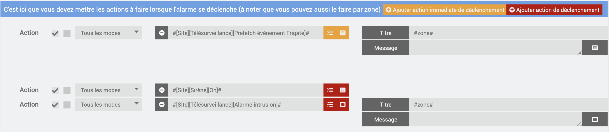
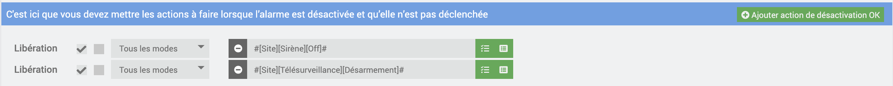
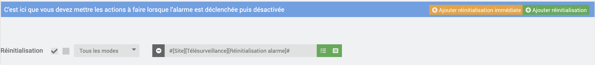
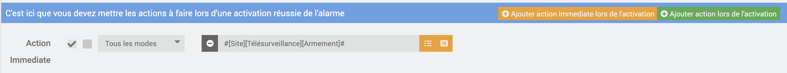

# Plugin Télésurveillance SIA DC-09 — Guide utilisateur

> Transmettez les alarmes de votre plugin Alarme Jeedom à une centrale de télésurveillance, avec le protocole normalisé SIA DC-09.

> 🧪 **Version de test pour les premiers testeurs** — le plugin n'est pas encore publié (ni sur le Market, ni en release GitHub). Son fonctionnement et ses réglages peuvent encore évoluer.

Ce plugin fait de Jeedom un transmetteur d'alarme : quand le plugin **Alarme** de Jeedom se déclenche, siaDC09 envoie une trame SIA DC-09 à la centrale de télésurveillance (toute centrale compatible SIA DC-09), attend son accusé de réception et vous prévient si la transmission échoue. En continu, il envoie aussi des trames de supervision pour que la centrale sache que le lien est vivant.

**Sommaire**

1. [Avant de commencer](#avant-de-commencer)
2. [Installation](#installation)
3. [L'assistant de configuration](#lassistant-de-configuration)
4. [Câbler le plugin Alarme](#câbler-le-plugin-alarme)
5. [Photos et vidéos Frigate (optionnel)](#photos-et-vidéos-frigate-optionnel)
6. [Comprendre les indicateurs d'état](#comprendre-les-indicateurs-détat)
7. [Scénarios : déclenchement sur les commandes info](#scénarios--déclenchement-sur-les-commandes-info)
8. [L'onglet Diagnostic](#longlet-diagnostic)
9. [Les alertes du plugin](#les-alertes-du-plugin)
10. [Dépannage](#dépannage)
11. [Limitations connues](#limitations-connues)

---

## Avant de commencer

Vous aurez besoin de :

- **Jeedom 4.5 ou plus récent** sur Debian 12 ou plus récent.
- Le **plugin Alarme** (officiel Jeedom), déjà configuré avec vos zones.
- Un **contrat avec une centrale de télésurveillance** qui accepte le protocole SIA DC-09. La centrale doit vous communiquer :
  - l'adresse IP et le port de son récepteur ;
  - le transport (UDP ou TCP) ;
  - votre **numéro de compte** (3 à 16 caractères hexadécimaux) ;
  - si le chiffrement est demandé, la **clé AES** (voir [Limitations connues](#limitations-connues) avant de l'activer).
- Optionnel : le **plugin Frigate** si vous voulez joindre une photo ou une vidéo aux alarmes.

> **Important** — Ce plugin transmet des alarmes réelles. Faites toujours un essai coordonné avec votre centrale (en la prévenant) avant de compter dessus.

## Installation

> ⏳ **Pas encore disponible sur le Market Jeedom** : l'installation depuis le Market (catégorie Sécurité) est prévue pour plus tard. En attendant, le plugin s'installe manuellement depuis GitHub : voir [l'installation manuelle dans le README](https://github.com/hlehoux2021/siadc09#manual-install-from-github).

1. *(à venir)* Installez le plugin depuis le **Market Jeedom** (catégorie Sécurité), puis activez-le. En attendant : installation manuelle depuis GitHub, puis activation dans **Plugins → Gestion des plugins**.
2. Sur la page de configuration du plugin, lancez l'**installation des dépendances** (Python : `jeedomdaemon`, `cryptography`). Attendez le statut **OK**.
3. Ouvrez **Plugins → Sécurité → Télésurveillance SIA DC-09**. L'équipement unique « Télésurveillance » est créé automatiquement.
4. Suivez l'assistant ci-dessous. Le démon ne peut pas démarrer tant que l'assistant n'est pas terminé.

## L'assistant de configuration

L'assistant comporte 4 étapes. Vous pouvez le relancer à tout moment avec le bouton **Relancer l'assistant**.

### Étape 1 — Centrale de télésurveillance

Choisissez la carte **Personnalisé** et saisissez les paramètres communiqués par votre centrale. Vérifiez avec elle le transport et le chiffrement (voir [Limitations connues](#limitations-connues)).

| Champ | Ce qu'il faut saisir |
|-------|----------------------|
| Adresse IP | Adresse du récepteur de la centrale (obligatoire) |
| Port | 1 à 65535 |
| Transport | UDP ou TCP, selon la centrale |
| Numéro de compte | 3 à 16 caractères hexadécimaux, fournis par la centrale |
| Chiffrement activé / Clé AES | Clé hexadécimale de 32, 48 ou 64 caractères, obligatoire si le chiffrement est coché |
| Intervalle supervision (s) | Fréquence des trames de supervision (60 s par défaut) |
| Tentatives | Nombre de tentatives de reconnexion **TCP** (6 par défaut) |
| Délai de reconnexion (s) | Délai de base entre deux reconnexions TCP (30 s par défaut) |

Cliquez sur **Suivant**.

### Étape 2 — Test de connexion

Le plugin envoie une trame de supervision à la centrale et affiche le résultat :

- **Vert (ACK)** : la centrale a répondu et accepté la trame. Continuez.
- **Orange (NAK)** : la centrale répond mais refuse la trame — souvent un numéro de compte inconnu. Vous pouvez continuer après confirmation, mais vérifiez avec la centrale.
- **Rouge** : pas de réponse, connexion refusée, adresse injoignable… Le message indique la cause probable. Corrigez l'étape 1 avant de continuer.

**Relancer le test** refait l'essai ; **Ignorer** passe à l'étape suivante sans test (déconseillé).

### Étape 3 — Zones

Le tableau liste les zones de votre plugin Alarme :

- **N°** : le numéro de zone transmis à la centrale. **Communiquez cette correspondance N° / zone à votre centrale.** Une zone garde son numéro d'une configuration à l'autre ; une nouvelle zone reçoit le numéro suivant.
- **Caméra Frigate** (optionnel) : la caméra dont la photo ou la vidéo accompagnera l'alarme de cette zone.

Sur la même étape :

- **URL media Frigate** (optionnel) : voir [Photos et vidéos Frigate](#photos-et-vidéos-frigate-optionnel).
- **Numéro utilisateur SIA** (1 à 999) : le numéro sous lequel la centrale identifie « l'utilisateur Jeedom » pour les armements, désarmements et annulations. Déclarez-le à votre centrale.

### Étape 4 — Alertes critiques

Choisissez qui prévenir si une alarme n'a pas pu être transmise ou si la supervision est perdue :

- **Commande d'un équipement** (SMS, Telegram, notification mobile, e-mail…) : seules les commandes action de sous-type « message » sont proposées.
- **Action interne Jeedom** : le **centre de messages** Jeedom, ou le lancement d'un **scénario** (déclencheur « siaDC09 », texte de l'alerte dans son historique).

Cliquez sur **Terminer**. La page affiche alors le panneau **Configuration active** (résumé de la connexion, des zones et de la notification) et l'onglet **Diagnostic** apparaît. Démarrez le démon depuis la page de configuration du plugin (ou laissez la gestion automatique le faire).

> Après toute modification de configuration, **redémarrez le démon** : il ne relit pas la configuration à chaud.

## Câbler le plugin Alarme

siaDC09 ne surveille pas vos capteurs : c'est le **plugin Alarme** qui décide, et qui appelle les commandes de l'équipement « Télésurveillance ». Dans la configuration de votre équipement Alarme :

| Où, dans le plugin Alarme | Commande siaDC09 à ajouter | Ce qui est envoyé à la centrale |
|---------------------------|----------------------------|----------------------------------|
| Onglet **Déclenchement**, bouton **« Ajouter action de déclenchement »** (actions globales, **recommandé**) — ou les actions de déclenchement de chaque zone | **Alarme intrusion** (ou **Alarme incendie**, **Alarme panique**), champ **Titre** = `#zone#` | BA (ou FA, PA) avec le N° de zone |
| « Désactivation OK » | **Désarmement** | BC puis OP si une intrusion est en cours, sinon OP seul |
| « Réinitialisation » | **Réinitialisation alarme** | BC seul si une intrusion est en cours (changement de mode sans désarmer) |
| Onglet « Activation OK », bouton **« Ajouter action immediate lors de l'activation »** | **Armement** | CL |
| Onglet **Déclenchement**, bouton **« Ajouter action immediate de déclenchement »** (recommandé) — ou les actions **immédiates** de chaque zone (si caméra Frigate), Titre = exactement `#zone#` | **Prefetch événement Frigate** | rien — prépare la photo/vidéo |

### Exemples de câblage

Dans les exemples ci-dessous, l'équipement siaDC09 s'appelle « Télésurveillance » et se trouve dans l'objet « Site ». La sirène n'est là que pour l'exemple : elle n'est pas nécessaire au plugin.

**Onglet Déclenchement.** En orange, l'action **immédiate** *Prefetch événement Frigate*. En rouge, l'action de déclenchement *Alarme intrusion*. Les deux ont le Titre `#zone#`.



**Onglet Désactivation OK** : *Désarmement*.



**Onglet Réinitialisation** : *Réinitialisation alarme*.



**Onglet Activation OK** : *Armement*, ajouté avec le bouton orange **« Ajouter action immediate lors de l'activation »**. La ligne indique alors « Action Immediate ».



### Points d'attention

- **Pourquoi les actions globales ?** Le plugin Alarme remplit `#zone#` avec le nom de la zone qui a déclenché, aussi bien dans les actions globales de l'onglet Déclenchement que dans celles des zones. Une seule action globale couvre donc toutes les zones, y compris celles que vous ajouterez plus tard. N'utilisez pas les deux à la fois pour la même commande, sinon l'alarme partira deux fois. Pour une zone sans caméra, le Prefetch ne fait simplement rien.
- Le **Titre** `#zone#` est indispensable : c'est lui qui dit à siaDC09 quelle zone a déclenché, donc quel N° envoyer et quelle caméra interroger. Une zone absente du tableau de l'étape 3 part **sans numéro de zone** (un avertissement est écrit dans le log).
- Câblez **les trois** commandes Désarmement / Réinitialisation alarme / Armement, sinon certains cas ne seront jamais signalés à la centrale.
- Pour l'armement, utilisez bien l'action **immédiate** : l'action « Ajouter action lors de l'activation » ne se déclenche plus après une dérogation.

## Photos et vidéos Frigate (optionnel)

Si une zone est reliée à une caméra Frigate, la trame d'alarme peut contenir un lien vers une photo et une vidéo de l'événement, que l'opérateur de la centrale ouvre depuis sa console.

1. Installez et configurez le **plugin Frigate**. siaDC09 lit l'adresse du serveur Frigate dans la configuration de ce plugin.
2. À l'étape 3, choisissez la caméra de chaque zone.
3. Renseignez l'**URL media Frigate** : c'est l'adresse publique par laquelle la centrale joindra votre Frigate, **avec des marqueurs littéraux à la place des identifiants**, par exemple `https://<user>:<pass>@frigate.example.org/` ou `https://frigate.example.org/?accesstoken=<token>`. **N'y mettez jamais un vrai mot de passe** : c'est la centrale qui remplace les marqueurs par vos identifiants, qu'elle détient par ailleurs.
4. Ajoutez la commande **Prefetch événement Frigate** aux **actions immédiates de déclenchement** (globales, de préférence), avec le Titre `#zone#` (voir [le tableau de câblage](#câbler-le-plugin-alarme)).

Pour bien régler Frigate (exposition à la centrale, enregistrements, objets suivis), lisez les [conseils Frigate](frigate.md).

Fonctionnement : dès que le capteur déclenche, siaDC09 demande à Frigate un enregistrement forcé de 30 s, puis cherche pendant quelques secondes le meilleur événement récent de la caméra (une personne de préférence). Quand l'alarme part, la meilleure photo/vidéo trouvée est jointe. **Si rien n'est trouvé, l'alarme part quand même, sans média** — la photo ne retarde ni ne bloque jamais une alarme.

## Comprendre les indicateurs d'état

### Le widget

Le widget « Télésurveillance » affiche deux lignes.

**Supervision** — pastille de couleur + texte :

| Pastille | Texte | Signification |
|----------|-------|---------------|
| 🟢 Vert | Connexion OK | La centrale accuse réception des trames de supervision |
| 🟠 Orange | Connexion en cours d'initialisation / DÉMARRAGE… | Démon démarré, première supervision pas encore envoyée (compter environ un intervalle de supervision) |
| 🟠 Orange | Connexion dégradée (1/3) ou (2/3) | 1 ou 2 supervisions consécutives sans réponse — le plugin réessaie |
| 🔴 Rouge | Connexion perdue | 3 supervisions sans réponse : alerte critique envoyée |
| 🔴 Rouge | Tentative de reconnexion en cours | TCP uniquement : le plugin tente de rétablir la connexion |
| 🔴 Rouge | Hors Réseau | TCP : toutes les reconnexions ont échoué ; le démon s'arrête et Jeedom le relance |
| 🔴 Rouge | ARRÊTÉ | Le démon est arrêté |
| ⚪ Gris | Données non disponibles | Aucune mise à jour depuis plus de 3 intervalles de supervision (l'infobulle indique depuis quand) — le démon est probablement arrêté ou bloqué |

**Alarme** — texte seul :

- `Inactif` ou `Aucun événement depuis le démarrage` : rien à signaler.
- `Intrusion (zone 2) : En cours` : trame envoyée, réponse attendue.
- `… : Confirmé par la centrale` : la centrale a accusé réception (ACK).
- `… : Refusé par la centrale` : la centrale a répondu NAK — **l'alarme n'est pas prise en compte**.
- `… : Sans réponse de la centrale` : aucune réponse après 4 tentatives — **appelez votre centrale**.

Pour les armements, désarmements et annulations, le libellé indique `(utilisateur N)` au lieu de la zone. Ce libellé ne garde que le **dernier** événement : un armement confirmé remplace l'affichage d'une alarme échouée juste avant (l'alerte critique, elle, a bien été envoyée).

### Les commandes info (pour vos scénarios)

| Commande | Valeurs |
|----------|---------|
| État supervision | 2 = OK, 1 = démarrage ou dégradé, 0 = perdu / reconnexion / hors réseau / arrêté |
| Supervision | le texte ci-dessus |
| État alarme | 0 = inactif, 1 = confirmée, 2 = échec, 3 = en cours |
| Alarme | le texte ci-dessus |

## Scénarios : déclenchement sur les commandes info

Les commandes **État supervision** et **Alarme** sont configurées pour que **chaque mise à jour reçue du démon soit traitée comme un événement**, même si la valeur ne change pas (réglage Jeedom « répétition des valeurs identiques : toujours »). C'est ce qui fait avancer l'heure affichée par le widget à chaque trame de supervision ou test cyclique (RP). Ce réglage est appliqué à l'enregistrement de l'équipement : **ouvrez l'équipement et cliquez sur Sauvegarder** après une mise à jour du plugin.

> ⚠️ **Conséquence pour vos scénarios** : un scénario déclenché par `#[Site][Télésurveillance][État supervision]#` (ou par **Alarme**) se lance **à chaque mise à jour**, pas seulement quand la valeur change.

### Quand un scénario se déclenche-t-il ?

| Déclencheur | Comportement |
|-------------|--------------|
| Simple commande, par exemple `#[Site][Télésurveillance][État supervision]#` | Part à **chaque** mise à jour (à chaque trame de supervision, donc toutes les 60 s par défaut), valeur identique ou non |
| Expression, par exemple `#[Site][Télésurveillance][État supervision]# == 0` | L'expression est évaluée à **chaque** mise à jour : tant que l'état reste à 0, le scénario repart à chaque trame |
| Scénario déjà en cours | Il n'est pas relancé, sauf si l'option « Autoriser plusieurs instances » est cochée |

Pour réagir **une seule fois** à un changement, ajoutez un test au début du scénario, avec `valueDate()`.

### Utiliser `valueDate()` pour éviter la répétition

Jeedom conserve pour chaque commande info deux dates, sans qu'il soit nécessaire d'activer l'historique :

- **`valueDate()`** : la date du **dernier changement de valeur**. Une répétition de la même valeur ne la modifie pas.
- **`collectDate()`** : la date de la **dernière mise à jour reçue**, avec ou sans changement.

Les deux fonctions renvoient une date au format `Y-m-d H:i:s` ; on peut passer un format PHP en second argument (par exemple `'U'` pour un nombre de secondes).

**Exemple : alerter une seule fois par perte de supervision.** Le scénario est déclenché par `#[Site][Télésurveillance][État supervision]#`. Un test de condition au début :

```
#[Site][Télésurveillance][État supervision]# == 0
ET (#timestamp# - valueDate(#[Site][Télésurveillance][État supervision]#, 'U')) < 90
```

La condition n'est vraie que dans les 90 secondes qui suivent le **passage** à 0 : les trames suivantes, qui répètent le même 0, sont ignorées. Choisissez une durée supérieure à l'intervalle de supervision et inférieure à ce que vous jugez acceptable pour la réaction.

**Exemple : depuis quand la connexion est-elle OK ?** `valueDate(#[Site][Télésurveillance][État supervision]#)` donne le moment où l'état est devenu OK, et `collectDate(...)` le moment de la dernière trame. Si `collectDate` est ancienne, le démon ne met plus à jour : même constat que le widget gris « Données non disponibles ».

> Les noms des fonctions et le format de date sont ceux du moteur de scénarios Jeedom 4.5 ; si une expression est refusée, vérifiez la syntaxe dans l'éditeur de scénario (bouton « Ajouter un bloc » → « Code » → aide aux fonctions).

## L'onglet Diagnostic

Visible une fois l'assistant terminé. Il se met à jour à l'ouverture et avec **Actualiser** (pas en temps réel).

- **État** : pastilles de la supervision et de la dernière alarme.
- **Dernières erreurs** : les 10 dernières erreurs importantes (niveaux T2 et T3, voir ci-dessous), avec l'heure (**en UTC**), le niveau, le code et le message. **Vider** efface la liste.
- **Inspecteur de protocole** : les 50 derniers échanges avec la centrale (les supervisions de routine n'occupent qu'une ligne, réécrite à chaque fois). Cliquez sur une ligne pour voir la trame décodée champ par champ : compte, séquence, données, horodatage, contrôle CRC, et les trames hexadécimales envoyée/reçue (bouton **Copier hex**). Utile pour échanger avec le support de votre centrale.

## Les alertes du plugin

Le plugin classe ses problèmes en trois niveaux :

| Niveau | Quand | Où vous le voyez |
|--------|-------|------------------|
| **T1** — se résout seul | Une supervision sans réponse, ou un NAK de supervision passager | Centre de messages Jeedom uniquement |
| **T2** — à vérifier | Réponse de la centrale incompréhensible, ou **alarme refusée (NAK)** | Centre de messages + notification de l'étape 4 + onglet Diagnostic |
| **T3** — critique | Supervision perdue, **alarme non transmise**, connexion TCP impossible | Idem T2, titre préfixé « CRITIQUE — » |

En plus, une tâche Jeedom vérifie toutes les 5 minutes que le démon répond encore. S'il tourne mais ne met plus à jour la supervision depuis plus de 3 intervalles, vous recevez « siaDC09 — Démon bloqué » (au plus une fois toutes les 30 minutes).

> Une alerte **T3 « Alarme non transmise »** signifie que la centrale **n'a pas reçu l'alarme**. Contactez-la par téléphone.

## Dépannage

| Symptôme | Causes probables | Que faire |
|----------|------------------|-----------|
| Le démon ne démarre pas, « Veuillez vérifier la configuration » | Assistant non terminé, IP/port/compte invalide, clé AES manquante, notification critique non choisie | Le message de la page de configuration du plugin indique l'étape de l'assistant à reprendre |
| Dépendances en échec | Installation Python interrompue | Relancez l'installation des dépendances, consultez le log `siaDC09_update`/dépendances |
| Test de connexion : « Connexion refusée » | Mauvais port, ou le récepteur n'écoute pas dans ce transport | Vérifiez port et UDP/TCP auprès de la centrale |
| Test de connexion : délai dépassé / injoignable | IP erronée, pare-feu, box Internet | Vérifiez l'IP ; autorisez la sortie vers le port de la centrale |
| Test de connexion : NAK | Numéro de compte inconnu du récepteur | Vérifiez le numéro de compte avec la centrale |
| Test de connexion : réponse illisible | Format CRC ou chiffrement différent de celui attendu | Vérifiez avec la centrale si le chiffrement est requis |
| Widget orange « initialisation » juste après le démarrage | Normal : la première supervision part après un intervalle | Attendez environ un intervalle de supervision |
| Widget gris « Données non disponibles » | Démon arrêté ou bloqué | Vérifiez l'état du démon sur la page du plugin, redémarrez-le |
| Libellé « Alarme » figé | Démon arrêté (la supervision peut encore afficher un ancien « OK ») | Vérifiez d'abord que le démon tourne |
| « Connexion dégradée » récurrente, NAK de supervision | Horloge de Jeedom décalée (la centrale rejette l'horodatage) | Vérifiez l'heure / NTP de Jeedom |
| Alarme partie **sans numéro de zone** | Titre de l'action vide, laissé à un autre texte, ou zone absente de l'étape 3 | Titre = `#zone#` ; refaites l'étape 3 si vous avez ajouté une zone |
| Pas de photo dans l'alarme | Commande Prefetch non câblée en action **immédiate**, Titre ≠ `#zone#`, caméra non choisie, Frigate injoignable, délai de déclenchement de l'alarme très court | Vérifiez le câblage ; l'alarme part de toute façon |
| Une caméra Frigate n'apparaît pas à l'étape 3 | Caméra récente sans aucun événement Frigate : il manque la commande `info_id` du plugin Frigate | Lancez **Créer un évènement** sur l'équipement caméra, puis rouvrez l'assistant |
| Modification de configuration sans effet | Le démon ne relit pas la configuration à chaud | Redémarrez le démon |

**Les logs** : `siaDC09` (partie Jeedom) et `siaDC09_daemon` (démon). Les lignes INFO/WARNING/ERROR sont en français ; en niveau **Debug**, le plugin écrit en plus le détail technique (en anglais), dont les trames hexadécimales. La clé AES n'apparaît jamais dans les logs.

## Limitations connues

- **Chiffrement** : le chiffrement AES est implémenté selon la norme DC-09-2021 (§ 5.4) et vérifié sur des trames chiffrées de vraies centrales d'alarme, mais il n'a **pas encore été validé avec un vrai récepteur**. Le fonctionnement validé en conditions réelles reste **TCP, sans chiffrement**. Renseignez-vous auprès de votre centrale avant d'activer cette option.
- **Clé AES** : elle se saisit en **hexadécimal**, 32, 48 ou 64 caractères (128, 192 ou 256 bits). Certaines centrales utilisent directement les caractères d'un texte comme clé : cette forme n'est pas encore prise en charge. Avec une clé absente ou invalide, le démon refuse de démarrer ; s'il tourne déjà, il continue de fonctionner mais n'envoie plus rien (jamais de repli en clair).
- **Un seul récepteur**, pas de récepteur de secours.
- **UDP** n'a été testé qu'avec un simulateur, pas avec un récepteur réel.
- Les alarmes sont retentées **4 fois** (valeur fixe) ; le champ « Tentatives » ne concerne que les reconnexions TCP. Une alarme refusée (NAK) est renvoyée immédiatement avec un horodatage mis à jour, dans la limite de ces 4 tentatives.
- **Incendie / panique** : pas de code d'annulation spécifique ; pas de code de retour à la normale (restauration) d'intrusion.
- Un changement de mode de l'alarme **sans désarmer** n'est pas signalé comme tel (seule l'annulation BC l'est).
- Un **seul numéro utilisateur** SIA pour tout le foyer.
- Le libellé « Alarme » ne montre que le **dernier** événement.
- Les messages du démon et des notifications sont **en français uniquement**.

Pour l'historique des versions, voir le [changelog](changelog.md).
