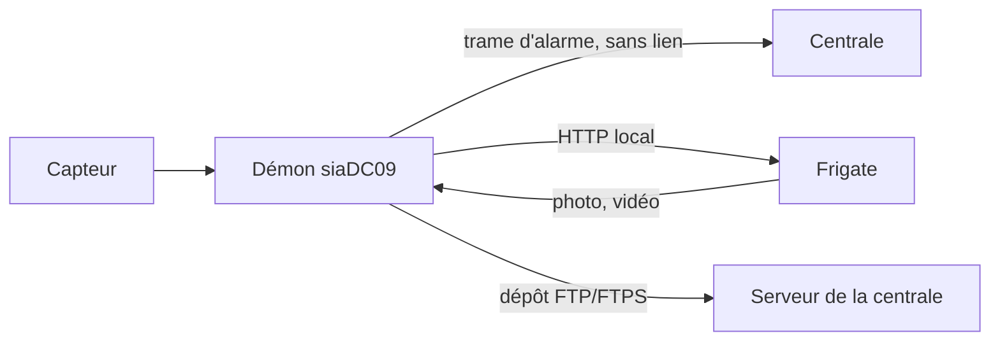

# Dépôt de la photo et de la vidéo par FTP/FTPS

**En bref**

- Deux façons de transmettre la photo ou la vidéo de levée de doute : une **adresse (URL)** dans le message d'alarme, ou une **copie déposée sur un serveur FTPS**.
- En FTPS, le message d'alarme **ne contient aucun lien**. Le démon récupère la photo et la vidéo sur Frigate, **en local**, puis les dépose sur le serveur indiqué par votre centrale. Rien n'est exposé sur Internet.
- Un échec de dépôt est **signalé** (log en erreur et centre de messages) mais **ne bloque jamais l'alarme**.
- Le mot de passe FTPS est **enregistré dans Jeedom** (donc dans les sauvegardes) : créez un compte dédié, en dépôt seul.

**Sommaire**

1. [URL ou FTPS : que choisir ?](#url-ou-ftps--que-choisir-)
2. [Comment ça marche](#comment-ça-marche)
3. [Réglages](#réglages)
4. [Certificat auto-signé et empreinte](#certificat-auto-signé-et-empreinte)
5. [FTP sans TLS](#ftp-sans-tls)
6. [Tester le serveur](#tester-le-serveur)
7. [Nom des fichiers](#nom-des-fichiers)
8. [Série de 5 photos](#série-de-5-photos)
9. [En cas d'échec](#en-cas-déchec)
10. [Secrets et sécurité du compte](#secrets-et-sécurité-du-compte)
11. [Vérifications](#vérifications)

---

## URL ou FTPS : que choisir ?

Le choix se fait à l'étape 1 de l'assistant, carte **Levée de doute photo / vidéo**, question « Comment la centrale reçoit-elle la photo ou la vidéo ? ».

| | Une adresse (URL) | Une copie déposée sur un serveur FTPS |
|---|---|---|
| Message d'alarme | Contient un lien (U ou V) | **Aucun lien** |
| Qui va chercher le média | La centrale, sur votre Frigate | Le démon, sur votre Frigate en local |
| Frigate exposé sur Internet | Oui (reverse-proxy, compte `viewer`) | **Non** |
| Ce qu'il faut côté centrale | Rien de spécial | Un serveur FTP/FTPS et un compte de dépôt |
| Guide | [frigate.md](frigate.md) | cette page |

Choisissez le mode que **votre centrale accepte** : demandez-lui.

## Comment ça marche



1. L'alarme part vers la centrale **sans attendre** le média.
2. Dans une tâche séparée, le démon récupère la photo (et la vidéo si elle est cochée) sur Frigate, à la même adresse que celle du plugin Frigate.
3. Il les dépose sur le serveur FTP/FTPS.

La **vidéo** : le démon attend qu'elle soit prête, jusqu'à **60 s**, puis la télécharge dans un fichier temporaire. Taille maximale : **200 Mo**. Il faut un enregistrement Frigate existant (`record.enabled`).

La **photo** est, par défaut, une [série de 5 photos](#série-de-5-photos) quand la case Photo est cochée.

La conservation côté Frigate importe peu une fois le dépôt fait ; elle peut être courte. Les réglages Frigate utiles (enregistrement, objets suivis) sont dans [frigate.md](frigate.md).

## Réglages

Dans l'assistant :

- **Étape 1**, carte **Levée de doute photo / vidéo** : cochez « Joindre une photo ou une vidéo à l'alarme », choisissez « Une copie déposée sur un serveur FTPS », puis cochez **Photo** et/ou **Vidéo**.
- **Étape 2**, **Options avancées**, carte **Serveur FTPS** :

| Champ | Rôle |
|---|---|
| Serveur | Nom ou adresse du serveur FTP/FTPS (obligatoire) |
| Port | Port du serveur ; 21 par défaut (obligatoire) |
| Utilisateur | Compte de dépôt (obligatoire) |
| Mot de passe | Mot de passe du compte (obligatoire) |
| Dossier distant | Dossier de dépôt. Vide : racine du compte. **Le dossier doit exister** |
| FTP sans TLS | Désactive le chiffrement (déconseillé) |
| Certificat du serveur | « Certificat reconnu » ou « Certificat auto-signé » |
| Empreinte SHA-256 du certificat | Pour un certificat auto-signé |

Ces réglages sont propres à votre installation. Les informations (serveur, compte, dossier) viennent de votre centrale.

## Certificat auto-signé et empreinte

- **Certificat reconnu** (autorité publique, par exemple Let's Encrypt) : le certificat est vérifié normalement. Laissez l'empreinte vide.
- **Certificat auto-signé** : choisissez cette option et saisissez l'**empreinte SHA-256** du certificat (64 caractères hexadécimaux, avec ou sans « : »). Le démon n'accepte alors que le serveur dont le certificat porte cette empreinte. Demandez-la à l'administrateur du serveur.

TLS 1.2 minimum.

## FTP sans TLS

L'option **FTP sans TLS** envoie le mot de passe et les images **en clair** sur le réseau, et le certificat du serveur n'est **pas vérifié**. Réservez-la à un serveur qui ne propose pas FTPS, sur un réseau de confiance.

## Tester le serveur

À l'étape 2, la zone **Test du serveur FTPS** vérifie la connexion, le certificat et l'identifiant. **Aucun fichier n'est écrit** : ce test ne prouve donc pas que le dossier distant existe ni que le compte a le droit d'y écrire. Vérifiez-le avec la centrale lors d'un [essai réel](#vérifications).

## Nom des fichiers

Les fichiers sont déposés à plat, à la racine du dossier configuré :

```
<compte>_<zone sur 2 chiffres>_<horodatage>_<image sur 4 chiffres>.<jpg|mp4>
```

- `<compte>` : le compte SIA ; `<zone>` : le numéro de zone envoyé avec l'alarme (00 si absent).
- `<horodatage>` : l'heure de l'alarme en **secondes depuis 1970** (epoch), indépendant du fuseau horaire.
- La photo et la vidéo d'une même alarme ne diffèrent que par l'extension. Les photos d'une série partagent l'horodatage et diffèrent par le numéro d'image (0001 à 0005).
- Deux alarmes de la même zone dans la **même seconde** portent le même nom : la seconde écrase la première.
- Les caractères non sûrs d'un nom sont remplacés par `_`.

Communiquez ce schéma à la centrale.

## Série de 5 photos

Quand la photo est cochée en FTPS, le plugin n'envoie pas la photo de l'événement Frigate mais une **série de 5 photos** :

- **une photo par seconde**, soit environ 4 s au total, prise depuis l'image courante de la caméra (`latest.jpg` de Frigate) ;
- elle démarre **au premier capteur** (Prefetch), avant le départ de l'alarme ;
- elle est envoyée **seule** : la photo de l'événement n'est pas envoyée en plus ;
- elle n'exige ni `snapshots.enabled` ni `objects.track` côté Frigate, mais la caméra doit répondre sur `latest.jpg` ;
- elle est conservée en mémoire **120 s** : si aucune alarme ne part dans ce délai, la série est **abandonnée** et rien n'est déposé ;
- le classement `person` / autre / `alarm` ne s'applique qu'à la vidéo (et à la photo en mode adresse).

## En cas d'échec

Le dépôt part **après** la mise en file de l'alarme, dans une tâche à part : l'alarme n'attend jamais et n'est jamais bloquée.

Si le dépôt échoue (serveur injoignable, certificat refusé, compte refusé, dossier absent…), vous avez :

- un message dans le **centre de messages** de Jeedom, par exemple « photo de levée de doute non transmise (FTPS) » ou « vidéo de levée de doute non transmise (FTPS) » ;
- une notification critique ;
- une ligne en **ERROR** dans le log du démon (`siaDC09_daemon`).

L'alarme, elle, est déjà partie. Il n'y a pas de nouvel essai automatique documenté : vérifiez le serveur, puis relancez un essai.

## Secrets et sécurité du compte

- **Le mot de passe FTPS est stocké dans Jeedom**, dans la configuration de l'équipement, donc **dans les sauvegardes Jeedom**. Il est transmis au démon par une variable d'environnement, jamais sur la ligne de commande, et masqué dans les logs.
- À l'inverse, le gabarit d'adresse du mode URL ne contient **jamais** de secret (seulement des marqueurs).
- Créez un **compte FTP dédié**, en **dépôt seul** (écriture sans lecture ni suppression si le serveur le permet), limité à un dossier.
- Préférez **FTPS** à FTP, et un certificat reconnu ou une empreinte épinglée.

## Vérifications

1. À l'étape 2, lancez le **Test du serveur FTPS**.
2. Faites un essai coordonné avec la centrale : déclenchez la zone en la prévenant.
3. Dans les logs (niveau Debug pour le détail), cherchez `photo series: frame n/5` (capture de la série) puis `FTPS upload to <serveur:port> done: <fichier>` (dépôt réussi).
4. Demandez à la centrale de confirmer que les fichiers sont arrivés, avec les bons noms, et lisibles.
