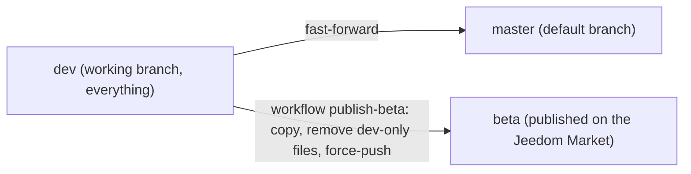

# Release process

**TLDR:** work on `dev`; `beta` is generated from `dev` by a manual workflow. Before each publication, bump `pluginVersion` and `DAEMON_VERSION` together, add a changelog entry, push `dev`, then run `publish-beta`.

## Branches



| Branch | Role | Rule |
|---|---|---|
| `dev` | Working branch, contains everything | Commit here |
| `master` | Default branch, follows `dev` by fast-forward | Needed so GitHub shows the workflow's "Run workflow" button |
| `beta` | Published on the Market | **Generated.** Never edited, never merged by hand, never merged back into `dev` |

`beta` always has one more commit than the `dev` it was built from: the workflow's `beta: publish dev@<sha> ...` commit, which removes the dev-only files.

## Publish a beta

Prerequisite: `dev` is pushed (the workflow reads `dev` on GitHub, not your local copy).

```
gh workflow run publish-beta.yml -R hlehoux2021/siadc09
gh run watch -R hlehoux2021/siadc09
```

- `-R` is required: remotes `origin` and `upstream` (jeedom-aiodemo) make `gh` ambiguous.
- The workflow is `.github/workflows/publish-beta.yml`, manual only, and force-pushes `beta`.
- Check the result: `git fetch origin && git ls-tree --name-only origin/beta` must list only runtime files.

### Files removed from `beta`

`.agents`, `.claude`, `_bmad-output`, `internal-docs`, `scripts`, `tests`, `CLAUDE.md`, `package.json`, `package-lock.json`, `pytest.ini`, `skills-lock.json`.

New dev-only file or directory at the repo root: add it to the `git rm` list of the workflow, otherwise it reaches `beta` at the next run. Kept on purpose: `core`, `desktop`, `resources`, `plugin_info`, `docs` (user documentation), `.github`, `LICENSE`, `README.md`, `.gitignore`.

## Version number

Numeric semver only (`X.Y.Z`), no pre-release suffix.

| Change | Bump |
|---|---|
| Fix, icon, text; no configuration change | Patch `0.1.0` to `0.1.1` |
| New feature, or configuration format change (migration in `install.php`) | Minor `0.1.1` to `0.2.0` |
| First announced stable, or breaking change | Major `1.0.0` |

Two places, changed in the same commit (a Level 1 test fails if they differ):

| Where | Field |
|---|---|
| `plugin_info/info.json` | `pluginVersion` |
| `resources/siadc09d/__init__.py` | `DAEMON_VERSION` |

Why the number matters even though Jeedom does not show it: on the Market and in the Update Center, beta and stable alike, plugins show an **update date**, not a version, and updates are detected from the Market's update dates (only the Jeedom core shows its number). The version number is visible in two other places: the daemon log line `Démon SIA DC-09 version X.Y.Z` (users check it after an update, see the changelog notice) and the changelog headings.

## Changelog

File: `docs/fr_FR/changelog.md`, French, newest version first.

- One section per version: `# Version X.Y.Z (beta)`, later `(stable)`.
- List what users notice; say explicitly when nothing changes functionally ("pas de migration").
- If the daemon needs a restart or a reconfiguration, say it in the entry.

## Publication order

1. One commit on `dev`: `pluginVersion`, `DAEMON_VERSION`, changelog entry.
2. `python3 -m pytest tests/level1/` (at least `test_daemon_version.py`).
3. `git push`.
4. Run `publish-beta` (above) and check `origin/beta`.
5. Stable release only: fast-forward `master`, tag `vX.Y.Z` on the published commit, then follow the Market procedure.

## Market listing text

The description shown in Jeedom (and presumably on the Market page) comes from `description.fr_FR` in `plugin_info/info.json`. Jeedom applies `nl2br()` to it, so `\n` gives a line break. The Market page may keep its own hand-edited text: check it after a publication.
